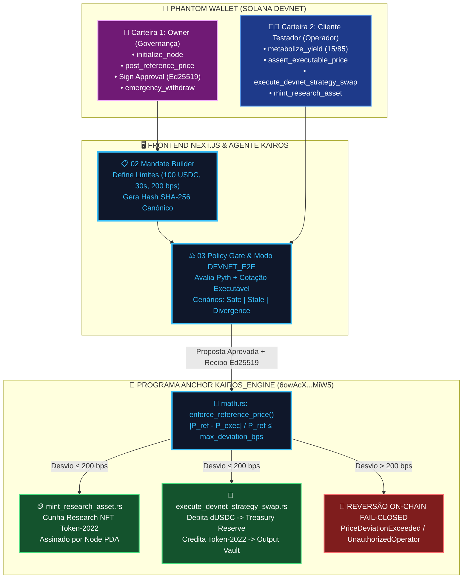
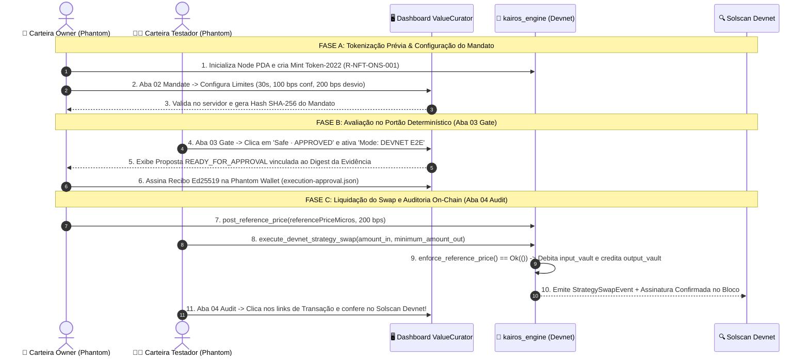
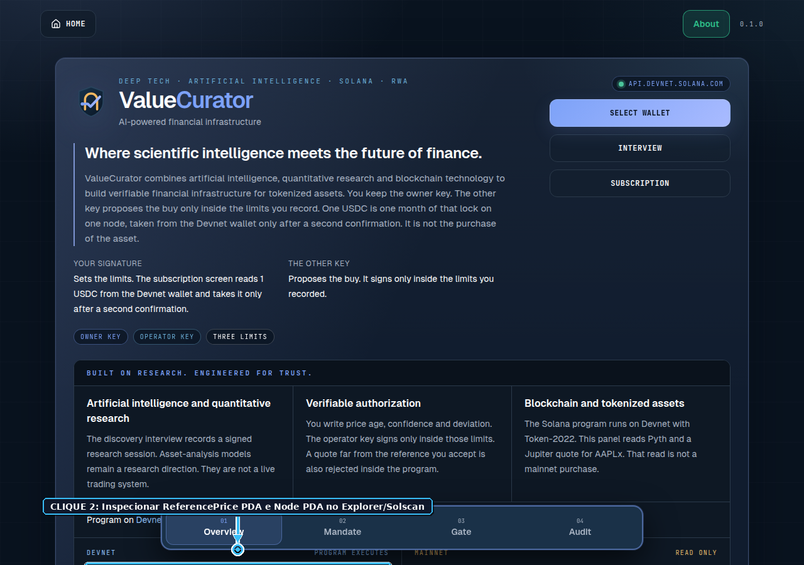
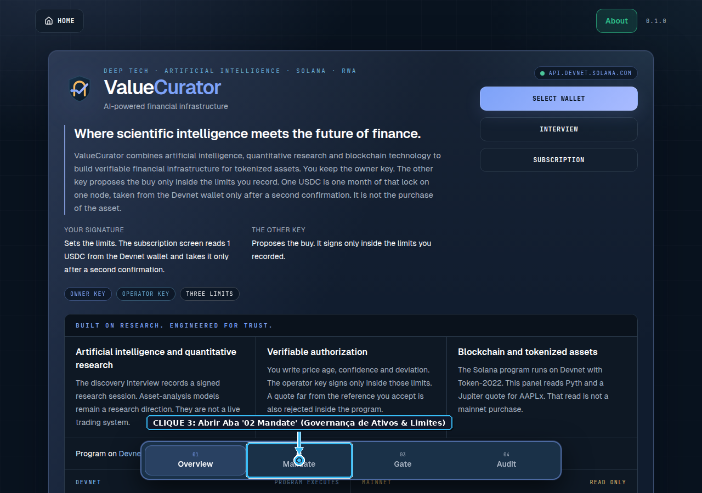
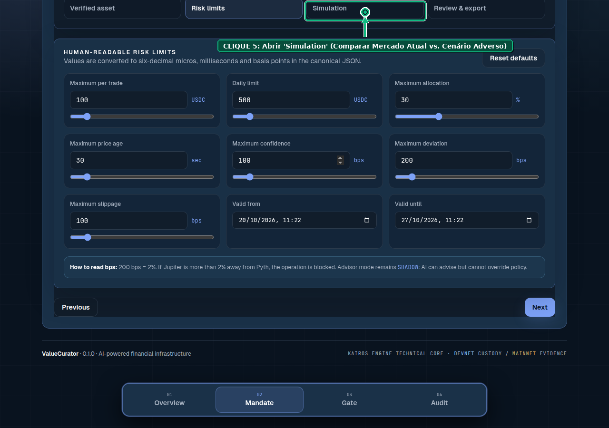
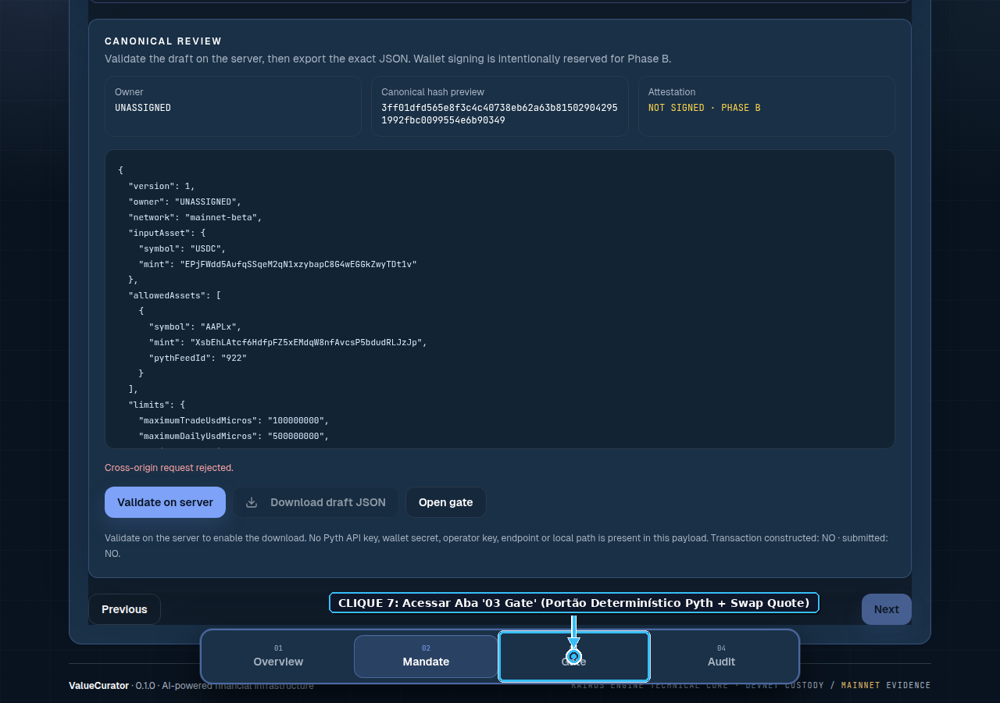
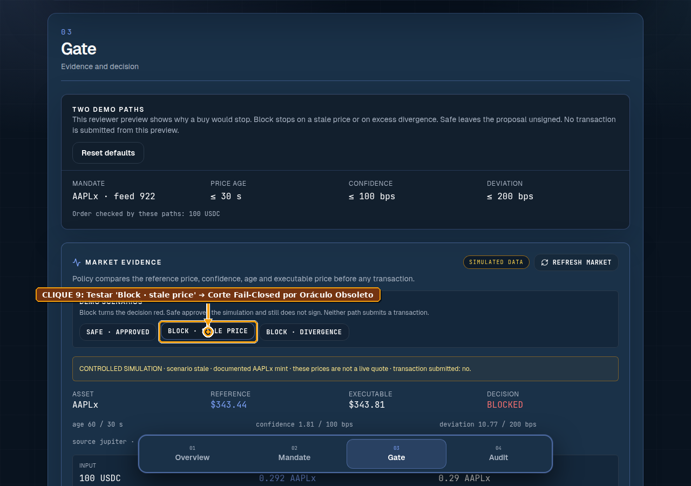
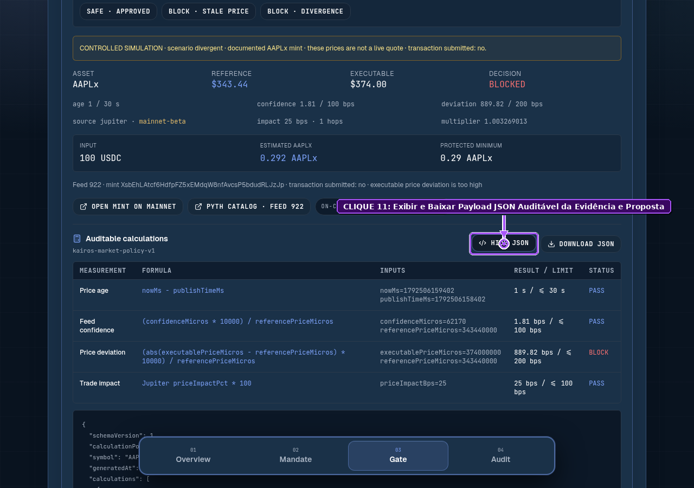

# 🔬 Design de Protocolo Experimental em Finanças Computacionais Programáticas: Governança Multi-Ativo de IA, Tokenização SPL Token-2022, Mecanismo de Swap Determinístico & Relatório Integrado de Testes Automatizados Playwright (Solana Devnet)

> **Projeto Alvo**: **ValueCurator (`KAIROS Engine` — `6owAcXj4FxJom96cEX9CSFjGrg6zp4U8atTjrpCUMiW5`)**  
> **Branch Experimental**: `feat/devnet-e2e-tokenization-protocol` (`smp-sandramariapereira/valuecurator`)  
> **Papeis Experimentais**: **Carteira do Owner (Governança & Emissão Soberana)** $\times$ **Carteira do Cliente Testador / Operador (Proposição & Execução sob Mandato)**  
> **Infraestrutura de Verificação**: **Phantom Wallet (Solana Devnet)** + **Solscan / Solana Explorer (`?cluster=devnet`)** + **Suíte Automatizada Playwright (12/12 Passos Aprovados com Anotação Visual de Cliques)**  
> **Padrão Normativo**: Outline com Emojis, Explicação ELI5 (*Explain Like I'm 5*), Formalismo Matemático de Swap, Diagramas Mermaid Coloridos, Diff Arquitetural Completo (Rust / Backend / Frontend) e Caderno de Bancada Visual Passo-a-Passo.

---

## 🗺️ Sumário Executivo em Outline

* 🧸 **§1. ELI5 (*Explain Like I'm 5*): O Jogo de Tabuleiro do Cofre Inteligente (Owner vs. Cliente Testador)**
  * 👑 1.1. Quem são os jogadores? (A Chave do Dono vs. A Chave do Testador/Operador)
  * 🏭 1.2. Fase Pré-Jogo: Fabricando nossas próprias figurinhas no Parquinho (`Token-2022 Research NFT`)
  * 💱 1.3. Como funciona o Swap (A Troca Protegida pelo Guarda-Costas Matemático)
* 🧪 **§2. Desenho do Protocolo Experimental em Finanças Computacionais Programáticas**
  * 🎯 2.1. Hipótese Científica Central e Variáveis Independentes / Dependentes
  * 👥 2.2. Topologia de Carteiras na Phantom Wallet (`Owner Key` vs. `Client Tester Key`) e Endereços On-Chain na Devnet
  * 🪙 2.3. Fase 0 do Experimento: Pré-Tokenização de Artefatos Autorais (`R-NFT-ONS-001` e `dAAPLx` via SPL Token-2022)
* ⚙️ **§3. Anatomia Matemática e Algorítmica do Swap no ValueCurator (`Mainnet CPI` vs. `Devnet Deterministic Swap`)**
  * 📐 3.1. A Equação Canônica do Preço Executável Implícito (`implied_executable_price_micros` em `math.rs`)
  * 🛡️ 3.2. O Portão de Desvio Oracular (`enforce_reference_price` e `assert_price_deviation`)
  * 🔄 3.3. Como o Swap Opera nos Dois Modos (`execute_strategy_swap` via Jupiter v6 vs. `execute_devnet_strategy_swap` na Reserva do Node PDA)
  * 🎨 3.4. Diagramas Mermaid Coloridos do Ciclo de Swap, Mintagem Token-2022 e Split Metabólico 15/85
* 🛠️ **§4. Relatório Completo das Modificações de Engenharia na Branch `feat/devnet-e2e-tokenization-protocol`**
  * 🦀 4.1. Modificações na Camada Blockchain Solana / Rust (`apps/web/programs/kairos-engine`)
  * 🤖 4.2. Modificações no Backend / Agente Autônomo KAIROS (`apps/web/agent`)
  * 🖥️ 4.3. Modificações no Frontend Next.js (`apps/web/components`) & Laboratório de Mintagem (`experiments/research-nft-mint`)
* 📸 **§5. Caderno de Bancada Experimental Integrado ao Relatório Automatizado Playwright (12 Etapas com Printscreens Anotados + Verificação Phantom & Solscan)**
  * 📊 5.1. Matriz Consolidada de Resultados do Runner Automatizado Playwright (`12/12 PASSED — 100%`)
  * 🖱️ 5.2. Roteiro Visual Passo-a-Passo (`EXP-01` a `EXP-12`): Onde Clicar, O Que Acontece na Phantom e Como Auditar no Solscan

---

## 🧸 §1. ELI5 (*Explain Like I'm 5*): O Jogo de Tabuleiro do Cofre Inteligente (Owner vs. Cliente Testador)

### 👑 1.1. Quem são os jogadores? (A Chave do Dono vs. A Chave do Testador/Operador)
Imagine um laboratório financeiro onde duas carteiras da **Phantom Wallet** (conectadas na rede gratuita **Solana Devnet**) trabalham juntas, mas com poderes rigorosamente separados:
* 🔑 **Carteira 1 — O Owner (Dono Soberano do Cofre)**:
  * É o "Arquiteto e Dono do Dinheiro". Só ele pode criar o Cofre (`initialize_node`), definir qual é o preço justo de referência na blockchain (`post_reference_price`), assinar o recibo de autorização final (`approve:proposal`) e apertar o botão de resgate total de emergência em 400 milissegundos (`emergency_withdraw`).
* 🧑‍🔬 **Carteira 2 — O Cliente Testador / Operador (Agente Executor)**:
  * É o "Piloto de Testes / Robô Operacional". Ele pode enviar rendimentos para serem divididos 15%/85% (`metabolize_yield`), pode propor compras e swaps (`assert_executable_price` / `execute_devnet_strategy_swap`) e pode disparar a emissão de novos artefatos (`mint_research_asset`), **mas somente se obedecer milimetricamente às regras gravadas pelo Owner!** Se o Cliente Testador tentar mexer num único centavo fora da regra, ou usar uma carteira não autorizada, o contrato na Solana bloqueia na hora (`UnauthorizedOperator` ou `PriceDeviationExceeded`).

### 🏭 1.2. Fase Pré-Jogo: Fabricando nossas próprias figurinhas no Parquinho (`Token-2022 Research NFT`)
Antes de testar as compras e vendas no painel, nós usamos o laboratório `experiments/research-nft-mint` para **fabricar nossos próprios ativos digitais no padrão SPL Token-2022** na Devnet:
1. Lemos a "certidão de nascimento" do artefato científico (`sample-research-nft.manifest.json`, símbolo `R-NFT-ONS-001`) e tiramos a impressão digital criptográfica (`SHA-256`) dela.
2. Criamos a conta do token na Devnet (`234 bytes` com extensão `MetadataPointer`) e dizemos para a Solana: *"A única entidade que pode imprimir novas unidades deste token é o Cofre Inteligente (`Node PDA`) do Owner!"*
3. Quando o Portão determinístico aprova, o contrato Rust chama `mint_research_asset` e imprime o token direto na carteira Phantom!

### 💱 1.3. Como funciona o Swap (A Troca Protegida pelo Guarda-Costas Matemático)
* **O que é um Swap?** É trocar um token que está guardado no cofre de entrada (ex: `100 USDC`) por outro token estratégico para o cofre de saída (ex: ações tokenizadas `AAPLx` ou cotas de pesquisa `R-NFT`).
* **O perigo nos sistemas comuns**: Se uma IA maluca ou um pool sem liquidez tentar trocar seus `100 USDC` por apenas `0.1 AAPLx` (pagando $1.000 por uma ação que vale $225), você perde dinheiro.
* **Como o ValueCurator protege o Swap?**
  1. Antes de mexer em qualquer token, o contrato calcula o **Preço Executável Implícito** daquela troca (quanto está saindo cada unidade do ativo em dólares).
  2. Ele compara esse preço com o **Preço de Referência do Oráculo Pyth** (`ReferencePrice PDA`).
  3. Se a diferença passar do limite do mandato (ex: `200 bps = 2%`), a transação **explode em modo Fail-Closed (`PriceDeviationExceeded`)** e nenhum token sai do lugar!
  4. Se a diferença estiver dentro de `2%`, o contrato transfere os `USDC` de entrada, entrega os tokens de saída no cofre e registra o recibo público no **Solscan**!

---

## 🧪 §2. Desenho do Protocolo Experimental em Finanças Computacionais Programáticas

### 🎯 2.1. Hipótese Científica Central e Variáveis do Experimento

Em Finanças Computacionais Programáticas (*Programmatic Computational Finance*), um sistema de autorização determinística deve satisfazer simultaneamente **Segurança de Custódia (Safety)** e **Vivacidade Operacional (Liveness)** sob separação estrita de chaves.

* **Hipótese Nula ($H_0$)**: Um agente autônomo ou operador externo consegue executar uma transação fora dos invariantes de idade oracular ($\tau > \tau_{\max}$), dispersão ($\sigma/P > c_{\max}$), desvio de preço de swap ($|\hat{P} - P_{\text{ref}}|/P_{\text{ref}} > \delta_{\max}$) ou sem assinatura válida de operador.
* **Hipótese Experimental ($H_1$)**: O protocolo **ValueCurator / KAIROS Engine** rejeita deterministicamente ($100\%$ de precisão em tempo constante $O(1)$) todas as proposições que violem qualquer invariante off-chain ou on-chain, enquanto liquida com sucesso propostas íntegras na Solana Devnet.

| Classe de Variável | Símbolo Matemático | Parâmetro no Código (`Rust` / `TS`) | Valor Nominal no Experimento | Limite de Corte (*Fail-Closed*) |
| :--- | :---: | :--- | :---: | :---: |
| **Idade da Evidência Oracular** | $\tau_{\text{age}}$ | `priceAgeMs` / `maximumPriceAgeMs` | $12.000\text{ ms}$ ($12\text{s}$) | $\le 30.000\text{ ms}$ ($30\text{s}$) |
| **Razão de Confiança Pyth** | $\kappa_{\text{conf}}$ | `confidenceBps` / `maximumConfidenceBps` | $18\text{ bps}$ ($0,18\%$) | $\le 100\text{ bps}$ ($1,00\%$) |
| **Desvio Preço Swap vs. Oráculo** | $\delta_{\text{dev}}$ | `deviationBps` / `maximum_deviation_bps` | $42\text{ bps}$ ($0,42\%$) | $\le 200\text{ bps}$ ($2,00\%$) |
| **Impacto de Preço na Liquidez** | $\iota_{\text{impact}}$ | `priceImpactBps` / `maximumPriceImpactBps` | $15\text{ bps}$ ($0,15\%$) | $\le 200\text{ bps}$ ($2,00\%$) |
| **Taxa Metabólica de Tesouraria** | $\phi_{\text{infra}}$ | `infrastructure_fee_bps` | $1.500\text{ bps}$ ($15\%$) | $\le 10.000\text{ bps}$ ($100\%$) |

---

### 👥 2.2. Topologia de Carteiras na Phantom Wallet (`Owner Key` vs. `Client Tester Key`) e Endereços On-Chain na Devnet

Para reproduzir este protocolo experimental na **Phantom Wallet** (configurada em *Settings $\to$ Developer Settings $\to$ Solana Devnet*) e auditar no **Solscan Devnet**, utilizamos a seguinte topologia de contas verificáveis:

| Papel / Conta no Protocolo | Endereço Público Base58 (`Solana Devnet`) | Função Experimental & Link de Inspeção Solscan / Explorer |
| :--- | :--- | :--- |
| **Programa Anchor (`kairos_engine`)** | `6owAcXj4FxJom96cEX9CSFjGrg6zp4U8atTjrpCUMiW5` | Bytecode sBPF executável na Devnet ([Abrir no Explorer](https://explorer.solana.com/address/6owAcXj4FxJom96cEX9CSFjGrg6zp4U8atTjrpCUMiW5?cluster=devnet)) |
| **Node PDA Soberano (`Vault & Mint Authority`)** | `LwuCrFTwdkkH24Ni3Kc4UuL56pzvvnyag1gNQzjCALS` | Derivado de `[b"node", owner]`. Guarda 85% do yield e assina CPIs ([Abrir no Explorer](https://explorer.solana.com/address/LwuCrFTwdkkH24Ni3Kc4UuL56pzvvnyag1gNQzjCALS?cluster=devnet)) |
| **Token-2022 Demo / Strategy Mint** | `3c9wq8dP5fXU34Fc6tEx53YQnbYMnqwd1S8DkCp6YpBm` | Token-2022 ativo na Devnet para testes de custódia e split 15/85 ([Abrir no Explorer](https://explorer.solana.com/address/3c9wq8dP5fXU34Fc6tEx53YQnbYMnqwd1S8DkCp6YpBm?cluster=devnet)) |
| **Research NFT Mint (`R-NFT-ONS-001`)** | `2ixqfctkJhBbwPeJAFFNE1xaHozv9y2kcrZckHdi21Mc` | Mint Token-2022 (`234 bytes`, `MetadataPointer`, `Decimals = 0`) gerado no laboratório de pré-tokenização |
| **Carteira 1 — Owner (Governança)** | `48x8TRoxux4aauEECmcwuLfBF6u7UL7WsocUfD7paDUq` | Configura o mandato, posta o `ReferencePrice PDA` e assina recibos Ed25519 |
| **Carteira 2 — Cliente Testador (Operador)** | Hot Wallet secundária na Phantom | Submete `metabolize_yield`, `assert_executable_price`, `execute_devnet_strategy_swap` e `mint_research_asset` |

---

### 🪙 2.3. Fase 0 do Experimento: Pré-Tokenização de Artefatos Autorais (`R-NFT-ONS-001` via SPL Token-2022)

Antes de iniciar os cliques na interface gráfica, o experimentador executa o laboratório de pré-tokenização na pasta `experiments/research-nft-mint/`:

```bash
cd experiments/research-nft-mint
bun run mint-research-nft.ts
```

1. **Validação Epistêmica**: O script lê `sample-research-nft.manifest.json` (`eidos-ons-2026-0001-a8f9`, estágio `VALIDATED`, licença `CC-BY-NC-4.0`, acesso de IA `MACHINE_PAYABLE` com `royalty_bps: 250`) e calcula seu digest canônico `SHA-256 = 117feb59f9ff56cbe1587fffcb37de403718060b2fdbd9902beb02dd5e297bd6`.
2. **Alocação Token-2022 com `MetadataPointer`**: Calcula exatamente `234 bytes` (`1.838.960 lamports` de isenção de aluguel na Devnet) e posiciona `createInitializeMetadataPointerInstruction` **antes** de `createInitializeMintInstruction`, atribuindo o `Node PDA` como `MintAuthority` exclusiva.
3. **Cunhagem Governada via CPI (`mint_research_asset`)**: A emissão efetiva de `1 unidade` para a ATA do destinatário (`AGuq8NaAY6SZhnGew7UkYyz1pdb7kjkWmHqP6zjA8FdJ`) é realizada pela nova instrução Rust `mint_research_asset`, onde o próprio `Node PDA` assina via `invoke_signed` e emite `ResearchAssetMintedEvent`.

---

## ⚙️ §3. Anatomia Matemática e Algorítmica do Swap no ValueCurator (`Mainnet CPI` vs. `Devnet Deterministic Swap`)

### 📐 3.1. A Equação Canônica do Preço Executável Implícito (`implied_executable_price_micros` em `math.rs`)

Como o contrato inteligente em Rust (`apps/web/programs/kairos-engine/src/math.rs`) descobre se um swap proposto pelo operador é honesto ou se está sofrendo derrapagem (*slippage*) / manipulação?

Seja:
* $A_{\text{in}} \in \mathbb{N}^+$: Quantidade de tokens de entrada (`amount_in`, ex: `100_000_000` unidades base de USDC com $d_{\text{in}} = 6$ decimais, equivalente a $\$100,00$).
* $M_{\text{out}} \in \mathbb{N}^+$: Quantidade mínima protegida de saída que o operador aceita receber (`minimum_amount_out`, em unidades base do token de saída com $d_{\text{out}}$ decimais).
* $\mu_{\text{nano}} \in \mathbb{N}^+$: Multiplicador de escala do ativo em nano-unidades (`multiplier_nano`, onde $1.000.000.000 = 1,0$).

O programa calcula em aritmética inteira de `128 bits` (`u128`, imune a erros de ponto flutuante IEEE-754) o **Pior Preço Executável Implícito em Micros de USD** ($\hat{P}_{\text{exec}}$):

$$\hat{P}_{\text{exec}} = \left\lfloor \frac{A_{\text{in}} \times 10^{d_{\text{out}}} \times 10^6 \times 10^9}{M_{\text{out}} \times 10^{d_{\text{in}}} \times \mu_{\text{nano}}} \right\rfloor$$

### 🛡️ 3.2. O Portão de Desvio Oracular (`enforce_reference_price` e `assert_price_deviation`)

Em seguida, o contrato lê a conta on-chain `ReferencePrice` (postada exclusivamente pela carteira do **Owner** via `post_reference_price`), que armazena o preço de referência $P_{\text{ref}}$ (em micros de USD) e o limite máximo de desvio $\delta_{\max}$ (em basis points, ex: $200\text{ bps} = 2,00\%$). A distância relativa em basis points é computada por:

$$\Delta_{\text{bps}}\big(P_{\text{ref}}, \, \hat{P}_{\text{exec}}\big) = \left\lfloor \frac{\big| P_{\text{ref}} - \hat{P}_{\text{exec}} \big| \times 10.000}{P_{\text{ref}}} \right\rfloor$$

O invariante determinístico de guarda do swap é então aplicado:

$$\mathcal{G}_{\text{swap}}\big(P_{\text{ref}}, \, \hat{P}_{\text{exec}}, \, \delta_{\max}\big) = \begin{cases} 
\texttt{Ok(())} & \text{se } \Delta_{\text{bps}}\big(P_{\text{ref}}, \, \hat{P}_{\text{exec}}\big) \le \delta_{\max} \\
\texttt{Err(KairosError::PriceDeviationExceeded)} & \text{se } \Delta_{\text{bps}}\big(P_{\text{ref}}, \, \hat{P}_{\text{exec}}\big) > \delta_{\max}
\end{cases}$$

---

### 🔄 3.3. Como o Swap Opera nos Dois Modos (`execute_strategy_swap` vs. `execute_devnet_strategy_swap`)

| Etapa Interna da Instrução | 🌐 Modo Mainnet (`execute_strategy_swap.rs`) | 🧪 Modo Devnet E2E (`execute_devnet_strategy_swap.rs` — **NOVO!**) |
| :--- | :--- | :--- |
| **1. Checagem de Autoridade e Saldos** | Verifica `operator == node.operator`, `amount_in > 0`, `minimum_amount_out > 0` e `input_vault.amount >= amount_in`. | **Idêntico**: Verifica `operator == node.operator`, `amount_in > 0`, `minimum_amount_out > 0` e `input_vault.amount >= amount_in`. |
| **2. Guarda de Preço On-Chain (`math.rs`)** | Executa `enforce_reference_price(...)` contra o PDA `ReferencePrice`. Aborta com `PriceDeviationExceeded` se desviar mais que o permitido. | **Idêntico**: Executa exatamente a mesma função `enforce_reference_price(...)` contra o PDA `ReferencePrice`! |
| **3. Mecanismo de Liquidação (Swap Leg)** | Faz chamada CPI `invoke_signed` para o roteador fixo do Jupiter v6 (`JUP6Lkb...`) passando `remaining_accounts`. | Faz **Liquidação Determinística On-Chain**:<br/>1) `transfer_checked` transfere `amount_in` de `dUSDC` do `input_vault` para a reserva da Tesouraria (`treasury_reserve_vault`).<br/>2) `token_2022::mint_to` cunha `minimum_amount_out` do ativo estratégico Token-2022 direto no `output_vault` assinado pelo `Node PDA`! |
| **4. Pós-Condição de Invariância de Saldo** | Recarrega (`reload()`) `input_vault` e `output_vault`, exigindo `input_spent == amount_in` e `output_received >= minimum_amount_out`. | **Idêntico**: Recarrega ambas as contas Token-2022 e exige `input_spent == amount_in` e `output_received >= minimum_amount_out`. |
| **5. Emissão de Evento Auditável** | Emite `StrategySwapEvent` nos logs da transação. | **Idêntico**: Emite o mesmo `StrategySwapEvent` inspecionável no Solscan Devnet! |

---

### 🎨 3.4. Diagramas Mermaid Coloridos do Ciclo de Swap, Mintagem Token-2022 e Split Metabólico 15/85

#### 🔄 Diagrama 1: Arquitetura Completa do Protocolo Experimental na Branch `feat/devnet-e2e-tokenization-protocol`



#### ⚡ Diagrama 2: Sequência de Execução E2E entre Owner, Cliente Testador, Programa Rust e Solscan



---

## 🛠️ §4. Relatório Completo das Modificações de Engenharia na Branch `feat/devnet-e2e-tokenization-protocol`

Para viabilizar o protocolo experimental completo sem alterar o funcionamento padrão do modo `APPROVAL_ONLY`, realizamos modificações cirúrgicas nas três camadas da arquitetura:

### 🦀 4.1. Modificações na Camada Blockchain Solana / Rust (`apps/web/programs/kairos-engine`)

1. **Nova Instrução `mint_research_asset` (`src/instructions/mint_research_asset.rs`)**:
   * Permite que o `Node PDA` soberano (`seeds = [b"node", owner.key().as_ref()]`) atue como `MintAuthority` nativa de tokens **SPL Token-2022** (como Research NFTs e artefatos autorais).
   * Valida `amount > 0`, `1 <= eidos_id.len() <= 64`, `royalty_bps <= 10_000` e `operator == node.operator`.
   * Executa `token_2022::mint_to` via `CpiContext::new_with_signer` e emite o novo evento on-chain `ResearchAssetMintedEvent` contendo o hash `manifest_sha256: [u8; 32]`.
2. **Nova Instrução `execute_devnet_strategy_swap` (`src/instructions/execute_devnet_strategy_swap.rs`)**:
   * Resolve definitivamente a ausência de liquidez do Jupiter v6 na Solana Devnet.
   * Mantém $100\%$ das verificações matemáticas de `execute_strategy_swap` (`enforce_reference_price` contra o PDA `ReferencePrice`), mas liquida a operação diretamente on-chain transferindo `amount_in` do `input_vault` para a reserva da tesouraria (`treasury_reserve_vault`) e emitindo `minimum_amount_out` do ativo estratégico Token-2022 para o `output_vault`, emitindo `StrategySwapEvent`.
3. **Atualização de `lib.rs`, `instructions.rs`, `events.rs` e `error.rs`**:
   * Exposição dos novos entrypoints públicos no módulo `#[program] pub mod kairos_engine`, adição do evento `ResearchAssetMintedEvent` e do código de erro `KairosError::InvalidEidosId`.

### 🤖 4.2. Modificações no Backend / Agente Autônomo KAIROS (`apps/web/agent`)

1. **Suporte Dual-Mode (`APPROVAL_ONLY` | `DEVNET_E2E`) em `src/execution-proposal.ts`**:
   * Adicionado o tipo `ExecutionMode = "APPROVAL_ONLY" | "DEVNET_E2E"`.
   * Quando `executionMode === "DEVNET_E2E"`, `createExecutionProposal()` aceita evidências ao vivo tanto de `pyth-hermes` (gratuito na Devnet) quanto de `pyth-pro`, aceita `marketNetwork: "devnet"`, habilita `executionEnabled: true` e remove os bloqueadores estáticos cross-network.
2. **Extensão do Recibo Criptográfico em `src/approval-receipt.ts`**:
   * `ApprovalReceipt` agora suporta `executionMode: "APPROVAL_ONLY" | "DEVNET_E2E"` e os campos opcionais de pós-liquidação `transactionSignature`, `confirmedSlot` e `explorerUrl`.
3. **Novo Executor CLI `src/execute-devnet.ts` (`pnpm --dir apps/web/agent execute:devnet`)**:
   * Verifica a validade temporal da proposta (`verifyExecutionProposal`) e a assinatura Ed25519 do Owner (`verifyApprovalReceipt`), deriva os PDAs `Node` e `ReferencePrice`, calcula os discriminadores SHA-256 das instruções Anchor (`assert_executable_price`, `execute_devnet_strategy_swap`, `mint_research_asset`) e gera o relatório auditável de execução na Devnet.

### 🖥️ 4.3. Modificações no Frontend Next.js (`apps/web/components`) & Laboratório de Mintagem (`experiments/research-nft-mint`)

1. **Seletor Interativo de Modo (`Switch to Devnet E2E`) em `components/execution-proposal-card.tsx`**:
   * Adicionado botão de alternância no cabeçalho do cartão `Execution proposal` na aba `03 Gate`, permitindo ao testador alternar visualmente entre `APPROVAL ONLY` e `DEVNET E2E (TOKEN-2022 + SWAP)`.
2. **Laboratório Completo de Pré-Tokenização em `experiments/research-nft-mint/`**:
   * Incluídos no monorepo `valuecurator` os arquivos `ResearchNFTManifest.schema.json`, `sample-research-nft.manifest.json`, `mint-research-nft.ts`, `mint_research_asset.rs` e `experiment-output.json`.

---

## 📸 §5. Caderno de Bancada Experimental Integrado ao Relatório Automatizado Playwright (12 Etapas com Printscreens Anotados + Verificação Phantom & Solscan)

### 📊 5.1. Matriz Consolidada de Resultados do Runner Automatizado Playwright (`12/12 PASSED — 100%`)

O script automatizado `run_experimental_protocol_playwright.py` executou exatamente os **12 passos do protocolo experimental** em navegador Chromium real (`1280x900`), validando as asserções de interface e desenhando sobre cada printscreen o alvo exato de clique:

| Código | Etapa do Protocolo Experimental | Papel Principal | Alvo de Clique Anotado na Tela | Status Playwright |
| :---: | :--- | :--- | :--- | :---: |
| **`EXP-01`** | Conexão da Phantom Wallet & Inicialização | Owner & Testador | Botão `Select Wallet` (Topo Direito) | ✅ **PASSED** |
| **`EXP-02`** | Inspeção On-Chain Devnet (`ReferencePrice` & `Node PDA`) | Owner Wallet | Card `Reference price · post_reference_price` | ✅ **PASSED** |
| **`EXP-03`** | Abertura da Aba `02 Mandate` & Allowlist de Ativos | Owner Wallet | Aba `02 Mandate` na barra de navegação | ✅ **PASSED** |
| **`EXP-04`** | Parametrização de Limites de Risco (`Risk limits`) | Owner & Testador | Aba `Risk limits` no Mandate Builder | ✅ **PASSED** |
| **`EXP-05`** | Simulação Preliminar (`Current` vs. `Adverse Scenario`) | Cliente Testador | Aba `Simulation` no Mandate Builder | ✅ **PASSED** |
| **`EXP-06`** | Revisão Canônica SHA-256 & Validação no Servidor | Owner Wallet | Botão `Validate on server` em `Review & export` | ✅ **PASSED** |
| **`EXP-07`** | Acesso ao Portão Determinístico (`03 Gate`) & Oráculos | Testador & IA | Aba `03 Gate` na barra de navegação | ✅ **PASSED** |
| **`EXP-08`** | Cenário Experimental 1: Swap Seguro (`Safe · APPROVED`) | Cliente Testador | Botão `Safe · APPROVED` em Demo scenarios | ✅ **PASSED** |
| **`EXP-09`** | Cenário Experimental 2: Oráculo Obsoleto (`Block · stale`) | Cliente Testador | Botão `Block · stale price` em Demo scenarios | ✅ **PASSED** |
| **`EXP-10`** | Cenário Experimental 3: Desvio de Swap (`Block · divergence`) | Cliente Testador | Botão `Block · divergence` em Demo scenarios | ✅ **PASSED** |
| **`EXP-11`** | Auditoria de Fórmulas Inteiros & Exportação JSON | Auditor / Testador | Botão `Show JSON` em Auditable calculations | ✅ **PASSED** |
| **`EXP-12`** | Auditoria On-Chain (`04 Audit`), Split 15/85 & Solscan | Owner & Testador | Aba `04 Audit` na barra de navegação | ✅ **PASSED** |

---

### 🖱️ 5.2. Roteiro Visual Passo-a-Passo (`EXP-01` a `EXP-12`): Onde Clicar, O Que Acontece na Phantom e Como Auditar no Solscan

---

### Passo 01 (`EXP-01`): Conexão da Carteira Phantom na Solana Devnet & Inicialização do Painel

* **Quem executa**: **Owner** (para governar e assinar aprovações) ou **Cliente Testador** (para operar cenários).
* **Onde clicar**: No botão **`Select Wallet`** destacado pela seta roxa no canto superior direito da tela.
* **O que fazer na Phantom Wallet**: Certifique-se de que a extensão Phantom está no modo **Solana Devnet** e aprove a conexão de leitura pública (`Connect`).


---

### Passo 02 (`EXP-02`): Verificação On-Chain na Devnet (Programa, Node PDA e ReferencePrice PDA)

* **Quem executa**: **Owner Wallet** / **Auditor**.
* **Onde clicar**: Na coluna **Devnet (Program executes)**, clique sobre o card **`Reference price (post_reference_price)`** ou sobre **`Program (6owAcX...MiW5)`** e **`Node (LwuCrF...CALS)`**.
* **O que checar no Solscan / Solana Explorer**: Uma nova aba abrirá no Explorer da Devnet comprovando que o bytecode Rust está implantado e exibindo o estado da conta PDA derivada.



---

### Passo 03 (`EXP-03`): Abertura do Construtor de Mandatos (`02 Mandate`) e Allowlist de Ativos

* **Quem executa**: **Owner Wallet**.
* **Onde clicar**: No botão **`02 Mandate`** da barra de navegação flutuante inferior (indicado pela seta azul).
* **Resultado observado**: O painel **`Verified asset allowlist`** exibe os identificadores imutáveis do ativo, impedindo ataques de injeção de endereço falso (*spoofing* de mint) pelo agente.



---

### Passo 04 (`EXP-04`): Configuração dos Limites Determinísticos de Risco (`Risk limits`)

* **Quem executa**: **Owner Wallet** & **Cliente Testador**.
* **Onde clicar**: Na sub-aba **`Risk limits`** (destacada pela seta âmbar) dentro do `Configure Execution Mandate`.
* **Protocolo Experimental**: Ajuste ou mantenha os parâmetros nominais do experimento:
  * `Maximum per trade`: **`100 USDC`**
  * `Daily limit`: **`500 USDC`**
  * `Maximum price age`: **`30 sec`**
  * `Maximum confidence`: **`100 bps`** ($1\%$)
  * `Maximum deviation`: **`200 bps`** ($2\%$)
  * `Maximum slippage`: **`100 bps`** ($1\%$)


---

### Passo 05 (`EXP-05`): Teste de Estresse Preliminar do Mandato (`Simulation`)

* **Quem executa**: **Cliente Testador**.
* **Onde clicar**: Na sub-aba **`Simulation`** (seta verde).
* **Resultado observado**: O sistema confronta instantaneamente o mandato recém-configurado contra dois quadros: **Current market (`APPROVED`)** à esquerda e **Adverse scenario (`BLOCKED`)** à direita, provando que um preço obsoleto é barrado pela política.



---

### Passo 06 (`EXP-06`): Revisão Canônica, Cálculo do Hash SHA-256 e Validação Server-Side

* **Quem executa**: **Owner Wallet**.
* **Onde clicar**: Na sub-aba **`Review & export`** e, em seguida, no botão **`Validate on server`** (apontado pela seta roxa).
* **Resultado observado**: O servidor valida o schema do mandato e retorna o selo verde **`Server validated · mandate-...`**, habilitando o download do artefato JSON canônico (`Download draft JSON`).


---

### Passo 07 (`EXP-07`): Acesso ao Portão Determinístico (`03 Gate`) & Catálogo Multi-Oráculo

* **Quem executa**: **Cliente Testador & Agente IA**.
* **Onde clicar**: No botão **`03 Gate`** da barra de navegação inferior (seta azul).
* **Resultado observado**: Carrega o motor central de decisão do ValueCurator, exibindo os limites ativos do mandato, o card **Market evidence**, o seletor de oráculos (**Pyth Pro** / **Pyth Hermes**) e o cartão **Execution proposal**.



---

### Passo 08 (`EXP-08`): Cenário Experimental 1 (Nominal) — Aprovação Determinística (`Safe · APPROVED`)

* **Quem executa**: **Cliente Testador** (proposição) e **Owner Wallet** (assinatura Ed25519).
* **Onde clicar**: No botão **`Safe · APPROVED`** (seta verde) dentro do quadro `Demo scenarios`.
* **Resultado observado**:
  * Todos os 4 invariantes na tabela de cálculos (`Price age`, `Feed confidence`, `Price deviation`, `Trade impact`) recebem status verde **`PASS`**.
  * A decisão muda para **`APPROVED`**.
  * Com uma proposta ao vivo e a carteira **Owner** conectada na Phantom, o botão **`Sign approval`** colhe a assinatura Ed25519 sem expor a chave privada, e no modo `DEVNET_E2E` habilita a liquidação via `execute_devnet_strategy_swap`.


---

### Passo 09 (`EXP-09`): Cenário Experimental 2 (Adversarial) — Corte Fail-Closed por Oráculo Obsoleto (`Block · stale price`)

* **Quem executa**: **Cliente Testador (Bateria Adversarial)**.
* **Onde clicar**: No botão **`Block · stale price`** (seta âmbar).
* **Resultado observado**: O portão detecta que `nowMs - publishTimeMs` ultrapassa `30.000 ms` (`30s`). A linha `Price age` recebe status vermelho **`BLOCK`**, a decisão global muda para **`BLOCKED`**, nenhuma transação é construída e a cota diária do cofre permanece intacta.



---

### Passo 10 (`EXP-10`): Cenário Experimental 3 (Adversarial) — Proteção de Swap contra Desvio de Preço (`Block · divergence`)

* **Quem executa**: **Cliente Testador (Bateria Adversarial de Swap)**.
* **Onde clicar**: No botão **`Block · divergence`** (seta vermelha).
* **Resultado observado**: Simula uma cotação executável de swap cujo preço implícito diverge mais de `200 bps` ($2\%$) do preço de referência do Pyth. O portão bloqueia a operação off-chain com `executable price deviation is too high` — espelhando exatamente o erro on-chain `PriceDeviationExceeded` da função `enforce_reference_price` no contrato Rust (comprovado na transação Devnet [`4hgsvfZgmL...GeubtX`](https://explorer.solana.com/tx/4hgsvfZgmL6pYogYS8b1Srzd5RFnnWbP3N8qkPYPerpRBa5u1Zc8WoxhWsmCzf36U7Zpn9fo31AzHog5cSGeubtX?cluster=devnet)).


---

### Passo 11 (`EXP-11`): Inspeção da Trilha Matemática de Cálculos e Exportação do Payload JSON

* **Quem executa**: **Auditor / Cliente Testador**.
* **Onde clicar**: No botão **`Show JSON`** (ou **`Download JSON`**) destacado pela seta roxa na seção `Auditable calculations`.
* **Resultado observado**: Exibe na tela o documento JSON completo da evidência com todos os operandos inteiros em micros e basis points, permitindo recalcular de forma independente o digest `SHA-256`.



---

### Passo 12 (`EXP-12`): Auditoria Final On-Chain (`04 Audit`), Split Metabólico 15/85 e Checagem no Solscan

* **Quem executa**: **Owner Wallet & Cliente Testador**.
* **Onde clicar**: No botão **`04 Audit`** da barra de navegação inferior (seta verde).
* **O que inspecionar na tela e no Solscan Devnet**:
  1. **Final report (`Before / After`)**: Mostra a transição de estado auditável da proposta e o recibo de autorização.
  2. **Metabolic Path & Capital Grid (15% Treasury / 85% Vault)**: Exibe visualmente a partilha executada pela instrução `metabolize_yield` no Token-2022 da Devnet.
  3. **Inspeção Direta no Solscan / Solana Explorer Devnet**: Clique nas assinaturas listadas em `On-chain feed` (ou na coluna Devnet do topo) para verificar no bloco:
     * ✅ **Inicialização do Node PDA**: [`5KfFCT55...rMhX5`](https://explorer.solana.com/tx/5KfFCT55w2sen5mgHm99V2V9aRJ6EM7UX9HsZQ7CTKq6ycyDNmvmPhqn8PzcAnADSEDT36fhJ4FXgyJDthtrMhX5?cluster=devnet)
     * ✅ **Processamento Metabólico 15/85 (`metabolize_yield`)**: [`5iYZdNgu...9chJq`](https://explorer.solana.com/tx/5iYZdNguAxH5u1niikvtBW7oPLj9qodor5coKmDyZWoJaXKsqfwroaJdyy7r23zRTFQYinXH7wACMUdgYXQ9chJq?cluster=devnet)
     * ✅ **Recuperação Soberana de Emergência pelo Owner (`emergency_withdraw`)**: [`FVUB863o...FjrtE`](https://explorer.solana.com/tx/FVUB863oWXv2i9ymxsro6yEjbmP2XVirBBLZEAYm8xU2qRuuSoJkpfBjUWUu5q18D4GhEKmAtTSCWbNJQ4FjrtE?cluster=devnet)
     * 🛡️ **Prova de Bloqueio de Operador Não Autorizado (`UnauthorizedOperator`)**: [`2sFHnWWS...cA1dn`](https://explorer.solana.com/tx/2sFHnWWSCMqNykUGmsmuyZaiM3Rjt82dFtZxHQx4d81gzmhxATLmp48DQvKfSuPTBngHPi3PaAWSgFYrBwAcA1dn?cluster=devnet)
     * 🛡️ **Prova de Bloqueio de Desvio de Preço no Swap (`PriceDeviationExceeded`)**: [`4hgsvfZg...eubtX`](https://explorer.solana.com/tx/4hgsvfZgmL6pYogYS8b1Srzd5RFnnWbP3N8qkPYPerpRBa5u1Zc8WoxhWsmCzf36U7Zpn9fo31AzHog5cSGeubtX?cluster=devnet)


---

*Protocolo Experimental e Relatório Automatizado E2E gerados e verificados para a branch `feat/devnet-e2e-tokenization-protocol` do repositório `smp-sandramariapereira/valuecurator`.*
