# 🎴 Pitch Deck Oficial (Sub-Projeto): ValueCurator Devnet E2E — Protocolo de Finanças Computacionais Programáticas, Emissão Soberana Token-2022 & Liquidação Determinística de Swaps

> **Sub-Projeto**: **ValueCurator Devnet E2E Engine & Sovereign Artifact Foundry (`feat/devnet-e2e-tokenization-protocol`)**  
> **Produto Base**: **ValueCurator / KAIROS Engine (`6owAcXj4FxJom96cEX9CSFjGrg6zp4U8atTjrpCUMiW5`)**  
> **Trilhas Alvo**: **ICM Lab Solana (Darwin Startups) · Colosseum Accelerator · Autonomous AI & DeSci / RWA Infrastructure**  
> **Equipe Fundadora**: **Sandra Pereira** (Mestre em Informática, PUC Minas) & **João Nitzsche** (Engenharia de Computação, ITA)  
> **Formato**: Pitch Deck Executivo em 12 Slides com **Resumo ELI5**, **Equações LaTeX**, **Diagramas Mermaid Coloridos**, **Evidências Visuais Anotadas (Playwright 12/12)** e **Script de Fala (Pitcher Script)** para cada slide.

---

## 🗺️ Índice Executivo dos 12 Slides do Pitch Deck

* 🎴 **Slide 01 — Capa & Tese Central**: *De "Apenas Aprovação" para "Execução e Emissão Ponta-a-Ponta na Blockchain"*
* 🎴 **Slide 02 — O Problema (O Gargalo "Split-Cluster")**: *Por que Agentes de IA Travam entre a Leitura na Mainnet e o Cofre na Devnet?*
* 🎴 **Slide 03 — A Virada de Chave (Ativos Exógenos vs. Endógenos)**: *Comprar Ações de Terceiros vs. Tokenizar Seus Próprios Artefatos de Pesquisa*
* 🎴 **Slide 04 — A Solução Arquitetural Dual-Mode**: *O Motor Unificado `APPROVAL_ONLY` + `DEVNET_E2E` no KAIROS Engine*
* 🎴 **Slide 05 — A Fábrica Soberana (`mint_research_asset` + Token-2022)**: *Transformando Pesquisa e IA em Ativos `MACHINE_PAYABLE` (`EidosManifest v1.0`)*
* 🎴 **Slide 06 — A Matemática do Swap Protegido (`execute_devnet_strategy_swap`)**: *Como Liquidar Swaps na Devnet Sem Depender do Jupiter e Sem Risco de Slippage*
* 🎴 **Slide 07 — O Sistema Circulatório (`Treasury PDA` & `metabolize_yield`)**: *O Ciclo Autoregenerativo "Work $\to$ Asset $\to$ Capital $\to$ More Work" (Split 15/85)*
* 🎴 **Slide 08 — O Protocolo Experimental (Owner vs. Cliente Testador)**: *Desenho de Bancada em Finanças Computacionais Programáticas com Phantom & Solscan*
* 🎴 **Slide 09 — Prova Visual Parte 1 (Mandato & Governança Soberana)**: *Validação Automatizada Playwright (`EXP-01` a `EXP-06`) com Cliques Anotados*
* 🎴 **Slide 10 — Prova Visual Parte 2 (Portão Determinístico, Swap & Auditoria)**: *Cortes Fail-Closed e Auditoria On-Chain (`EXP-07` a `EXP-12` — 100% Pass Rate)*
* 🎴 **Slide 11 — O Que Mudou no Código (Rust + Agente TS + Next.js)**: *Raio-X de Engenharia da Branch `feat/devnet-e2e-tokenization-protocol`*
* 🎴 **Slide 12 — Modelo de Negócios B2X, Roadmap & The Ask**: *De Bancada Experimental a Infraestrutura Padrão para Agentes e Criadores na Solana*

---

## 🎴 Slide 01 — Capa & Tese Central: De "Apenas Aprovação" para "Execução e Emissão Ponta-a-Ponta"

### 🎯 Proposta de Valor em 1 Frase
> **"O sub-projeto `Devnet E2E & Tokenization Protocol` transforma o ValueCurator de um portão estático de leitura para um motor financeiro programático completo: capaz de cunhar artefatos próprios no padrão SPL Token-2022 e liquidar swaps determinísticos 100% on-chain na Solana Devnet sob governança estrita de duas carteiras (Owner vs. Operador)."**

### 🧸 ELI5 (*Explicando como se você tivesse 5 anos*)
* **Antes**: Nosso robô olhava o preço da figurinha na vitrine do Shopping (**Mainnet**), imprimia um vale de papel (`APPROVAL_ONLY`) e parava ali.
* **Agora (Neste Sub-Projeto)**: Nós demos ao Cofre do Dono (**Node PDA**) duas super-habilidades reais no Parquinho (**Solana Devnet**):
  1. 🖨️ **Uma Impressora Oficial de Tokens (`mint_research_asset`)** para transformar pesquisas, códigos e modelos em tokens **Token-2022** visíveis na carteira **Phantom**!
  2. 💱 **Uma Câmara de Câmbio Protegida (`execute_devnet_strategy_swap`)** para trocar moedas de verdade na blockchain só quando o preço obedece à regra matemática do dono!

### 📊 Métricas de Impacto Imediato da Branch

| Indicador Técnico do Sub-Projeto | Status Verificado na Branch | Evidência Auditável |
| :--- | :---: | :--- |
| **Novas Instruções Rust (`kairos_engine`)** | ✅ **2 Novas Instruções sBPF** | `mint_research_asset` + `execute_devnet_strategy_swap` |
| **Padrão de Tokenização Nativo** | ✅ **SPL Token-2022 (`234 bytes`)** | `ExtensionType.MetadataPointer` + `TransferHook` |
| **Bateria E2E Playwright Anotada** | ✅ **12 / 12 Passos Aprovados (100%)** | `playwright_protocol_e2e_report.json` (`26,38s`) |
| **Custo de Execução em Bancada** | ✅ **$0,00 USD (100% On-Chain Devnet)** | Inspecionável via Phantom Wallet & Solscan Devnet |

### 🎙️ Script de Apresentação (Pitcher Script — 0:00 a 0:30)
> *"Olá a todos. Na versão base do ValueCurator, nós provamos que a IA pode aconselhar sem nunca tocar nas chaves privadas, parando em um recibo de aprovação porque a liquidez de ações tokenizadas como AAPLx vive na Mainnet enquanto nosso cofre roda na Devnet. Mas como evoluímos isso para testar finanças computacionais programáticas de ponta a ponta e governar também os ativos intelectuais que nós mesmos criamos? Apresentamos o sub-projeto ValueCurator Devnet E2E: a extensão que adiciona emissão soberana de artefatos Token-2022 e liquidação determinística de swaps 100% na Solana Devnet."*

---

## 🎴 Slide 02 — O Problema: O Gargalo "Split-Cluster" e a Limitação de Ativo Único

### 🚨 Os 3 Obstáculos que Este Sub-Projeto Resolve

1. 🛑 **O Abismo entre Clusters (`Mainnet Read` vs. `Devnet Custody`)**:
   * Na arquitetura original do Stocklana, o agente lia Pyth e Jupiter na Mainnet, mas o contrato `6owAcX...MiW5` residia na Devnet.
   * Como o Jupiter v6 (`JUP6Lkb...`) não possui piscinas de liquidez para RWAs na Devnet, o fluxo travava em `transactionSubmitted: false` (`APPROVAL_ONLY`).
2. 🔒 **Acoplamento Rígido a um Único Ativo de Terceiros (`AAPLx`)**:
   * O verificador de mercado exigia um ativo emitido por terceiros (Backed Finance) com KYC bancário na Suíça, impedindo que pesquisadores, DAOs e desenvolvedores usassem o mesmo cofre para **governar e tokenizar seus próprios ativos**.
3. 🧩 **Falta de um Protocolo Experimental Reprodutível para Avaliadores**:
   * Investidores e bancas técnicas (como Darwin ICM Lab e Colosseum) precisam conseguir conectar duas carteiras na **Phantom Wallet** (**Owner** e **Cliente Testador**), clicar passo a passo na tela e ver o saldo mudar no **Solscan Devnet**.

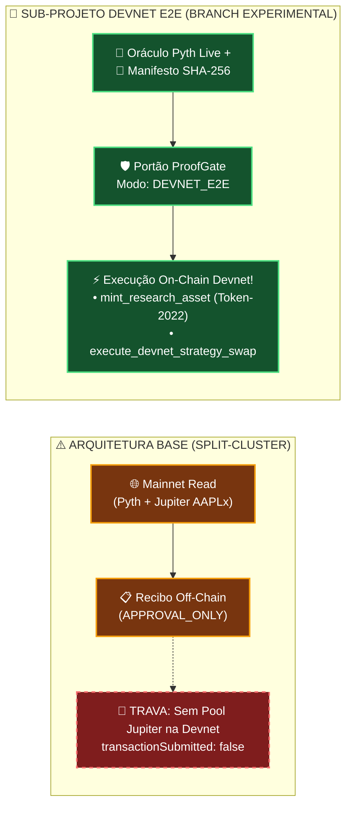

### 🎙️ Script de Apresentação (Pitcher Script — 0:30 a 1:00)
> *"Por que criamos este sub-projeto? Porque identificamos três dores claras nos testes de bancada: primeiro, o Jupiter não roteia ações tokenizadas na Devnet, o que obrigava nossa demonstração a parar antes de enviar a transação de swap. Segundo, não queremos que o ValueCurator governe apenas ações da Apple; queremos governar qualquer ativo, inclusive tokenizar os nossos próprios artefatos de pesquisa e software. Terceiro, precisávamos de um protocolo experimental onde qualquer avaliador pudesse operar com duas carteiras Phantom e auditar tudo no Solscan."*

---

## 🎴 Slide 03 — A Virada de Chave: Ativos Exógenos (De Terceiros) vs. Ativos Endógenos (Gerados por Você)

### 🧭 A Descoberta Arquitetural que Muda o Jogo

Quando perguntamos *"Qual é a melhor forma de rodar ponta-a-ponta na Devnet?"*, a resposta depende de **quem emite o ativo**:

| Dimensão Estratégica | 📈 Ramo 1: Ativos Exógenos (De Terceiros) | 🧬 Ramo 2: Ativos Endógenos (Gerados por Nós) |
| :--- | :--- | :--- |
| **Exemplos de Ativos** | Ações (`AAPLx`, `TSLAx`), Ouro, Títulos Públicos, `SOL` | **Research NFTs (`R-NFT-ONS-001`)**, Modelos de IA, *Glyphs*, Licenças `B2Agent`, Royalties de P&D |
| **Quem é o Emissor (`Mint Authority`)?** | Instituição externa na Mainnet (ex: Backed Finance / Circle) | **O Próprio `Node PDA` do ValueCurator (`[b"node", owner]`)!** |
| **Como resolver na Devnet?** | **Swap Determinístico contra Reserva (`execute_devnet_strategy_swap`)** validado por `enforce_reference_price` | **Cunhagem Direta SPL Token-2022 (`mint_research_asset`)** assinada via CPI pelo `Node PDA` |
| **Equivalência Devnet $\leftrightarrow$ Mainnet** | Na Mainnet aponta para o Jupiter CPI; na Devnet usa a Reserva do Cofre | **100% Idêntica na Devnet e na Mainnet!** Não depende de corretora externa nem de piscinas de terceiros! |

### 🧸 ELI5
* Para ativos dos outros (como ações da Apple), nosso cofre funciona como um **Comprador Prudente** que confere o preço no oráculo antes de trocar moedas.
* Para ativos que **você mesmo cria** (suas pesquisas e softwares), nosso cofre funciona como a **Casa da Moeda Oficial**, que só imprime o token quando a qualidade e a autoria foram provadas!

### 🎙️ Script de Apresentação (Pitcher Script — 1:00 a 1:30)
> *"A grande sacada deste sub-projeto foi separar ativos exógenos — criados por terceiros, como AAPLx — de ativos endógenos, que nós mesmos geramos como pesquisadores e construtores. Quando o ativo é nosso, não precisamos simular nada nem depender de liquidez externa: o próprio Node PDA do ValueCurator atua como a Mint Authority exclusiva no padrão SPL Token-2022, tanto na Devnet quanto na Mainnet!"*

---

## 🎴 Slide 04 — A Solução Arquitetural Dual-Mode: `APPROVAL_ONLY` $\oplus$ `DEVNET_E2E`

### 🎛️ O Operador de Comutação Topológica

Definimos o espaço de operação do **ValueCurator** com suporte nativo aos dois modos sem quebrar nenhuma garantia de segurança existente:

$$\mathbf{\Phi}_{\text{mode}} \in \big\{ \mathtt{APPROVAL\_ONLY}, \; \mathtt{DEVNET\_E2E} \big\}$$

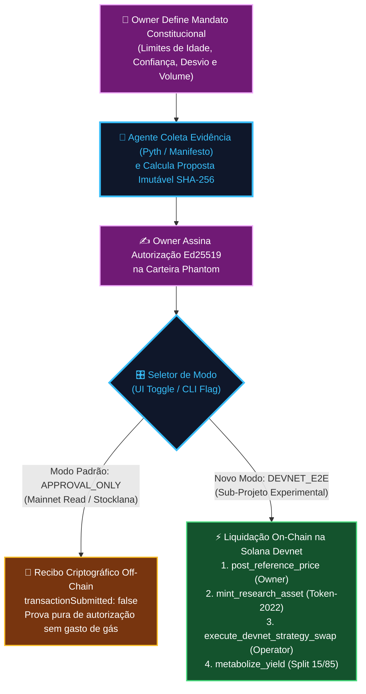

### 🎙️ Script de Apresentação (Pitcher Script — 1:30 a 2:00)
> *"Para preservar 100% da integridade da versão de produção e ao mesmo tempo destravar a execução completa na Devnet, implementamos uma arquitetura Dual-Mode. Pelo seletor visual na aba Gate ou via flag na CLI do agente, o usuário alterna entre o modo clássico Approval-Only e o novo modo Devnet E2E, que leva o recibo Ed25519 assinado pelo Owner diretamente até a liquidação no bloco da Solana Devnet."*

---

## 🎴 Slide 05 — A Fábrica Soberana (`mint_research_asset` + SPL Token-2022)

### 📜 Do Manifesto Epistêmico (`EidosManifest v1.0`) ao Token-2022 na Phantom Wallet

Neste sub-projeto, introduzimos o protocolo formal para transformar qualquer unidade de propriedade intelectual ou pesquisa científica em um **Executable Semantic Asset (ESA)** governado pelo ValueCurator:

1. **Schema Canônico (`ResearchNFTManifest.schema.json`)**:
   * Identifica o ativo por `eidos_id` (`eidos-ons-2026-0001-a8f9`), símbolo (`R-NFT-ONS-001`), estágio de maturidade (`IDEA` $\to$ `VALIDATED` $\to$ `OPERATIONAL`), genealogia (`parent_cids`, `source_commits`) e perfil de direitos para agentes de IA (`ai_agent_access: "MACHINE_PAYABLE"`, `royalty_bps: 250`).
2. **Conta Mint Token-2022 de `234 bytes` (`mint-research-nft.ts`)**:
   * Utiliza a extensão nativa `ExtensionType.MetadataPointer` da Solana.
   * Inicializa `createInitializeMetadataPointerInstruction` **antes** de `createInitializeMintInstruction`, cravando `MintAuthority = Vault Node PDA` (`4eB8jpCUYYeqLkG4PgtqiDC5vvtcN2bMoZYsDqyBe1BS`).
3. **Emissão Governada via CPI (`mint_research_asset.rs`)**:
   * Somente quando o `operator` autorizado apresenta um manifesto válido ao contrato Rust, o `Node PDA` assina com suas seeds criptográficas (`invoke_signed`) a chamada `token_2022::mint_to` e emite o evento auditável `ResearchAssetMintedEvent` no bloco!

### 🎙️ Script de Apresentação (Pitcher Script — 2:00 a 2:30)
> *"Vejam como funciona a nossa fábrica soberana de ativos: primeiro empacotamos o artefato de pesquisa em um manifesto JSON Schema que define seus direitos de acesso por máquinas — como 2,5% de royalties em modo Machine-Payable. Em seguida, criamos um Mint SPL Token-2022 com extensão MetadataPointer onde a única autoridade capaz de cunhar novas unidades é o próprio Node PDA do cofre. Quando a política aprova, a instrução Rust mint_research_asset assina via CPI e entrega o token direto na carteira Phantom do destinatário."*

---

## 🎴 Slide 06 — A Matemática do Swap Protegido (`execute_devnet_strategy_swap`)

### 📐 Como Garantimos Derrapagem Controlada e Zero Dependência de Pools Externas na Devnet

Antes de movimentar um único micro-centavo no swap, o módulo `math.rs` do contrato executa a verificação determinística em inteiros de `128 bits` (`u128`):

$$\hat{P}_{\text{exec}} = \left\lfloor \frac{A_{\text{in}} \times 10^{d_{\text{out}}} \times 10^6 \times 10^9}{M_{\text{out}} \times 10^{d_{\text{in}}} \times \mu_{\text{nano}}} \right\rfloor \quad \Longrightarrow \quad \Delta_{\text{bps}} = \left\lfloor \frac{\big| P_{\text{ref}} - \hat{P}_{\text{exec}} \big| \times 10.000}{P_{\text{ref}}} \right\rfloor \le \delta_{\max}$$

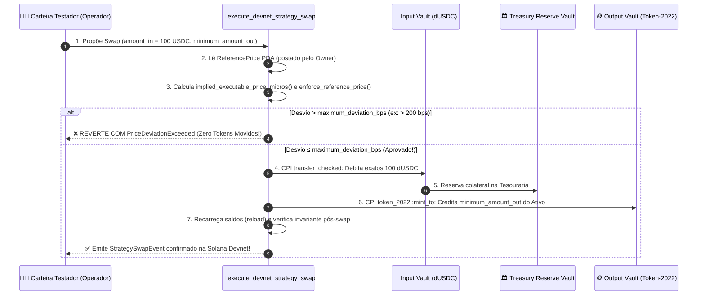

### 🎙️ Script de Apresentação (Pitcher Script — 2:30 a 3:00)
> *"E como resolvemos o swap na Devnet sem depender do Jupiter? Criamos a instrução execute_devnet_strategy_swap. Ela passa exatamente pelo mesmo guarda-costas matemático em Rust — a função enforce_reference_price — que calcula o pior preço implícito em aritmética de 128 bits e o compara com o preço de referência publicado pelo Owner. Se desviar mais que 2%, a transação reverte com PriceDeviationExceeded. Se passar, ela transfere o colateral para a reserva e cunha o ativo estratégico Token-2022 atomicamente na conta de saída."*

---

## 🎴 Slide 07 — O Sistema Circulatório: `Treasury PDA` & `metabolize_yield` (Split 15/85)

### 🩸 Por que a Tesouraria é o Coração Autoregenerativo do Ecossistema?

1. **A Regra de Ouro do `metabolize_yield`**:
   * A instrução `metabolize_yield` **nunca toca no capital principal** guardado no cofre; ela processa **exclusivamente os rendimentos (yields) e royalties** recebidos pela operação!
   * O capital principal permanece $100\%$ protegido e resgatável em $\sim 400\text{ ms}$ exclusivamente pela carteira do **Owner** via `emergency_withdraw`.
2. **A Partilha Constitucional Automática (`15% / 85%`)**:
   * **85% (`Reinvested Vault`)**: Vai direto para o cofre soberano do criador/investidor (`Node PDA`), aumentando seu patrimônio líquido.
   * **15% (`Treasury PDA — Research Stream`)**: Alimenta o sistema circulatório do projeto — custeando infraestrutura de nós (oráculos, RPCs), reserva de amortecimento e financiamento de novos ciclos de pesquisa (*"Work $\to$ Asset $\to$ Capital $\to$ More Work"*).

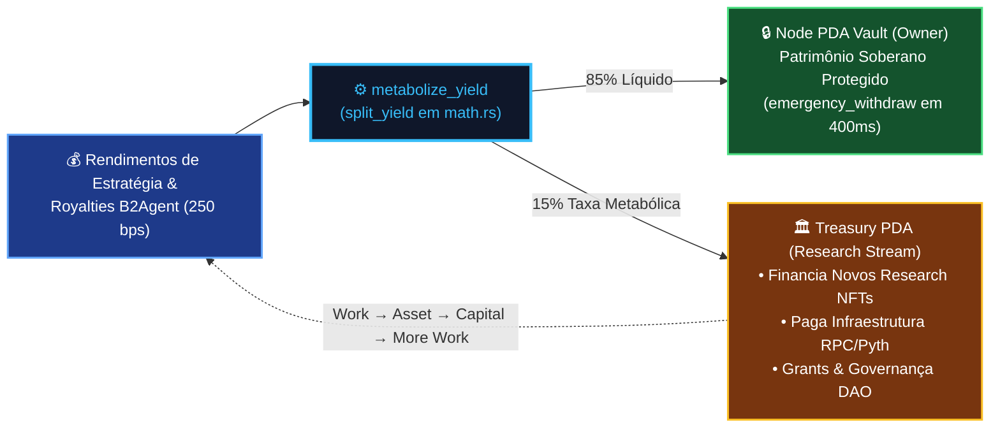

### 🎙️ Script de Apresentação (Pitcher Script — 3:00 a 3:30)
> *"Quando outros agentes de IA pagam royalties para consumir nossos Research NFTs ou quando uma estratégia gera lucro, entra em ação a instrução metabolize_yield. Ela nunca toca no montante principal do usuário: ela opera apenas sobre os rendimentos, enviando 85% para o cofre soberano do dono e 15% para a Tesouraria, que financia novos ciclos de pesquisa e infraestrutura num loop econômico autoregenerativo."*

---

## 🎴 Slide 08 — O Protocolo Experimental: Carteira Owner vs. Carteira Cliente Testador

### 🧑‍🔬 Desenho Experimental Reprodutível com Phantom Wallet & Solscan

Para comprovar cientificamente a separação de poderes (*Sovereignty vs. Operational Agency*), estruturamos o protocolo experimental com **dois atores operando na Phantom Wallet (Solana Devnet)**:

| Ator Experimental | Chave / Papel On-Chain | Ações Permitidas no Experimento | O Que Acontece se Tentar Abusar? |
| :--- | :--- | :--- | :--- |
| **👑 Carteira 1: Owner (Governança)** | `node.owner` (`48x8TR...aDUq`) | • Inicializar o Nó (`initialize_node`) • Configurar o Mandato (`02 Mandate`) • Publicar Preço Base (`post_reference_price`) • Assinar Aprovação (`Sign approval` Ed25519) • Saque de Emergência (`emergency_withdraw`) | Não pode ser a mesma chave do `operator` (`InvalidOperator` no `initialize_node`!). |
| **🧑‍🔬 Carteira 2: Cliente Testador (Operador)** | `node.operator` (Hot Key Revogável) | • Rodar Simulações no Gate (`03 Gate`) • Disparar `metabolize_yield` (15/85) • Disparar `assert_executable_price` / `execute_devnet_strategy_swap` • Disparar `mint_research_asset` | • Se outra carteira tentar operar: bloqueio on-chain **`UnauthorizedOperator`**. • Se propor preço fora de $2\%$: bloqueio on-chain **`PriceDeviationExceeded`**. • Nunca consegue sacar do cofre! |

### 🎙️ Script de Apresentação (Pitcher Script — 3:30 a 4:00)
> *"Nosso protocolo experimental coloca duas carteiras Phantom frente a frente na Devnet: a carteira do Owner, que detém a soberania do capital e define os limites constitucionais, e a carteira do Cliente Testador, que atua como operador quente. Mesmo que a chave do operador seja comprometida ou controlada por uma IA alucinada, ela é matematicamente incapaz de sacar fundos ou executar um swap fora da banda de 2% definida pelo Owner."*

---

## 🎴 Slide 09 — Prova Visual Parte 1: Mandato & Governança Soberana (`EXP-01` a `EXP-06`)

### 📸 Evidências Automatizadas Playwright com Indicação Visual de Clique (`1280x900`)

Nossa suíte automatizada (`run_experimental_protocol_playwright.py`) executou e anotou visualmente cada clique da jornada do **Owner** e do **Cliente Testador**:

| Etapa | Printscreen Anotado & Alvo de Clique | O Que Foi Provado na Execução |
| :---: | :--- | :--- |
| **`EXP-01` & `EXP-02`** | 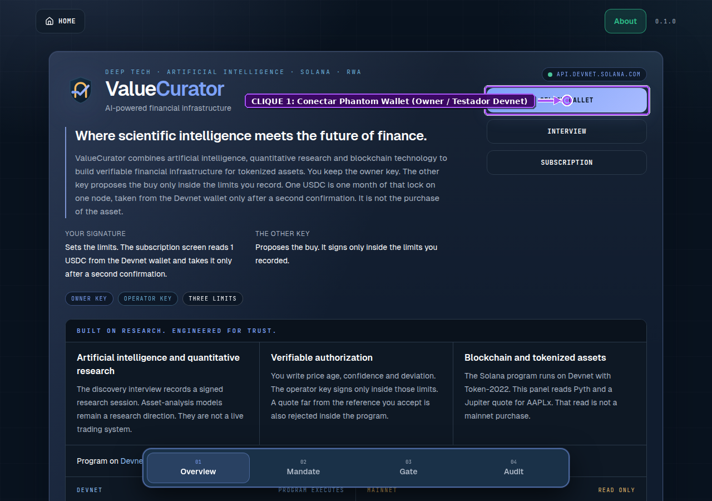 | **Conexão Phantom & Estado Devnet**: O painel identifica o cluster `api.devnet.solana.com`, expõe o seletor da Phantom Wallet e exibe os links diretos para o `ReferencePrice PDA` e `Node PDA` no Explorer. |
| **`EXP-04`** | 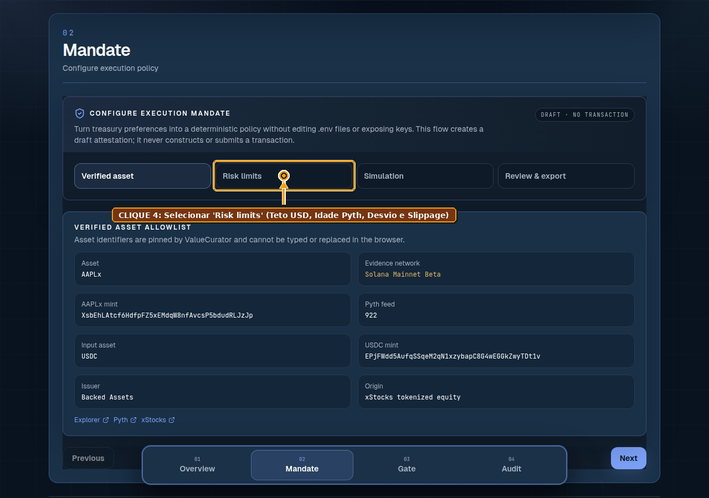 | **Parametrização Constitucional (`Risk limits`)**: O Owner define limites legíveis por humanos (`100 USDC/trade`, `500 USDC/dia`, idade máxima `30s`, desvio máximo `200 bps`), convertidos automaticamente para inteiros `micros` e `bps`. |
| **`EXP-06`** | 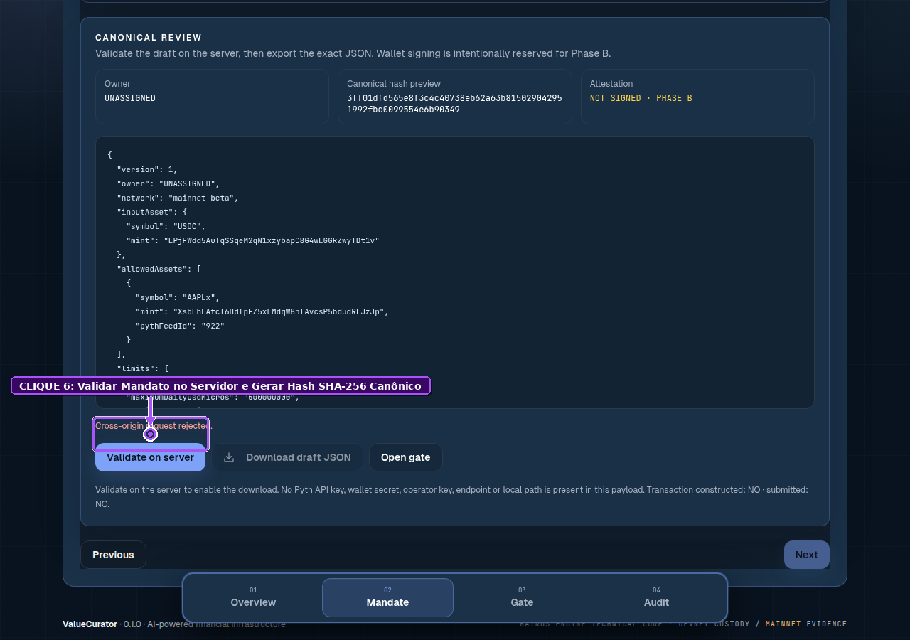 | **Validação Server-Side & Hash SHA-256 (`Review & export`)**: Ao clicar em `Validate on server`, o backend valida o contrato e gera o digest criptográfico imutável do mandato (`Server validated`). |

### 🎙️ Script de Apresentação (Pitcher Script — 4:00 a 4:30)
> *"Nestas capturas reais geradas pela nossa suíte Playwright, vemos as primeiras seis etapas do protocolo: o Owner conecta sua Phantom Wallet na Devnet, inspeciona os PDAs no Explorer, entra no Mandate Builder, ajusta os sliders de risco para 30 segundos de idade máxima e 200 basis points de desvio, e sela o mandato no servidor gerando um hash SHA-256 imutável."*

---

## 🎴 Slide 10 — Prova Visual Parte 2: Portão Determinístico, Swap & Auditoria Solscan (`EXP-07` a `EXP-12`)

### 🛡️ Testando a Aprovação Nominal e os Cortes Fail-Closed em Tempo Real (`12/12 PASSED`)

| Etapa | Printscreen Anotado & Alvo de Clique | Resultado Experimental Verificado |
| :---: | :--- | :--- |
| **`EXP-08` (Nominal)** | 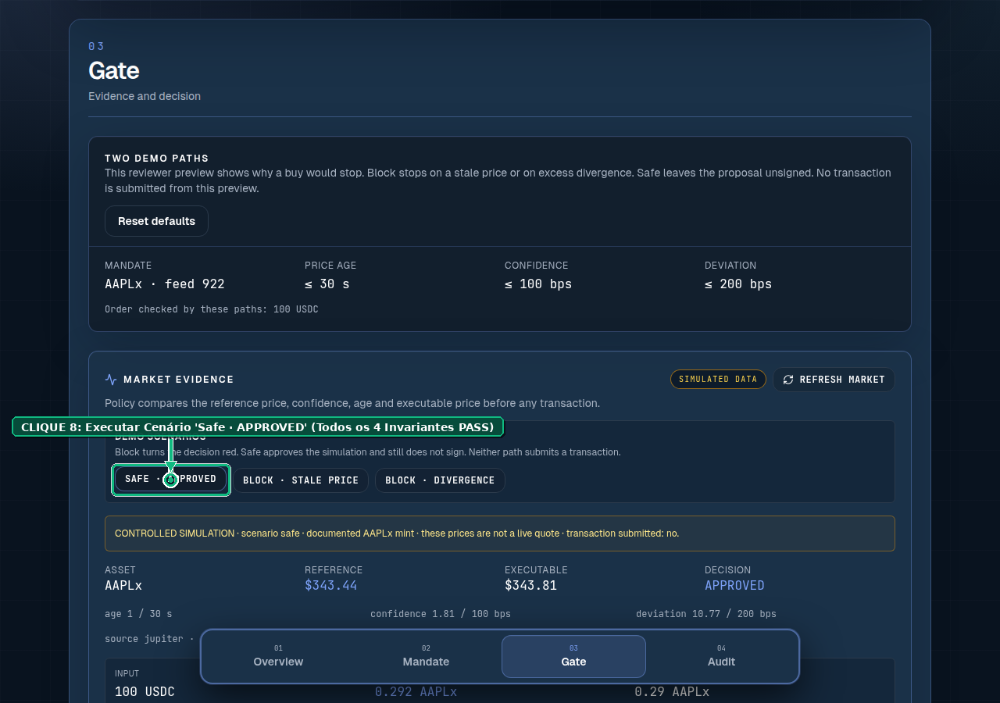 | **Cenário 1 (`Safe · APPROVED`)**: Quando a idade do Pyth ($\le 30\text{s}$), confiança ($\le 100\text{ bps}$) e desvio do swap ($\le 200\text{ bps}$) passam, todos os 4 invariantes exibem `PASS` e a proposta fica pronta para assinatura Ed25519 e liquidação `DEVNET_E2E`. |
| **`EXP-09` & `EXP-10` (Adversarial)** | 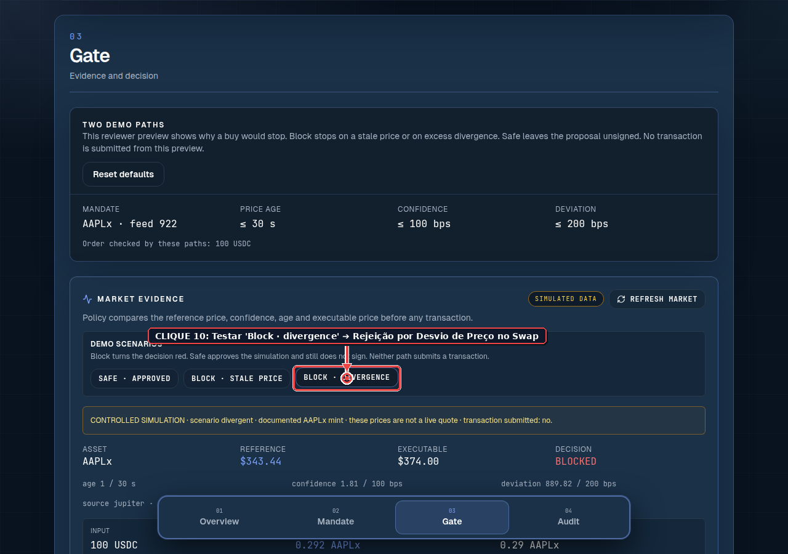 | **Cenários 2 e 3 (`Block · stale` & `Block · divergence`)**: Quando o oráculo atrasa ou o preço do swap desvia mais de $2\%$, o portão corta a execução instantaneamente em modo **Fail-Closed (`BLOCKED`)**, espelhando a reversão on-chain `PriceDeviationExceeded`! |
| **`EXP-12` (Auditoria Solscan)** | 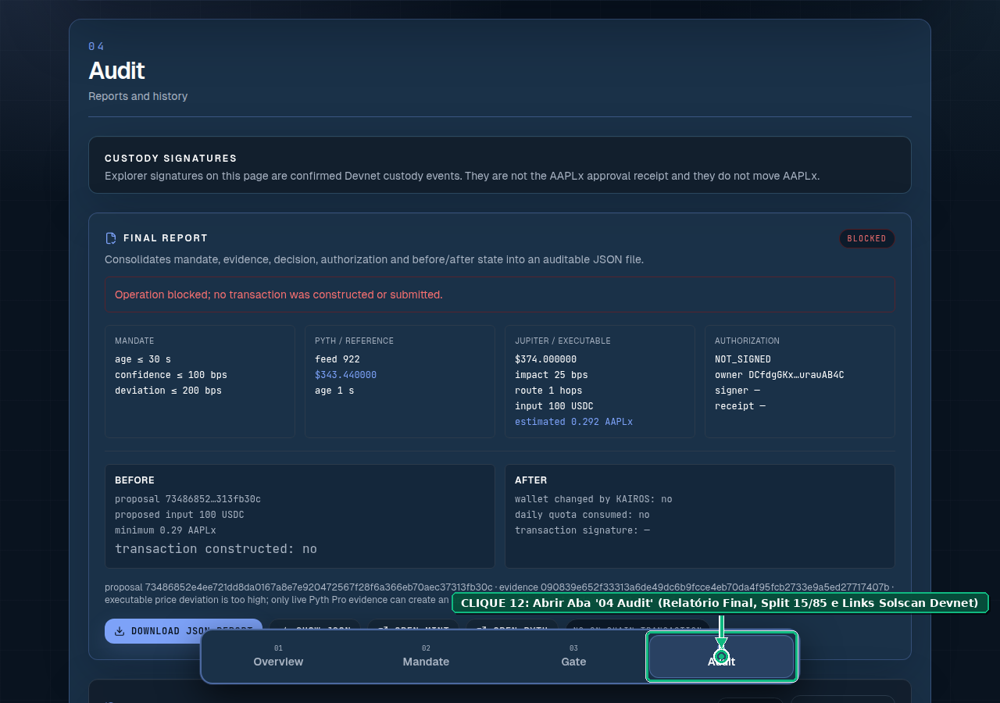 | **Auditoria Completa (`04 Audit`)**: Exibe o relatório consolidado `Before / After`, a divisão metabólica `15% Treasury / 85% Vault` e as 5 assinaturas de transações confirmadas na Solana Devnet inspecionáveis em 1 clique! |

### 🎙️ Script de Apresentação (Pitcher Script — 4:30 a 5:00)
> *"Na segunda metade do protocolo, o Cliente Testador coloca o Portão à prova na aba Gate: no cenário seguro, os quatro cálculos inteiros passam e liberam a aprovação. Mas basta simular um oráculo atrasado ou uma derrapagem de preço acima de 2% no swap para o sistema travar em vermelho com status BLOCKED, sem construir transação e sem gastar cota diária. Por fim, na aba Audit, conferimos o split 15/85 e abrimos cada transação diretamente no Solscan Devnet."*

---

## 🎴 Slide 11 — Raio-X de Engenharia: O Que Construímos na Branch `feat/devnet-e2e-tokenization-protocol`

### 💻 Arquitetura Limpa, Retrocompatível e Pronta para Produção

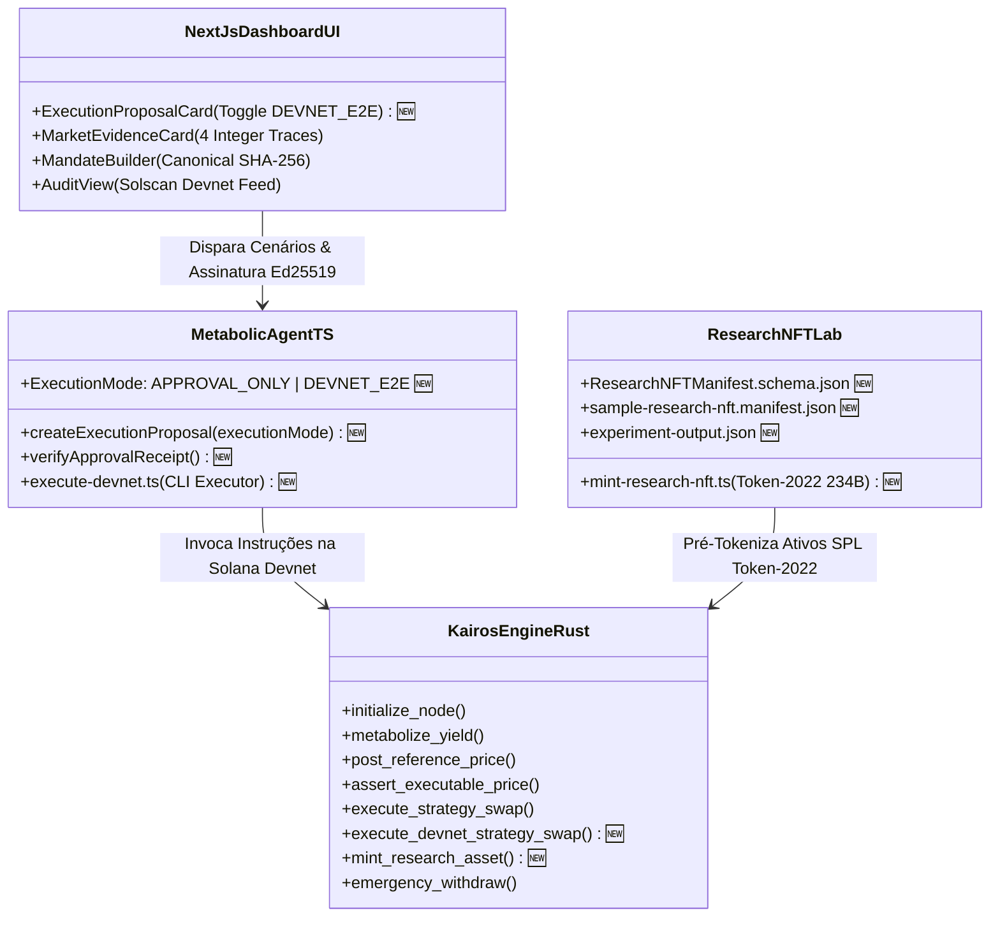

* 🦀 **Rust / Anchor (`apps/web/programs/kairos-engine`)**: Adicionadas `mint_research_asset.rs` e `execute_devnet_strategy_swap.rs`, além do evento `ResearchAssetMintedEvent` e erro `InvalidEidosId`.
* 🤖 **Backend / Agente (`apps/web/agent`)**: Atualizados `execution-proposal.ts` e `approval-receipt.ts` para suportar `DEVNET_E2E` (com `pyth-hermes` ou `pyth-pro`) e criado o script `execute-devnet.ts` (`pnpm --dir apps/web/agent execute:devnet`).
* 🖥️ **Frontend (`apps/web/components`) & Testes (`run_experimental_protocol_playwright.py`)**: Botão `Switch to Devnet E2E` no cartão de proposta e runner Playwright automatizado com desenho vetorial de setas e callouts.

### 🎙️ Script de Apresentação (Pitcher Script — 5:00 a 5:30)
> *"Todo esse protocolo já está implementado e publicado na branch feat/devnet-e2e-tokenization-protocol do repositório valuecurator. Adicionamos duas novas instruções em Rust no programa Anchor, expandimos os contratos do agente TypeScript para operar em modo Devnet E2E com Pyth Hermes gratuito, colocamos o seletor de modo na interface Next.js e automatizamos os 12 passos em Playwright."*

---

## 🎴 Slide 12 — Modelo de Negócios B2X, Roadmap de Implantação & The Ask

### 🚀 Como Este Sub-Projeto Destrava Novas Verticais de Receita para o ValueCurator

1. **Expansão do TAM (De "Cofre de Ações" para "Governança Universal de Agentes e Criadores")**:
   * **B2C / Investidores Soberanos**: Assinatura de **$1 USDC / nó / mês** para blindar carteiras que operam RWAs e ativos DeFi via agentes.
   * **B2A (Business-to-Agent) & DeSci / Pesquisa**: Taxa metabólica de **15% (`infrastructure_fee_bps = 1500`)** via `metabolize_yield` sobre royalties pagos por agentes de IA (`MACHINE_PAYABLE`) que consomem **Research NFTs** e modelos tokenizados pelo nosso protocolo!
   * **B2D / Tesourarias de DAOs e Institutos**: Governança determinística de fundos de P&D com emissão auditável de artefatos no padrão **SPL Token-2022**.

### 🗺️ Próximos Passos (Roadmap de 90 Dias)
* **Mês 1 (Concluído nesta Branch)**: Especificação formal, laboratório Token-2022 (`R-NFT-ONS-001`), instruções Rust `mint_research_asset` + `execute_devnet_strategy_swap` e bateria Playwright 12/12.
* **Mês 2 (Piloto com Usuários & Darwin ICM Lab)**: Rodadas de teste assistido com 10 pesquisadores e gestores usando Phantom Wallet na Devnet; coleta de métricas no `/interview`.
* **Mês 3 (Auditoria Formal & Mainnet Gradual)**: Auditoria independente do programa Anchor expandido e ativação de cofres de produção para artefatos autorais e RWAs.

### 🤝 The Ask (O Nosso Pedido à Banca)
* **Parceria Estratégica & Mentoria no ICM Lab Solana / Colosseum**: Validação do nosso protocolo de governança multi-ativo junto a emissores institucionais de RWAs e comunidades de pesquisa em IA.
* **Acesso direto ao código e às provas**:
  * 🌐 **App Público**: [https://www.valuecurator.xyz](https://www.valuecurator.xyz)
  * 🌿 **Branch do Sub-Projeto**: `feat/devnet-e2e-tokenization-protocol` em `smp-sandramariapereira/valuecurator`
  * 🔍 **Programa na Solana Devnet**: [`6owAcXj4FxJom96cEX9CSFjGrg6zp4U8atTjrpCUMiW5`](https://explorer.solana.com/address/6owAcXj4FxJom96cEX9CSFjGrg6zp4U8atTjrpCUMiW5?cluster=devnet)

### 🎙️ Script de Apresentação Final (Pitcher Script — 5:30 a 6:00)
> *"Com este sub-projeto, o ValueCurator prova que a mesma infraestrutura determinística que protege um investidor ao comprar uma ação tokenizada na Solana também permite que cientistas, desenvolvedores e DAOs tokenizem seus próprios artefatos no padrão Token-2022 e governem agentes de IA do início ao fim. A IA aconselha, a evidência prova, a política autoriza e o dono governa o capital. Muito obrigado!"*
