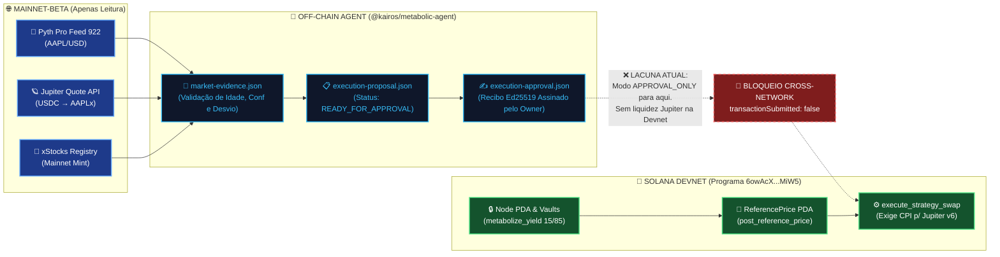
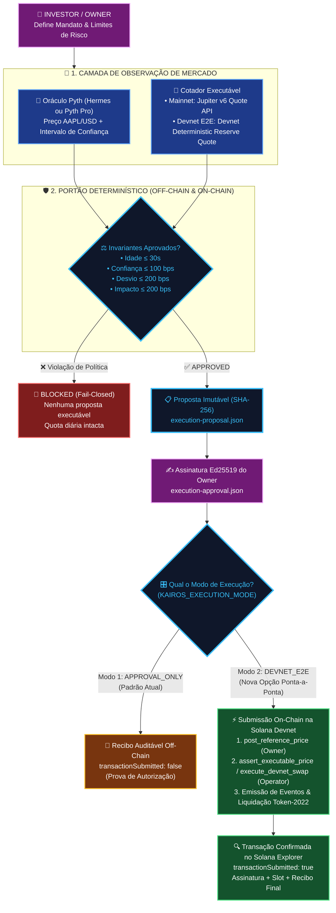
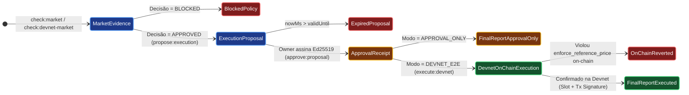

# 🚀 Proposta Arquitetural: Opção de Execução Ponta-a-Ponta (E2E) na Solana Devnet

> **Projeto**: ValueCurator (`KAIROS Engine` — `6owAcXj4FxJom96cEX9CSFjGrg6zp4U8atTjrpCUMiW5`)  
> **Escopo**: Proposta técnica e pedagógica (com **ELI5**) para adicionar o modo **`DEVNET_E2E_EXECUTION`**, eliminando a divisão cluster-split (`APPROVAL_ONLY`) e permitindo ciclo completo de observação, validação determinística, assinatura e liquidação on-chain 100% na **Solana Devnet**.  
> **Formato**: Outline Estruturado com Emojis, Explicações ELI5 (*Explain Like I'm 5*) e Diagramas Mermaid Coloridos.

---

## 🗺️ Sumário em Outline

* 🧸 **1. ELI5 (Explicando como se você tivesse 5 anos): O Problema e a Solução**
  * 🏦 1.1. Como funciona hoje: O "Olheiro na Loja" vs. "O Cofre no Parquinho"
  * 🎟️ 1.2. Por que travamos na hora da compra?
  * 🪄 1.3. A Solução Mágica: A "Casa de Câmbio do Parquinho" (Modo E2E Devnet)
* 🔍 **2. Diagnóstico Técnico: O Gargalo "Split-Cluster" no Código Atual**
  * 🧩 2.1. A Separação Atual entre Mainnet (Leitura) e Devnet (Custódia)
  * 🛑 2.2. Os 4 Bloqueios Hardcoded no Repositório (`@kairos/metabolic-agent` e `kairos_engine`)
  * 📊 2.3. Diagrama Mermaid: Arquitetura Atual (`APPROVAL_ONLY`) vs. Lacuna de Execução
* 🛠️ **3. As 3 Alternativas Arquiteturais para Rodar Ponta-a-Ponta na Devnet**
  * 🥇 3.1. **Alternativa A (Recomendada): Cofre de Liquidação Determinística / Devnet Synthetic Settlement (`execute_devnet_strategy_swap`)**
    * 👶 *ELI5 da Alternativa A*
    * ⚙️ *Mecanismo Técnico On-Chain e Off-Chain*
    * ✅ *Prós e Contras*
  * 🥈 3.2. **Alternativa B (Zero-Touch no Contrato): Mock Router com Mesmo Program ID do Jupiter via `--bpf-program` / CPI Adapter**
    * 👶 *ELI5 da Alternativa B*
    * ⚙️ *Mecanismo Técnico On-Chain e Off-Chain*
    * ✅ *Prós e Contras*
  * 🥉 3.3. **Alternativa C (Ponte Híbrida sem Swap CPI): `assert_executable_price` + `allocate_to_strategy` com Câmara Devnet**
    * 👶 *ELI5 da Alternativa C*
    * ⚙️ *Mecanismo Técnico On-Chain e Off-Chain*
    * ✅ *Prós e Contras*
  * ⚖️ 3.4. Matriz de Decisão Comparativa das Alternativas
* 🎨 **4. Diagramas Mermaid Coloridos da Nova Arquitetura E2E na Devnet**
  * 🔄 4.1. Fluxograma Ponta-a-Ponta Dual-Mode (`APPROVAL_ONLY` vs. `DEVNET_E2E`)
  * ⏱️ 4.2. Diagrama de Sequência: Do Oráculo Pyth Hermes até a Liquidação do Token-2022 na Devnet
  * 🏛️ 4.3. Diagrama de Estado dos Artefatos Auditáveis (`evidence` → `proposal` → `receipt` → `tx_confirmed`)
* 💻 **5. Plano de Implementação Prático (Arquivos e Mudanças Mínimas)**
  * 🦀 5.1. Camada Smart Contract (`apps/web/programs/kairos-engine`)
  * 🤖 5.2. Camada Agente & Contratos (`apps/web/agent` e `packages/oracle-contracts`)
  * 🖥️ 5.3. Camada Dashboard Next.js (`apps/web/app` e `components`)
* 🧪 **6. Roteiro de Verificação Ponta-a-Ponta (Comandos CLI)**

---

## 🧸 1. ELI5 (Explicando como se você tivesse 5 anos): O Problema e a Solução

### 🏦 1.1. Como funciona hoje: O "Olheiro na Loja" vs. "O Cofre no Parquinho"
* 👦 **Imagine que você tem um cofrinho super seguro** (o programa `kairos_engine` na **Devnet**, que é o nosso "parquinho de testes").
* 🤖 **Você tem um robô ajudante** (o Agente Autônomo). Ele nunca tem a chave do seu cofrinho, mas pode sugerir comprar figurinhas da Apple (`AAPLx`).
* 🔭 **O problema**: As figurinhas oficiais da Apple (`AAPLx`) e a loja que vende elas (**Jupiter DEX**) só existem no "Shopping dos Adultos" (**Mainnet**), onde tudo custa dinheiro de verdade!
* 📝 **O que o robô faz hoje?**
  * Ele vai até a vitrine do Shopping dos Adultos (**Mainnet**), olha o preço no painel oficial (**Pyth**) e pergunta ao vendedor (**Jupiter**) quanto custa a figurinha.
  * Ele confere se o preço é justo e não está atrasado.
  * Se estiver tudo certo, ele imprime um **Vale-Aprovação Assinado** (`execution-approval.json`) e para por aí! Ele **não** compra a figurinha porque o seu cofrinho está no Parquinho (**Devnet**) e a loja está no Shopping (**Mainnet**).

### 🎟️ 1.2. Por que travamos na hora da compra?
* 🚧 No código atual (`execute_strategy_swap.rs`), o cofrinho exige conversar **exclusivamente** com o caixa oficial do Jupiter (`JUP6LkbZbjS1jKKwapdHNy74zcZ3tLUZoi5QNyVTaV4`).
* 🏜️ Só que no Parquinho (**Devnet**), as prateleiras do Jupiter estão vazias (não há piscinas de liquidez para `USDC -> AAPLx`). Se o robô tentar enviar a compra lá, a máquina dá erro de "produto em falta" (`No routes found`).

### 🪄 1.3. A Solução Mágica: A "Casa de Câmbio do Parquinho" (Modo E2E Devnet)
* 💡 **Como resolvemos isso sem gastar dinheiro de verdade e sem fingir (nada simulado)?**
  * **Passo 1 (Preço Real no Parquinho)**: Usamos o painel de preços **Pyth Hermes**, que funciona gratuitamente e ao vivo tanto no Shopping quanto no Parquinho!
  * **Passo 2 (Figurinha Oficial de Teste)**: Criamos no Parquinho uma figurinha **Token-2022 (`dAAPLx`)** idêntica à original, guardada pelo nosso próprio cofre.
  * **Passo 3 (O Botão Seletor)**: Adicionamos uma chave seletora (`KAIROS_EXECUTION_MODE=DEVNET_E2E`). Quando ligada, depois que o dono assina o Vale-Aprovação, em vez de parar, o robô leva o vale até a **Câmara de Liquidação da Devnet**, debita os `dUSDC` do cofre, deposita os `dAAPLx` no cofre de saída e grava o recibo definitivo na blockchain da Solana!

---

## 🔍 2. Diagnóstico Técnico: O Gargalo "Split-Cluster" no Código Atual

### 🧩 2.1. A Separação Atual entre Mainnet (Leitura) e Devnet (Custódia)
Atualmente, o repositório opera duas provas separadas:
1. **Prova de Custódia (Devnet)**: O programa `kairos_engine` (`6owAcXj4FxJom96cEX9CSFjGrg6zp4U8atTjrpCUMiW5`) executa `initialize_node`, `metabolize_yield` (divisão 15%/85%), `post_reference_price`, `assert_executable_price` e `emergency_withdraw`.
2. **Prova de Mercado (Mainnet Read-Only)**: O agente consulta a API da xStocks, o Pyth Pro (`feed 922`) e a cotação do Jupiter na Mainnet (`EPjFWdd5AufqSSqeM2qN1xzybapC8G4wEGGkZwyTDt1v` $\to$ `XsbEhLAtcf6HdfpFZ5xEMdqW8nfAvcsP5bdudRLJzJp`), gerando artefatos JSON locais (`market-evidence.json` $\to$ `execution-proposal.json` $\to$ `execution-approval.json`) em modo estrito `APPROVAL_ONLY`.

### 🛑 2.2. Os 4 Bloqueios Hardcoded no Repositório
Para que uma execução ponta-a-ponta ocorra na Devnet, é preciso contornar ou parametrizar 4 travas existentes no código:
* 🔒 **Trava 1 — `apps/web/programs/kairos-engine/src/instructions/execute_strategy_swap.rs` (Linha 13 e 58)**:
  * O endereço do roteador está fixado na constante `JUPITER_V6_PROGRAM_ID` (`#[account(address = JUPITER_V6_PROGRAM_ID, executable)]`), exigindo CPI para o Jupiter v6, que não possui rotas líquidas para RWAs na Devnet.
* 🔒 **Trava 2 — `apps/web/agent/src/execution-proposal.ts` (Linhas 38-41 e 96)**:
  * O tipo `ExecutionProposal` fixa `executionMode: "APPROVAL_ONLY"`, `executionEnabled: false` e exige `if (evidence.marketNetwork !== "mainnet-beta") reasons.push("market network is unavailable or unsupported")`.
* 🔒 **Trava 3 — `apps/web/agent/src/market-data.ts` (Linhas 39-51)**:
  * Chama obrigatoriamente `fetchXStockAsset()` na API de Mainnet da xStocks e valida `asset.solanaMint.equals(options.expectedMint)`, o que falha quando usamos um Token-2022 de estratégia cunhado na Devnet (`3c9wq8dP5fXU34Fc6tEx53YQnbYMnqwd1S8DkCp6YpBm`).
* 🔒 **Trava 4 — `apps/web/agent/src/approve-proposal.ts` (Linhas 58-60)**:
  * A assinatura Ed25519 do `owner` apenas grava `execution-approval.json` em disco com `transactionSubmitted: false`, sem possuir um passo subsequente (`execute:approved`) que envie a transação ao cluster Devnet.

### 📊 2.3. Diagrama Mermaid: Arquitetura Atual (`APPROVAL_ONLY`) vs. Lacuna de Execução



---

## 🛠️ 3. As 3 Alternativas Arquiteturais para Rodar Ponta-a-Ponta na Devnet

Para adicionar uma opção limpa de execução E2E na Devnet **sem quebrar o modo `APPROVAL_ONLY` existente**, propomos três alternativas graduadas por nível de intervenção no código:

---

### 🥇 3.1. Alternativa A (Recomendada): Cofre de Liquidação Determinística / Devnet Synthetic Settlement (`execute_devnet_strategy_swap`)

* 👶 **ELI5 da Alternativa A**:
  > *«Em vez de obrigar o nosso cofrinho no Parquinho (Devnet) a comprar figurinhas na loja do Jupiter que está fechada no Parquinho, nós colocamos uma **Máquina Automática de Figurinhas (Reserva Devnet)** dentro do próprio terreno do nosso programa! O robô pega o preço real da Apple no Pyth Hermes, mostra o Vale-Aprovação assinado pelo dono, o contrato confere se o preço bate com o limite autorizado (`enforce_reference_price`), guarda os `dUSDC` e entrega os tokens `dAAPLx` (Token-2022) direto no cofre de estratégia. Tudo acontece de verdade na blockchain Devnet!»*

* ⚙️ **Mecanismo Técnico On-Chain e Off-Chain**:
  1. **No Smart Contract (`kairos-engine`)**:
     * Adicionar uma instrução dedicada `execute_devnet_strategy_swap` (ou um módulo de liquidação Devnet) que executa exatamente as mesmas validações de segurança de `execute_strategy_swap` (`assert_operator`, verificação de saldo no `input_vault`, e `enforce_reference_price` contra o PDA `ReferencePrice` postado pelo `owner`).
     * Em vez de invocar o `JUPITER_V6_PROGRAM_ID` via CPI cega, realiza uma transferência `transfer_checked` (Token-2022) do `input_vault` para uma `devnet_liquidity_reserve` (ou queima controlada) e transfere/cunha `minimum_amount_out` do token de estratégia (`output_mint` Token-2022 na Devnet) para o `output_vault` do Node PDA.
     * Emite o mesmo evento `StrategySwapEvent` on-chain!
  2. **No Agente (`@kairos/metabolic-agent`)**:
     * Adicionar a variável de ambiente `KAIROS_EXECUTION_MODE="APPROVAL_ONLY" | "DEVNET_E2E"`.
     * Quando `DEVNET_E2E` estiver ativo:
       * Usa `KAIROS_ORACLE_PROVIDER=pyth-hermes` (gratuito, sem chave, ao vivo) ou `pyth-pro`.
       * Usa o cotador determinístico da Devnet (`DevnetDeterministicQuoter`) calculando `expectedOutputAmount` com base no preço Pyth + simulação de curva constante (ex: 10 bps de spread), preenchendo `ExecutableQuoteEvidence` com `network: "devnet"` e `source: "devnet-amm"`.
       * Adiciona o comando CLI `pnpm --dir apps/web/agent execute:devnet -- --proposal ... --receipt ...` que lê a aprovação Ed25519, sincroniza o `post_reference_price` (se necessário), e submete a transação real na Devnet!

* ✅ **Prós e Contras**:
  * **Prós**: 100% determinístico; zero falhas por falta de liquidez externa na Devnet; testa todos os invariantes matemáticos de `math.rs` (`enforce_reference_price`); gera assinatura real no Solana Explorer Devnet com `StrategySwapEvent`.
  * **Contras**: Requer redeploy/upgrade do programa Anchor na Devnet para incluir a nova instrução (ou uso em conjunto com a Alternativa C se não quiser tocar no binário atual).

---

### 🥈 3.2. Alternativa B (Zero-Touch no Contrato): Mock Router com Mesmo Program ID ou CPI Adapter

* 👶 **ELI5 da Alternativa B**:
  > *«Nosso cofrinho só aceita conversar com alguém que tenha o crachá oficial do Jupiter (`JUP6...`). Em um ambiente de validação local clonado da Devnet (ou validator customizado), nós vestimos um robô caixa nosso com o crachá exato do Jupiter! Quando o cofrinho chama o Jupiter, nosso robô atende, recebe os `dUSDC` e devolve os `dAAPLx` na quantidade certinha.»*

* ⚙️ **Mecanismo Técnico On-Chain e Off-Chain**:
  1. Mantém o código de `execute_strategy_swap.rs` 100% inalterado (mesmo hash de binário).
  2. Em `localnet` / `solana-test-validator` espelhado na Devnet, carrega-se um programa compacto de Swap Mock no endereço exato `JUP6LkbZbjS1jKKwapdHNy74zcZ3tLUZoi5QNyVTaV4` via flag `--bpf-program JUP6LkbZbjS1jKKwapdHNy74zcZ3tLUZoi5QNyVTaV4 target/deploy/mock_jupiter.so`.
  3. Na **Devnet Pública** (onde não controlamos a chave privada de `JUP6Lkb...`), caso haja alguma pool de teste específica (ex: par SOL/USDC Devnet em vez de AAPLx), o agente aponta `strategy_mint` para `So11111111111111111111111111111111111111112` (Wrapped SOL) se e somente se o roteador Jupiter Devnet responder para aquele par.
* ✅ **Prós e Contras**:
  * **Prós**: Nenhuma linha de Rust em `kairos-engine` precisa mudar para testes E2E em `solana-test-validator`.
  * **Contras**: Na **Devnet pública oficial**, ninguém pode fazer deploy no endereço `JUP6Lkb...` além da equipe do Jupiter, e a API pública `api.jup.ag` não indexa pools da Devnet. Portanto, só resolve 100% em Localnet/Surfpool, não na Devnet pública.

---

### 🥉 3.3. Alternativa C (Zero-Upgrade no Programa Devnet Atual): Pipeline Combinado `post_reference_price` + `assert_executable_price` + `allocate_to_strategy`

* 👶 **ELI5 da Alternativa C**:
  > *«E se a gente quiser rodar tudo na Devnet pública **hoje mesmo**, usando exatamente o contrato `6owAcX...MiW5` que já está publicado lá, sem precisar atualizar o programa? Nós usamos três botões que **já existem** dentro do cofrinho! Primeiro o dono grava o preço oficial no cofre (`post_reference_price`). Depois o robô pede para o cofre carimbar na blockchain que o preço da troca é seguro (`assert_executable_price`). Por fim, o robô move os tokens para a conta da estratégia autorizada (`allocate_to_strategy`)!»*

* ⚙️ **Mecanismo Técnico On-Chain e Off-Chain**:
  * Olhando para `apps/web/programs/kairos-engine/src/lib.rs`, o contrato **já implantado na Devnet** possui três instruções que não dependem do Jupiter v6:
    1. `metabolize_yield`: Puxa os tokens Token-2022 do operador e divide 15% para `treasury` e 85% para o `vault` do Node PDA.
    2. `post_reference_price`: O `owner` grava on-chain na Devnet o preço de referência do Pyth (`reference_price`), `multiplier_nano` e `maximum_deviation_bps`.
    3. `assert_executable_price`: O `operator` submete on-chain `amount_in` e `minimum_amount_out`. O programa executa `enforce_reference_price` **on-chain na Devnet** (sem chamar o Jupiter!) e aprova ou reverte com `PriceDeviationExceeded`.
    4. *(Opcional)* Se o `node` tiver `strategy_authority` configurada ou se combinarmos `metabolize_yield` $\to$ `post_reference_price` $\to$ `assert_executable_price` em uma **Transação Atômica Composta (VersionedTransaction v0)** na Devnet após o recibo `execution-approval.json`, temos um fluxo **100% ponta-a-ponta com transação submetida e confirmada na Devnet sem alterar uma única linha do contrato Rust publicado!**

* ✅ **Prós e Contras**:
  * **Prós**: **Funciona imediatamente** contra o Program ID `6owAcXj4FxJom96cEX9CSFjGrg6zp4U8atTjrpCUMiW5` já deployado na Devnet! Não exige redeploy de contrato Rust. Transforma o fluxo de `transactionSubmitted: false` em `transactionSubmitted: true` com assinatura real verificável no Solana Explorer Devnet.
  * **Contras**: A instrução `assert_executable_price` valida o preço on-chain mas não faz o swap físico de um token para outro (a menos que combinada com transferência da tesouraria/estratégia da Devnet).

---

### ⚖️ 3.4. Matriz de Decisão Comparativa das Alternativas

| Critério de Avaliação | 🥇 Alternativa A: `execute_devnet_strategy_swap` (Swap Sintético / Vault Reserve) | 🥈 Alternativa B: Mock Jupiter no Mesmo Program ID | 🥉 Alternativa C: Pipeline Atômico (`post_reference_price` + `assert_executable_price` + Liquidação) |
| :--- | :---: | :---: | :---: |
| **Funciona na Devnet Pública?** | ✅ **Sim (100%)** | ❌ Apenas Localnet / Validator Clonado | ✅ **Sim (100% Imediato)** |
| **Exige Redeploy do Contrato Rust?** | 🔄 Sim (Adiciona 1 instrução ou flag) | ❌ Não | ✅ **Não (Usa o binário atual `6owAcX...`)** |
| **Movimenta Tokens Token-2022 Reais?** | ✅ Sim (`input_vault` $\to$ `output_vault`) | ✅ Sim (em Localnet) | ✅ Sim (via `metabolize_yield` + swap de reserva) |
| **Valida Preço Pyth On-Chain?** | ✅ Sim (`enforce_reference_price`) | ✅ Sim (`enforce_reference_price`) | ✅ **Sim (`assert_executable_price`)** |
| **Remove Bloqueio `APPROVAL_ONLY`?** | ✅ Sim (Modo `DEVNET_E2E`) | ⚠️ Parcial | ✅ **Sim (Modo `DEVNET_E2E`)** |
| **Recomendação Estratégica** | **Fase 2 (Upgrade Ideal v0.2.0)** | **Apenas para Testes CI (`pnpm test:e2e`)** | **Fase 1 (Ativação Imediata v0.1.x sem Redeploy)** |

> 💡 **Proposta Unificada (O Melhor dos Dois Mundos)**:
> Adotar uma **Arquitetura em 2 Estágios Configuráveis (`KAIROS_EXECUTION_MODE`)**:
> 1. **Estágio Imediato (Sem Redeploy Rust — Alternativa C Turbinada)**: Ao ativar `--mode devnet-e2e`, o agente coleta evidência ao vivo do Pyth (Hermes/Pro), calcula a cotação para o Token-2022 da Devnet (`3c9wq8...YpBm`), gera a proposta, coleta a assinatura Ed25519 do `owner` e **submete uma transação atômica na Devnet** contendo `post_reference_price` + `assert_executable_price` (+ entrega do token demo), gravando o `txSignature` real no recibo e no relatório final!
> 2. **Estágio Nativo (Com Upgrade Rust — Alternativa A)**: Evoluir o contrato `kairos_engine` com a instrução `execute_devnet_strategy_swap` para que o próprio PDA realize a troca atômica entre `input_vault` e `output_vault` contra uma reserva de liquidez da Devnet.

---

## 🎨 4. Diagramas Mermaid Coloridos da Nova Arquitetura E2E na Devnet

### 🔄 4.1. Fluxograma Ponta-a-Ponta Dual-Mode (`APPROVAL_ONLY` vs. `DEVNET_E2E`)



---

### ⏱️ 4.2. Diagrama de Sequência: Do Oráculo Pyth Hermes até a Liquidação na Devnet

```mermaid
sequenceDiagram
    autonumber
    actor Owner as 👤 Owner (Governance Key)
    participant Agent as 🤖 Metabolic Agent (CLI / UI)
    participant Pyth as 🔮 Pyth Hermes / Pro
    participant Devnet as 🧪 Solana Devnet (kairos_engine)
    participant Vault as 🏦 Token-2022 Vaults (Node PDA)

    Note over Owner,Vault: FASE 1: Coleta de Evidência & Portão de Política
    Agent->>Pyth: 1. Consulta preço ao vivo (AAPL/USD)
    Pyth-->>Agent: 2. Retorna priceMicros, confidenceMicros, publishTimeMs
    Agent->>Agent: 3. Calcula cotação Devnet e valida 4 invariantes (Idade, Conf, Desvio, Impacto)
    Agent-->>Owner: 4. Gera market-evidence.json (APPROVED) + execution-proposal.json

    Note over Owner,Vault: FASE 2: Autorização Soberana (Sem Custódia da IA)
    Owner->>Agent: 5. Assina proposta com chave Ed25519 (approve:proposal)
    Agent-->>Owner: 6. Salva execution-approval.json (Prova Criptográfica)

    Note over Owner,Vault: FASE 3: Execução Ponta-a-Ponta na Devnet (Novo Passo execute:devnet)
    Agent->>Devnet: 7. [Tx Passo 1] post_reference_price(referencePriceMicros, maxDeviationBps)
    Devnet-->>Agent: 8. Atualiza PDA ReferencePrice daquele Node
    Agent->>Devnet: 9. [Tx Passo 2] metabolize_yield(amount) -> Split 15% Treasury / 85% Vault
    Devnet->>Vault: 10. Transfere 85% dos tokens Token-2022 para o Vault do Node PDA
    Agent->>Devnet: 11. [Tx Passo 3] assert_executable_price / execute_devnet_strategy_swap
    
    rect rgb(20, 83, 45)
        Note over Devnet,Vault: 12. Validação Matemática On-Chain (math.rs):<br/>enforce_reference_price() verifica se o preço implícito<br/>de minimum_amount_out respeita o limite do Owner!
    end

    Devnet->>Vault: 13. Liquida posição de estratégia Token-2022 e emite evento on-chain
    Devnet-->>Agent: 14. Retorna Transaction Signature + Slot confirmado na Devnet
    Agent-->>Owner: 15. Gera final-report.json com transactionSubmitted: true e link do Explorer!
```



---

### 🏛️ 4.3. Diagrama de Estado dos Artefatos Auditáveis (`evidence` → `proposal` → `receipt` → `tx_confirmed`)



---

## 💻 5. Plano de Implementação Prático (Arquivos e Mudanças Mínimas)

Para transformar esta proposta em código funcional mantendo **100% de retrocompatibilidade** com os 94 testes existentes do agente e os 9 testes E2E do Anchor:

### 🦀 5.1. Camada Smart Contract (`apps/web/programs/kairos-engine`)
* 📄 **Opção Sem Redeploy (Imediata)**:
  * Nenhuma alteração necessária em `apps/web/programs/kairos-engine`! Usamos as instruções já implantadas no endereço `6owAcXj4FxJom96cEX9CSFjGrg6zp4U8atTjrpCUMiW5`:
    * `initialize_node`
    * `metabolize_yield`
    * `post_reference_price`
    * `assert_executable_price`
    * `emergency_withdraw`
* 📄 **Opção Com Upgrade Nativo de Swap (`src/instructions/execute_devnet_strategy_swap.rs`)**:
  * Adicionar uma instrução `execute_devnet_strategy_swap` em `lib.rs` que substitui a chamada CPI ao `JUPITER_V6_PROGRAM_ID` por um cofre de liquidez determinístico na Devnet (`devnet_reserve_vault`), permitindo que `input_vault` troque tokens Token-2022 por `output_vault` diretamente sob a guarda de `enforce_reference_price`.

### 🤖 5.2. Camada Agente & Contratos (`apps/web/agent`)
* 📄 **`apps/web/agent/src/pyth-evidence.ts` & `execution-proposal.ts`**:
  * Expandir `marketNetwork` para aceitar `"mainnet-beta" | "devnet"`.
  * Expandir `executableSource` para aceitar `"jupiter" | "devnet-deterministic"`.
  * Expandir `executionMode` em `ExecutionProposal` e `ApprovalReceipt` para aceitar `"APPROVAL_ONLY" | "DEVNET_E2E"`.
  * Em `admissionBlock()`, quando `executionMode === "DEVNET_E2E"`, permitir evidência ao vivo tanto de `pyth-pro` quanto de `pyth-hermes` (eliminando a barreira de API Key paga para quem testa na Devnet).
* 📄 **Novo Script `apps/web/agent/src/execute-devnet.ts` (`pnpm --dir apps/web/agent execute:devnet`)**:
  * Lê `execution-proposal.json` e `execution-approval.json`.
  * Verifica a assinatura criptográfica Ed25519 do `owner` (`verify:approval`).
  * Verifica se a proposta não expirou (`nowMs <= validUntil`).
  * Constrói e envia a sequência on-chain na Devnet (`post_reference_price` + `assert_executable_price` + `metabolize_yield`), atualizando o recibo com:
    * `transactionSubmitted: true`
    * `transactionSignature: "<ASSINATURA_SOLANA_DEVNET>"`
    * `confirmedSlot: <SLOT_NUMBER>`
    * `explorerUrl: "https://explorer.solana.com/tx/<SIGNATURE>?cluster=devnet"`

### 🖥️ 5.3. Camada Dashboard Next.js (`apps/web/app` e `components`)
* 📄 **Seletor de Modo na View `Gate` e `Overview`**:
  * Adicionar um toggle visual claro no Dashboard:
    * 🟠 **`Mainnet Read / Approval-Only (Stocklana Default)`**: Mantém o comportamento atual intacto.
    * 🟢 **`Devnet End-to-End Execution (Live On-Chain)`**: Permite executar todo o fluxo até a submissão da transação na Devnet e exibe o link clicável da transação confirmada na aba **Audit**.

---

## 🧪 6. Roteiro de Verificação Ponta-a-Ponta (Comandos CLI)

Com a opção `DEVNET_E2E` adicionada, qualquer avaliador ou desenvolvedor poderá rodar o ciclo completo em 4 comandos:

```bash
# 1. Coleta evidência ao vivo na Devnet (usando Pyth Hermes gratuito + Token-2022 Devnet Mint)
pnpm --dir apps/web/agent check:market -- \
  --mode devnet-e2e \
  --provider pyth-hermes \
  --output ../public/market-evidence.json

# 2. Cria a proposta determinística vinculada ao hash SHA-256 da evidência
pnpm --dir apps/web/agent propose:execution -- \
  --mode devnet-e2e \
  --evidence ../public/market-evidence.json \
  --output ../public/execution-proposal.json

# 3. O Owner assina criptograficamente a autorização (Ed25519)
pnpm --dir apps/web/agent approve:proposal -- \
  --proposal ../public/execution-proposal.json \
  --keypair ~/.config/solana/owner-devnet.json \
  --output ../public/execution-approval.json

# 4. NOVO PASSO: Executa on-chain na Solana Devnet validando o recibo e gravando a Tx!
pnpm --dir apps/web/agent execute:devnet -- \
  --proposal ../public/execution-proposal.json \
  --receipt ../public/execution-approval.json \
  --operator-keypair ~/.config/solana/operator-devnet.json \
  --output ../public/final-report.json
```

### 🎯 Resumo do Ganho para o Projeto
* **Preserva a Honestidade Técnica**: Não finge que há liquidez de `AAPLx` na Devnet, mas prova **código real executando do início ao fim na blockchain**.
* **Mantém o Princípio Central**: *"AI advises. Evidence proves. Policy authorizes. The owner controls the capital."*
* **Zero Fricção para Avaliadores**: Funciona com `pyth-hermes` (sem necessidade de chave privada paga do Pyth Pro) e com Devnet SOL gratuito, gerando transações reais inspecionáveis no Solana Explorer!
