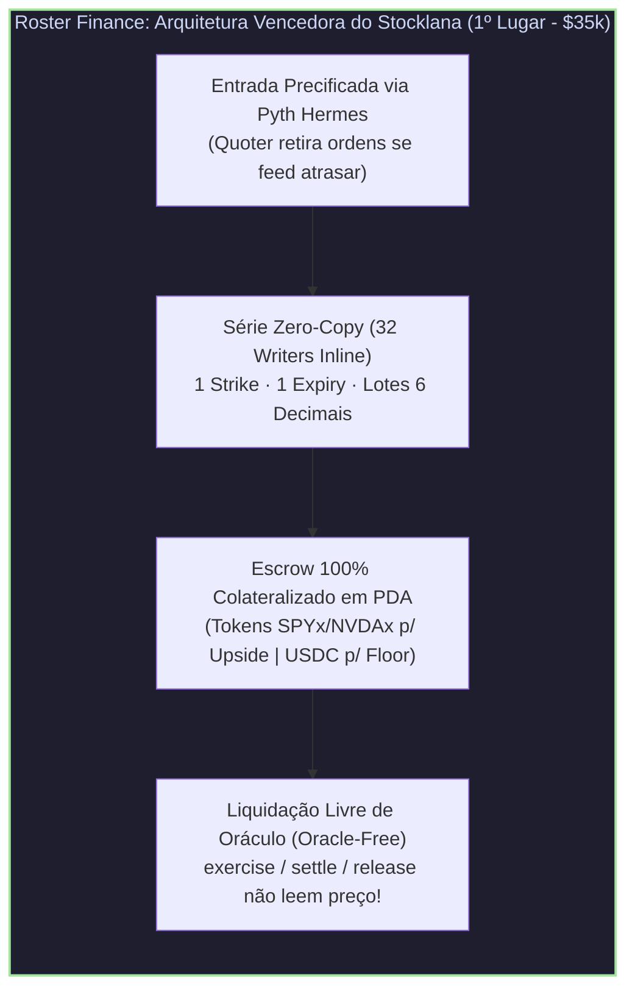
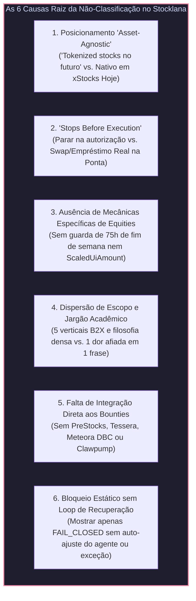
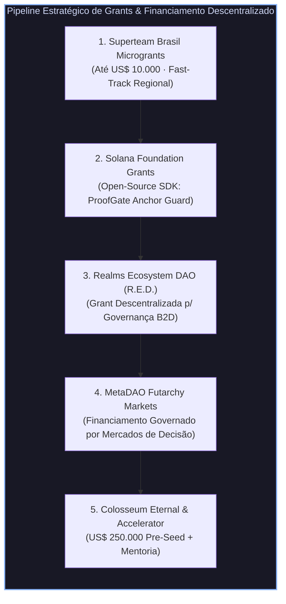

# 🏆 Relatório de Inteligência Competitiva & Post-Mortem Stocklana: Roster Finance, Concorrentes Vencedores e Estratégia para Colosseum & Grants Descentralizadas

> **Análise Conjunta: Antigravity AI & Colosseum Copilot Evidence Engine**  
> **Data da Auditoria**: 27 de Outubro de 2026  
> **Fontes Primárias Verificadas**:
> * Página Oficial de Resultados do Stocklana: [`hackathons.solana.com/hackathons/stocklana`](https://hackathons.solana.com/hackathons/stocklana) *(1.182 registrados, 604 submissões, US$ 126.000 em prêmios)*
> * Aplicação e Documentação Ao Vivo do 1º Colocado: [`roster.finance`](https://www.roster.finance/), [`roster.finance/risk`](https://www.roster.finance/risk), [`roster.finance/markets`](https://www.roster.finance/markets) e [`roster.finance/roster`](https://www.roster.finance/roster)
> * Submissões Vencedoras no Stocklana: [Roster Finance](https://hackathons.solana.com/hackathons/stocklana/projects/a3436f56-dc4f-4454-9405-533b48823a52) (1º Lugar), [Draw](https://hackathons.solana.com/hackathons/stocklana/projects/c77711e0-36b5-4f29-8927-683e06c91f53) (2º Lugar), [Neo](https://hackathons.solana.com/hackathons/stocklana/projects/018d4a14-6216-4b33-9c76-f903c6d0eee6) (3º Lugar), [CRESCO](https://hackathons.solana.com/hackathons/stocklana/projects/2a02ceaa-17c7-45fa-a5a7-cfa6cd88b1c8) (4º Lugar / Tier $15k), [Xorr Finance](https://hackathons.solana.com/hackathons/stocklana/projects/743b365c-56a1-47d2-b27d-bd9aa5837018) (5º Lugar / Tier $15k), [Afterhours](https://hackathons.solana.com/hackathons/stocklana/projects/ebdcf694-5588-4b54-a52f-fb23426db85a) (Vencedor Clawpump $5k) e [Tearsheet](https://hackathons.solana.com/hackathons/stocklana/projects/743b98c8-ef22-4b74-acf8-5dab064ae159) (Vencedor Tessera $6k)
> * Base de Evidências Colosseum Copilot (`/api/v2`): Registro oficial do [ValueCurator](https://colosseum.com/arena/projects/value-curator) e precedentes vencedores [Autonom](https://colosseum.com/projects/explore/autonom-unleashing-rwas-in-solana), [Mercantill](https://colosseum.com/projects/explore/mercantill), [Sudont](https://colosseum.com/projects/explore/sudont), [Senthos](https://colosseum.com/projects/explore/senthos), [Clawpump](https://colosseum.com/projects/explore/clawpump) e [Latinum Agentic Commerce](https://colosseum.com/projects/explore/latinum-agentic-commerce)

---

## 📑 Sumário Executivo

* 🥇 **§1. Radiografia Completa do Vencedor: O Que é o Roster Finance (`roster.finance`) e Por Que Ganhou o 1º Lugar ($35.000)**
* 🪞 **§2. O Choque de Realidade no Stocklana: Três Projetos Vencedores Construíram a Mesma Tese do ProofGate / ValueCurator**
* 🔍 **§3. Diagnóstico Cirúrgico (Antigravity + Colosseum Copilot): As 6 Causas da Nossa Não-Classificação no Stocklana**
* 📊 **§4. Matriz Comparativa Direta: ValueCurator / ProofGate vs. Vencedores do Stocklana & Colosseum**
* 🛠️ **§5. Guia de Boas Práticas e Engenharia de Produto para o Hackathon Colosseum e Próximos Eventos**
* 💰 **§6. Estratégia de Captação de Grants: Fundações e Grants Descentralizadas (Superteam, Solana Foundation, Realms R.E.D. e MetaDAO Futarchy)**

---

## 🥇 §1. Radiografia Completa do Vencedor: O Que é o Roster Finance (`roster.finance`) e Por Que Ganhou o 1º Lugar ($35.000)

O [**Roster Finance**](https://www.roster.finance/) ([submissão oficial no Stocklana](https://hackathons.solana.com/hackathons/stocklana/projects/a3436f56-dc4f-4454-9405-533b48823a52)) conquistou o **1º Lugar Geral ($35.000)** entre 604 projetos submetidos no hackathon Stocklana da Solana Foundation, além de Menção Honrosa na trilha da PreStocks.

### 1.1. O Insight Financeiro Central: "O Problema das 19% vs. 168 Horas (A Sombra de Sábado às 03h10)"
Em vez de apresentar uma tese genérica sobre DeFi ou IA, o Roster Finance abriu sua página e seu pitch com uma **assimetria estrutural específica das ações tokenizadas**:
* Uma ação norte-americana na NYSE/Nasdaq negocia **32,5 horas por semana** ($\approx 19,3\%$ das 168 horas da semana).
* O seu token correspondente na Solana (`NVDAx`, `TSLAx`, `SPYx`) negocia **168 horas por semana**.
* Existem **75 horas contínuas** entre o fechamento de sexta-feira (16h00 NY) e a abertura de segunda-feira (09h30 NY) em que **a ação subjacente não tem preço de bolsa** e o livro de ofertas do token on-chain fica raso.
* Ao mesmo tempo, dados da CoinGecko (Setembro de 2026) citados pelo projeto mostram que contratos perpétuos (*perps*) sobre ações tokenizadas movimentaram **US$ 376,3 bilhões contra US$ 7,5 bilhões no mercado à vista (spot)** — uma razão de $\approx 50:1$ provando que a demanda real do mercado é por **alavancagem**.
* **A Dor Letal**: Quem abre uma posição alavancada em 10x num *perp* (ex: Hyperliquid, Wasabi) ou num loop de empréstimo (ex: Kamino, Loopscale) na sexta-feira fica exposto a um *mark price* derivado de um livro raso no fim de semana. Uma única venda que cause uma agulhada (*wick*) de $-11\%$ às 03h10 da madrugada de sábado liquida 100% da margem do trader (ex: perde US$ 758 de margem em 10 `SPYx`), mesmo que na segunda-feira às 09h30 a bolsa abra em alta a US$ 803,15.

### 1.2. Os 4 Produtos Empacotados em Uma Única Promessa ("Stock Leverage Without Margin Liquidation")
Mecanicamente, o Roster Finance construiu um protocolo de **opções americanas 100% colateralizadas e liquidadas fisicamente no próprio token da ação** (`xStocks` e tokens pré-IPO da `PreStocks`). Porém, na interface de usuário, **eles aboliram completamente o jargão de opções** (sem cadeias de strikes intermináveis, sem gregas $\Delta, \Gamma, \Theta, \mathcal{V}$):

1. **Upside (ou Gap)**: Compra de uma *Call*. Alavancagem na alta de `SPYx`, `NVDAx`, `TSLAx` com perda máxima estritamente limitada ao prêmio pago no clique (ex: US$ 18,43 para controlar 10 `SPYx` até sexta-feira). Sem empréstimo, sem taxa de *funding*, sem chamada de margem e sem preço de liquidação.
2. **Floor**: Compra de uma *Put*. Uma saída garantida e pré-financiada em USDC travado em *escrow* antes do clique, exercível a qualquer momento (inclusive no sábado, quando nenhuma corretora tradicional vende proteção para Nvidia).
3. **Earn (Commit)**: Cofres (*vaults*) de *Covered Call* e *Cash-Secured Put* onde detentores de `NVDAx` ou `USDC` travam colateral para subscrever contratos e receber prêmios semanais — explicitamente declarado como **"risco remunerado (*paid risk*), nunca *yield* mágico"**.
4. **First Print**: Contratos `Upside` e `Floor` sobre ações privadas pré-IPO emitidas pela **PreStocks** (`OPENAI`, `ANTHROPIC`, `SPACEX`, `KALSHI`, `NEURALINK`, `ANDURIL`, `FIGUREAI`, `POLYMARKET`), precificadas pelo preço real negociado on-chain contra a marcação do emissor, exibindo no bilhete a taxa de transferência Token-2022 em números claros.

### 1.3. Cinco Decisões de Engenharia On-Chain que Encantaram os Juízes
Ao inspecionar o código, a submissão técnica e a página [`roster.finance/risk`](https://www.roster.finance/risk), destacam-se cinco escolhas arquiteturais brilhantes:

1. **Liquidação Livre de Oráculo (*Oracle-Free Settlement*)**:
   * O Pyth precifica **apenas a entrada** (quando o usuário compra a opção).
   * As instruções `exercise`, `settle`, `release` e `close_series` são **swaps fixos entre duas contas de custódia (escrows)** do programa: queima o token de posição Token-2022, entrega o USDC do strike e retira o token `xStock` subjacente. **Elas não leem nenhuma conta de oráculo**.
   * Resultado fiduciário: Uma queda do Pyth Hermes ou o fechamento da bolsa no fim de semana pode impedir novas compras, mas **jamais impede um usuário de exercer sua proteção e sair com seu dinheiro**.
2. **Sobrevivência Nativa a Dividendos e Splits sem Oráculo**:
   * Os contratos do Roster guardam quantidades em lotes brutos de 6 casas decimais do token subjacente. Como os `xStocks` processam desdobramentos (*splits*) e dividendos alterando apenas o multiplicador da extensão `ScaledUiAmount` do Token-2022 (sem alterar o saldo bruto da conta), os contratos atravessam eventos corporativos intactos sem depender de recálculo externo.
3. **Tratamento Explícito de Pausas e Congelamentos Regulatórios (`Pause` / `Freeze`)**:
   * Em [`roster.finance/risk`](https://www.roster.finance/risk), a equipe implementou e documentou o que ocorre se o emissor regulado de um `xStock` pausar o *mint*: o exercício aguarda e **o vencimento da série se estende automaticamente por 24 horas após o fim da pausa**, impedindo que uma pausa regulatória roube o tempo do comprador.
4. **Portabilidade Unificada via Surfpool (Fork / Devnet / Mainnet) e Liquidez Real Visível**:
   * Em vez de exibir telas vazias ou dados visivelmente fictícios, o Roster utilizou **Surfpool** (`surfpool.run`) e *bots* de *market making* do próprio tesouro (`AuLv…7EqD`) com **US$ 13.883.721 de profundidade executável em 14 mercados** (sendo US$ 565.000 em USDC e 1.257 `SPYx` reservados em cofres inspecionáveis na página `/roster`). Além disso, qualquer juiz podia explorar cotações reais na tela inicial **sem sequer conectar uma carteira**.
5. **Honestidade Radical ("What is live and what is not")**:
   * Na página `/risk`, há uma seção explícita declarando o que estava funcionando no cluster atual (`Upside`, `Floor`, `Earn`, exercício físico, 14 mercados) e o que ainda **não** estava ativo (`Protected Buy`, que exige rota de swap conjunta no cluster). Juízes de hackathons da Solana valorizam imensamente a transparência técnica sobre o que é real versus o que é próximo passo.

---

## 🪞 §2. O Choque de Realidade no Stocklana: Três Projetos Vencedores Construíram a Mesma Tese do ProofGate / ValueCurator

O dado mais revelador de toda a nossa investigação na página oficial [`hackathons.solana.com/hackathons/stocklana`](https://hackathons.solana.com/hackathons/stocklana) é que **a tese central do ProofGate / ValueCurator (autorização determinística, mandatos on-chain, guardrails fail-closed e agentes autônomos operando dentro de limites) NÃO perdeu porque o tema era ruim — pelo contrário, TRÊS projetos que venceram prêmios no Stocklana construíram exatamente essa tese!**

Veja quem ganhou no nosso exato espaço de problema:

### 1. [Xorr Finance](https://hackathons.solana.com/hackathons/stocklana/projects/743b365c-56a1-47d2-b27d-bd9aa5837018) — Vencedor Principal (Tier 3º/5º Lugar — US$ 15.000)
* **O que construiu**: *"AI agents that trade tokenized US stocks on Solana for you — each from its own wallet, inside rules you set and an on-chain permission you revoke in one tap. Live on mainnet: xStocks and pre-IPO tokens through Jupiter, guarded by Pyth. It never holds your money."*
* **Como executou a nossa tese**:
  * **Sub-carteiras derivadas por agente**: Cada agente de IA (*Momentum Scout, Yield Keeper, Drawdown Guard, Earnings Desk*) recebe uma conta USDC própria pertencente ao usuário, derivada via `createWithSeed`, e delegação nativa via `SPL ApproveChecked` (limite diário $\times$ dias).
  * **Guarda Fora de Horário (*Off-Hours Guard*) Específica para Ações**: Como o `xStock` opera 24/7 mas a Nasdaq fecha, antes de qualquer entrada de agente fora do pregão, o Xorr lê diretamente da conta Solana do Pyth o feed `Equity.US.*/USD` e compara com o preço da pool DEX — bloqueando a ordem se houver deriva (*drift*).
  * **Multiplicador Token-2022 (`ScaledUiAmount`)**: Calcula P&L lendo o multiplicador real de dividendos e splits do Token-2022.
  * **Execução Real na Mainnet + Kill-Switch em 1 Toque**: Operou **ao vivo na Mainnet** com rotas reais do Jupiter para `xStocks` e da Meteora para tokens pré-IPO da Tessera (`OpenAI`, `SpaceX`, `Kalshi`), com botão de `SPL Revoke` em um clique que funciona mesmo se o servidor deles cair.

### 2. [CRESCO](https://hackathons.solana.com/hackathons/stocklana/projects/2a02ceaa-17c7-45fa-a5a7-cfa6cd88b1c8) — Vencedor Principal (Tier 3º/4º Lugar — US$ 15.000)
* **O que construiu**: *"CRESCO gives young people real financial agency inside family-set boundaries: act freely when an investment fits the Key, get an explainable refusal when it doesn’t, and request more room only at the boundary. Solana enforces that authority where demo capital actually moves."*
* **Como executou a nossa tese**:
  * Chamou o mandato versionado on-chain de **"Key"** e focou em um **segmento de usuário ultra-específico**: famílias e jovens aprendendo a investir em ações (`AAPL`).
  * Adotou literalmente a filosofia **Fail-Closed**: *"Fail closed, not fake success. CRESCO treats negative outcomes as part of the product: `ALLOW · REFUSE · PENDING · UNKNOWN`. The UI is not the guard. The capital path is."*
  * **Roteiro de Demo Impecável em 8 Passos**:
    1. Limite configurado em $10 por ação;
    2. Maya tenta comprar $5 de AAPL $\to$ `ALLOW` (sem precisar pedir ao responsável);
    3. Maya tenta comprar $12 de AAPL $\to$ `REFUSE` (excede a Key);
    4. Maya pede exceção na fronteira;
    5. O responsável aprova uma exceção de uso único para exatos $12;
    6. Maya tenta mudar o pedido aprovado de $12 para $11 $\to$ `REFUSE` (proteção contra mutação de intenção);
    7. Maya restaura os exatos $12 $\to$ `ALLOW` (exceção consumida, mandato base inalterado);
    8. Maya tenta repetir (*replay*) a autorização de $12 $\to$ `REFUSE`.

### 3. [Afterhours](https://hackathons.solana.com/hackathons/stocklana/projects/ebdcf694-5588-4b54-a52f-fb23426db85a) — Vencedor Stocknized Agent on Clawpump (US$ 5.000)
* **O que construiu**: *"Meet Afterhours the first Agentic DAO for tokenized markets on Solana where holders set the mandate, and an autonomous agent puts the treasury to work."*
* **Como executou a nossa tese B2D (Business-to-DAO)**:
  * Conectou governança real no **Realms** (onde detentores de tokens aprovam o mandato: estratégia, ativos, orçamento, duração, venues e limites de risco) a um cofre de estratégia isolado (*isolated strategy vault*) operado por um agente no **Clawpump** usando **Pyth** e **Meteora**.
  * Trouxe **prova histórica real**: mostrou o link de um protótipo anterior que já havia operado cerca de US$ 4.000 de tesouraria real na Robinhood Chain comprando e vendendo AAPL fora do horário de pregão.

---

## 🔍 §3. Diagnóstico Cirúrgico (Antigravity + Colosseum Copilot): As 6 Causas da Nossa Não-Classificação no Stocklana

Cruzando os dados dos vencedores do Stocklana com o registro atual do [**ValueCurator**](https://colosseum.com/arena/projects/value-curator) no Colosseum Copilot (`GET /me`) e com vencedores históricos do Colosseum (como [**Autonom**](https://colosseum.com/projects/explore/autonom-unleashing-rwas-in-solana), [**Mercantill**](https://colosseum.com/projects/explore/mercantill) e [**Sudont**](https://colosseum.com/projects/explore/sudont)), identificamos com precisão cirúrgica os **6 motivos pelos quais o nosso projeto não classificou no Stocklana**:

### ❌ Causa 1: Posicionamento "Asset-Agnostic" onde Ações Tokenizadas Eram Promessa Futura
No registro da nossa submissão (`GET /me` no Colosseum Copilot), escrevemos:
> *"ValueCurator is building asset-agnostic authorization infrastructure for autonomous financial agents on Solana... Future development will expand asset coverage to tokenized stocks and other real-world assets (RWAs)."*

Em um hackathon temático chamado **Stocklana** (*"One week to build something innovative with stocks on Solana"*), dizer que a plataforma é "agnóstica a ativos" e que "no futuro expandirá suporte para ações tokenizadas" desqualifica imediatamente o projeto frente a concorrentes que colocaram `NVDAx`, `SPYx`, `AAPLx`, `OPENAI` e `SPACEX` no centro absoluto da tela desde o segundo zero.

### ❌ Causa 2: "Deliberately Stops Before Mainnet Execution" vs. Caminho de Capital Completo
Na nossa submissão, declaramos honestamente:
> *"The current financial authorization workflow deliberately stops before Mainnet execution."*

Enquanto nós paramos antes da execução final do swap, nossos concorrentes diretos no mesmo tema (**Xorr Finance**, **CRESCO** e **Afterhours**) fecharam o ciclo completo do dinheiro:
* O **Xorr Finance** executou swaps reais de `xStocks` no Jupiter na Mainnet;
* O **Draw** executou as 17 instruções reais da Kamino em um *fork* da Mainnet;
* O **CRESCO** moveu os tokens SPL na mesma instrução Anchor que avaliava o mandato (*"The UI is not the guard. The capital path is"*).

### ❌ Causa 3: Ausência das "Leis da Física" Exclusivas de Ações Tokenizadas
Para um juiz do Stocklana (ou da trilha RWA do Colosseum), uma ação tokenizada **não é apenas um token SPL qualquer com outro ticker**. Ela possui três propriedades técnicas que todo vencedor tratou no código:
1. **Assimetria de Horário de Mercado (32,5h vs. 168h)**: Comparar o feed da ação na bolsa (`Equity.US.AAPL/USD`) com o feed do token (`Crypto.AAPLX/USD`) e proteger contra *gaps* de fim de semana (como fizeram Roster, Draw e Xorr).
2. **Eventos Corporativos via Token-2022 (`ScaledUiAmount`)**: Ler os campos `multiplier` e `newMultiplier` do Token-2022 para splits e dividendos (como fizeram Roster, Xorr, Tearsheet e, no Colosseum Cypherpunk, o vencedor de 1º lugar em RWAs [**Autonom**](https://colosseum.com/projects/explore/autonom-unleashing-rwas-in-solana)).
3. **Autoridades Regulatórias do Emissor (`Pause`, `Freeze`, `PermanentDelegate`, `TransferFee`)**: Verificar na instrução on-chain se o *mint* do `xStock` não está pausado ou sujeito a taxa de transferência embutida (50 bps na PreStocks, 20 bps na Tessera).
Nosso motor tratou `SOL/USDC` com invariantes genéricos ($C_1 \dots C_6$), sem incorporar essas três regras específicas de ações tokenizadas.

### ❌ Causa 4: Dispersão em Múltiplas Teses (B2X) e Sobrecarga Conceitual vs. "Um Produto, Um Benefício"
Compare a abertura dos vencedores com a nossa abordagem:
* **Roster Finance**: *"Stock leverage without margin liquidation. Pay once, pick your expiry, and your maximum loss is the premium."*
* **Draw**: *"Spend your tokenized shares without selling them."*
* **Xorr Finance**: *"AI agents that trade tokenized US stocks on Solana for you — inside rules you set and an on-chain permission you revoke in one tap."*
* **Mercantill** ([4º Lugar Stablecoins no Colosseum Cypherpunk](https://colosseum.com/projects/explore/mercantill)): *"Enterprise banking infrastructure for AI agents. Built on Squads Grid."*

Quando tentamos explicar simultaneamente 5 verticais (B2C Pé-de-meia, B2B Clubes, B2A Middleware, B2D DAOs, B2B2C Neobanks), somadas a conceitos densos (*KAIROS neuro-simbólico, econofísica, geodésia, metacuradoria HaaS*), o juiz — que tem apenas **2 a 3 minutos** para avaliar cada uma das 604 submissões — sofre sobrecarga cognitiva e não consegue resumir em uma frase o que o usuário faz ao clicar no botão.

### ❌ Causa 5: Falta de Alinhamento Tático com os Bounties de Patrocinadores
No Stocklana, além dos US$ 100.000 da trilha principal, havia US$ 26.000 distribuídos entre **PreStocks**, **Tessera**, **Clawpump**, **Meteora DBC** e **Pyth Pro**. Todos os projetos premiados na trilha principal também competiram nos *bounties* integrando as APIs desses patrocinadores (`prestocks.com/api/prestocks`, `rest-api.tessera.pe`, `mcp.pyth.network/mcp`). Isso garantiu que os patrocinadores também avaliassem e defendessem esses projetos na banca.

### ❌ Causa 6: Mostrar Apenas o "Não" (`FAIL_CLOSED`) sem o Ciclo de Resolução Dinâmica
Tanto o [**Sudont**](https://colosseum.com/projects/explore/sudont) (Vencedor do Colosseum Frontier, US$ 10.000) quanto o [**CRESCO**](https://hackathons.solana.com/hackathons/stocklana/projects/2a02ceaa-17c7-45fa-a5a7-cfa6cd88b1c8) (4º Lugar no Stocklana, US$ 15.000) provaram que mostrar uma transação bloqueada é metade da história; **o que encanta o juiz é o que acontece 1 segundo depois do bloqueio**:
* No **Sudont**, quando a política nega a transação (`SUDONT_POLICY_DENY`), o agente de IA lê o erro em um loop ReAct, **reduz automaticamente o valor da ordem para caber no limite da política e reenvia a transação, que então é aprovada on-chain sem intervenção humana!**
* No **CRESCO**, quando o gasto de US$ 12 é recusado pelo limite de US$ 10, o sistema abre o fluxo de **exceção de uso único vinculada a nonce**, provando que se o jovem tentar alterar US$ 12 para US$ 11 ou fazer *replay*, o programa Rust recusa na hora.

---

## 📊 §4. Matriz Comparativa Direta: ValueCurator / ProofGate vs. Vencedores do Stocklana & Colosseum

| Dimensão de Avaliação | Roster Finance (1º Stocklana - $35k) | Xorr Finance (5º Stocklana - $15k) | CRESCO (4º Stocklana - $15k) | Sudont (Vencedor Frontier - $10k) | ValueCurator / ProofGate (Estado Atual) |
| :--- | :--- | :--- | :--- | :--- | :--- |
| **Gancho em 1 Frase** | Alavancagem em ações sem liquidação de margem | Agentes de IA que operam xStocks na sua carteira com revogação em 1 toque | Agência financeira para jovens dentro de limites familiares on-chain | Firewall de execução bare-metal e sidecar RPC local para Solana | Camada de autorização baseada em evidências para finanças autônomas |
| **Ativos Demonstrados** | 14 mercados reais (`SPYx`, `NVDAx`, `OPENAI`, `SPACEX`) | `xStocks` via Jupiter + Pre-IPO Tessera via Meteora | Ações dos EUA (`AAPL`) com verificação Pyth | Swaps AMM na Solana Mainnet / LiteSVM | `SOL/USDC` genérico (xStocks citado como futuro) |
| **Física Específica de RWA/Ações** | Liquidação sem oráculo + lotes imunes a splits Token-2022 | Guarda de fim de semana (`Equity.US` vs pool) + `ScaledUiAmount` | Verificação de valor nocional USD via Pyth assinado | Simulação de state-diff inline + Monte Carlo < 10ms | 6 invariantes gerais ($C_1 \dots C_6$), sem `ScaledUiAmount` ou guarda de pregão |
| **Execução do Capital** | 100% executável no cluster (Surfpool/Devnet) com $13,8M em reservas | **Mainnet ao vivo** via `SPL ApproveChecked` + `createWithSeed` | Move tokens SPL reais de demo dentro da mesma instrução Anchor | Bloqueia trojans e reexecuta ordens ajustadas pelo agente | Para deliberadamente antes da execução do swap na Mainnet |
| **Fricção para o Juiz Testar** | **Zero** (abre cotações reais sem conectar carteira) | Login social via Privy ou carteira Solana | Fluxo guiado canônico da personagem Maya ($5 vs $12) | Terminal CLI ao vivo com telemetria p50-p99 | Dashboard público sem login, mas sem liquidação final de RWA |

---

## 🛠️ §5. Guia de Boas Práticas e Engenharia de Produto para o Hackathon Colosseum e Próximos Eventos

Como lembra a FAQ oficial de julgamento do Colosseum (`GET /faqs?program=hackathon&q=judged` — [`colosseum.com/hackathon#h-faq-12`](https://colosseum.com/hackathon#h-faq-12)):
> *"First and foremost, Colosseum hackathons are startup competitions. Every submission is reviewed against: Founder + Market Fit, Insight, Product + Execution, Potential Market Size, Founder Communication, Viability, and Traction."*

Para transformar o **ValueCurator / ProofGate** em um forte candidato no Colosseum (**Crypto World's Fair**, **Eternal** e **Accelerator**) e no **Darwin ICM**, recomendamos **7 ações imediatas de alto impacto**:

### 1. Adote o Loop ReAct de Auto-Correção do Agente ("Fail-Closed $\to$ Self-Heal $\to$ Approved")
* Em vez de encerrar a demonstração quando o ProofGate bloqueia a intenção (`RUN_002: FAIL_CLOSED` porque o agente pediu US$ 80.000 acima do teto de US$ 25.000 e 20% de slippage), adicione **o passo seguinte automático**:
  1. O agente recebe o erro estruturado do ProofGate (`ERR_C1_VOLUME_EXCEEDED: max=25000, requested=80000; ERR_C6_SLIPPAGE_EXCEEDED: max=5%, requested=20%`);
  2. O agente recalcula sua intenção automaticamente para respeitar o mandato ($V_{\text{in}} = \$25.000$, $s_{\text{tol}} = 4,5\%$);
  3. O agente reenvia a transação corrigida e o programa Anchor **aprova e liquida a operação on-chain**!
* Isso transforma o ProofGate de um "bloqueador passivo" em um **governador cibernético ativo** (como o vencedor **Sudont** fez no Frontier).

### 2. Incorpore os 3 Invariantes Específicos de Ações Tokenizadas (`C7`, `C8`, `C9`) para a Trilha RWA
Como o ValueCurator foi submetido na categoria **Real World Assets (RWA)** do Crypto World's Fair (`GET /me`), adicione ao nosso motor de invariantes as três travas que os juízes de RWA procuram:
* **$C_7$ (Off-Hours Basis Guard)**: Quando o mercado subjacente da NYSE/Nasdaq estiver fechado (fins de semana e noites), compare a última cotação `Equity.US.<TICKER>/USD` do Pyth com o preço do token `Crypto.<TICKER>X/USD` e reduza automaticamente o limite de exposição se o *basis spread* exceder $\delta_{\text{weekend}}$.
* **$C_8$ (Token-2022 Corporate Action & Multiplier Check)**: Leia a extensão `ScaledUiAmount` (`multiplier` / `newMultiplier`) diretamente da conta do *mint* Token-2022 antes de calcular limites nocionais, evitando falsos bloqueios após *splits* de ações (ex: split de 5x da SpaceX ou dividendos de `SPYx`).
* **$C_9$ (Issuer Authority & Pause/TransferFee Check)**: Verifique se o *mint* Token-2022 não está com a flag `Paused` armada e desconte a `TransferFee` embutida no *mint* ao validar o recebimento mínimo do swap.

### 3. Use Surfpool (`surfpool.run`) + Devnet Vault para Execução 100% Real sem Custo de Mainnet
* Tanto o **Roster Finance** (1º lugar) quanto o **Draw** (2º lugar) usaram **forks determinísticos da Mainnet (Surfpool)** combinados com Devnet para executar transações reais contra contratos existentes (`xStocks`, `Kamino`, `Jupiter`) sem gastar milhares de dólares em liquidez na Mainnet.
* Ao combinar nosso **Synthetic Peer-to-Pool Vault na Devnet** com suporte a **Surfpool Mainnet Fork**, nenhuma página ou texto precisará dizer *"deliberately stops before execution"* — o caminho do capital vai até o fim, gerando assinatura verificável!

### 4. Escolha UMA Persona de Usuário Principal por Submissão ("Corte o Ruído B2X na Porta de Entrada")
* Na biblioteca do Colosseum Copilot, projetos vencedores nunca dizem que atendem simultaneamente varejo, fundos, DAOs, neobancos e desenvolvedores de agentes no mesmo parágrafo.
* **Regra prática para comunicação**:
  * Escolha **1 cliente-alvo primário** na abertura (ex: **Gestores de Tesouraria e Fundos On-Chain que delegam execução a agentes de IA**) e apresente os demais apenas como expansão futura de mercado (TAM).
  * Substitua termos acadêmicos abstratos na página inicial por **números financeiros auditáveis logo na primeira dobra da tela** (ex: *"US$ 185.000 em capital protegido contra oráculos defasados e pools rasas em 54 testes formais de invariantes"*).

### 5. Elimine a Fricção de Carteira e Crie um "Modo Interativo de 30 Segundos" na Home
* Olhe para [`roster.finance`](https://www.roster.finance/) e [`cresco-lac.vercel.app`](https://cresco-lac.vercel.app/): o juiz abre o site e, **sem precisar instalar carteira, criar conta ou pedir SOL em faucet**, já consegue arrastar um controle deslizante ou clicar em 3 botões de cenário (`1. Trade Normal $15k [ALLOW]`, `2. Ataque Oráculo Defasado 135s [FAIL-CLOSED]`, `3. Auto-Correção do Agente [HEALED & EXECUTED]`) que disparam transações reais via carteira de demonstração pré-financiada (*burner/fee-payer wallet* no servidor ou Devnet)!

### 6. Construa Validação Comercial Assinada (Mesmo em Estágio Pré-Receita)
* Lembre-se do caso do [**Autonom**](https://colosseum.com/projects/explore/autonom-unleashing-rwas-in-solana) (1º Lugar RWAs no Cypherpunk, US$ 25.000 — dados do Colosseum Copilot): o produto estava em *testnet* na Solana, mas eles fecharam uma parceria/proposta concreta com a DEX perpétua **Adrena** prevendo 10% de participação nas taxas de uma pool de ações MAG-7.
* **Ação prática**: Converse com 2 ou 3 projetos do próprio ecossistema (ex: clubes de investimento da Superteam Brasil, protocolos de agentes como Clawpump, ou gestores locais) para obter **Cartas de Intenção de Piloto (LOIs)** ou integrações de teste reais e publique isso nos *Build Logs / Updates* da Arena!

### 7. Higienize a Lista de Tecnologias e Segredos de Submissão
* Em `GET /me`, nossa lista de tecnologias cita 12 itens (`Solana, Anchor, Rust, Token-2022, PDAs, TypeScript, Next.js, Pyth Pro, Jupiter, Ed25519 signatures, SHA-256, Solana RPC, and wallet integrations`). Nas próximas submissões e entrevistas, concentre o destaque técnico nos **4 a 5 componentes diferenciais de engenharia**: `Solana (Anchor/Rust)`, `Token-2022`, `Pyth Hermes` e `Jupiter CPI`.

---

## 💰 §6. Estratégia de Captação de Grants: Fundações e Grants Descentralizadas

Mesmo quando um projeto não vence um hackathon específico de 1 semana como o Stocklana, o código, a prova formal (PoC) e o MVP construídos são ativos valiosíssimos para captar **financiamento não-dilutivo (Grants)** — especialmente porque muitas bancas de grants financiam **infraestrutura de segurança e bens públicos (*public goods*)**, exatamente onde o ProofGate brilha!

Abaixo está o mapa completo das **5 melhores rotas de Grants (incluindo Grants Descentralizadas On-Chain)** para o ValueCurator / ProofGate:

### 1. 🇧🇷 Superteam Brasil Microgrants & Superteam Earn (Até US$ 10.000)
* **Por que temos vantagem imediata**: No registro oficial do Colosseum (`GET /me`), vocês já estão vinculados ao ecossistema da **Superteam Brasil** (`supportedBy: ["Superteam"], programDetail: "Superteam Brasil"`).
* **Como funciona**: Os capítulos regionais da Superteam operam programas de *microgrants* (tipicamente de US$ 1.000 a US$ 10.000) respaldados pela Solana Foundation para apoiar fundadores locais que continuam construindo após hackathons.
* **Estratégia de Aplicação**:
  * Não peça grant para "construir uma empresa genérica". Peça um **Milestone-Based Grant de US$ 5.000 a US$ 10.000** com 3 entregas claras em 6 semanas:
    * *Milestone 1*: Publicar o pacote open-source `@valuecurator/proofgate-sdk` (TypeScript + Rust Anchor CPI crate) para que qualquer desenvolvedor da Superteam Brasil possa plugar os invariantes $C_1 \dots C_9$ em seus agentes de IA em 10 linhas de código;
    * *Milestone 2*: Integrar o módulo de ações tokenizadas (`xStocks` / `Token-2022 ScaledUiAmount`) em Devnet/Surfpool;
    * *Milestone 3*: Rodar 3 pilotos documentados com equipes brasileiras de DeFi/Agentes.

### 2. 🌐 Solana Foundation Milestone Grants (Bens Públicos & Tooling Open-Source)
* **Foco da Fundação**: A Solana Foundation prioriza **bens públicos open-source (*public goods*)**, infraestrutura de segurança, ferramentas para desenvolvedores e padrões que beneficiem todo o ecossistema Solana (`solana.org/grants`).
* **Como posicionar o ProofGate**:
  * Em hackathons, "infraestrutura pura" às vezes perde para apps de consumidor chamativos. **Nas Grants da Solana Foundation, a lógica se inverte**: eles financiam exatamente bibliotecas open-source que evitam que agentes de IA percam fundos de usuários!
  * Separe o projeto em duas camadas claras:
    1. **Camada Pública Open-Source (Alvo da Grant)**: O **ProofGate Deterministic Invariant Engine & Formal Verification Bench** (licença MIT/Apache 2.0), um padrão aberto de segurança fiduciária para carteiras de agentes na Solana.
    2. **Camada Comercial (ValueCurator SaaS / B2B)**: O painel corporativo, curadoria de mandatos e auditoria institucional.

### 3. 🏛️ Realms Ecosystem DAO — R.E.D. (Grant 100% Descentralizada via DAO)
* **O que é**: Após o spin-off do Realms (`SPL Governance`) para a entidade independente *Realms Today Trust*, foi criado o **Realms Ecosystem DAO (R.E.D.)**, um programa de grants **totalmente descentralizado e votado on-chain pela comunidade** para financiar ferramentas que fortaleçam tesourarias de DAOs na Solana.
* **O Encaixe Perfeito com a nossa Tese B2D (`EMPIRICAL_INVESTMENT_THESIS_B2D_DEFAI_HAH_DAO_STEWARDS.md`)**:
  * Veja o que o projeto **Afterhours** fez no Stocklana: usou o **Realms** para aprovar um mandato de tesouraria e delegou um cofre isolado para um agente operar.
  * Podemos submeter uma proposta de Grant Descentralizada ao **Realms Ecosystem DAO** propondo um **Plugin / Adaptador Oficial `Realms-ProofGate Guard`**: quando uma DAO no Realms aprova uma proposta de alocação de tesouraria para um agente autônomo ou *steward*, o cofre é protegido on-chain pelos 6 invariantes determinísticos do ProofGate, impedindo drenagem de tesouraria por flash-loans ou oráculos manipulados!
  * Como a nossa tese B2D já elimina a necessidade de lobby subjetivo através de verificação matemática (*algorithm as policy*), os próprios membros do Realms DAO verão valor imediato na ferramenta.

### 4. 📈 MetaDAO & Financiamento por Futarquia (*Decision Markets* na Solana)
* **O que é**: A **MetaDAO** é o protocolo pioneiro de governança e alocação de capital por **futarquia** (*"Vote on values, bet on beliefs"*) na Solana. Em vez de comitês políticos votarem em quem recebe recursos, o mercado abre dois livros condicionais (`Pass` vs. `Fail`): se os traders precificarem que a aprovação da proposta aumentará o valor do ecossistema, a proposta passa automaticamente por consenso de mercado.
* **Por que o ProofGate é ideal para o ecossistema de Futarquia / ICM (Darwin & MetaDAO)**:
  * Na futarquia e nos *Iterated Capital Markets (ICM)*, o maior risco após uma proposta passar é a **execução infiel ou desastrosa** do capital liberado.
  * O ProofGate atua como o **Executor Fiduciário Pós-Futarquia**: o mercado de decisão aprova a tese macro, e o ProofGate garante matematicamente (com prova formal indutiva e *Fail-Closed*) que cada centavo liberado só pode ser executado se os invariantes de liquidez, oráculo e slippage forem respeitados.
  * Além disso, a nossa **Prova de Conceito Formal (PoC)** e a planilha de simulação de 11 abas fornecem exatamente os dados quantitativos que *traders* de mercados de decisão exigem para precificar uma proposta favoravelmente.

### 5. 🚀 Colosseum Eternal & Accelerator (US$ 250.000 Pre-Seed)
* **Como funciona**: Além dos hackathons periódicos (como o Crypto World's Fair), o Colosseum opera o programa contínuo **Eternal** (para fundadores que constroem fora das janelas de hackathon ou evoluem seus produtos após uma edição).
* Os melhores projetos dos hackathons e do Eternal são entrevistados em chamadas de 15 minutos no Zoom (`GET /faqs?program=hackathon&q=judged`) para ingresso no **Colosseum Accelerator**, que investe **US$ 250.000** em troca de participação padrão e conecta os fundadores diretamente aos maiores fundos de Venture Capital do ecossistema Solana.
* **O que prepara você para os 15 minutos de entrevista do Colosseum**:
  1. Ter o caminho ponta a ponta rodando sem falhas na tela;
  2. Saber responder em 1 frase por que o produto precisa da Solana (velocidade sub-segundo do Pyth Hermes, extensões Token-2022 e custo de 5.000 lamports por verificação de invariante);
  3. Mostrar as métricas reais da nossa Bancada Formal de Testes (US$ 185.000 protegidos na simulação, 54 asserções formais provadas sem falhas) somadas às primeiras conversas reais com usuários.

---

## ✅ Checklist Prático de Ação Imediata (Próximos 7 Dias)

1. **No Repositório e Demo (`valuecurator`)**:
   - [ ] Adicionar o **Loop de Auto-Correção do Agente (Self-Healing ReAct Loop)**: quando o ProofGate rejeitar uma ordem por violar $C_1$ (volume) ou $C_6$ (slippage), fazer o agente ajustar os parâmetros automaticamente e executar a ordem corrigida em seguida.
   - [ ] Adicionar os invariantes específicos de ações tokenizadas: **Guarda de Fim de Semana (`Equity.US` vs `Crypto.xStock`)** e leitura do multiplicador **`Token-2022 ScaledUiAmount`**.
   - [ ] Configurar botão de **"1-Click Judge Demo"** na página inicial (sem exigir que o juiz conecte carteira ou tenha SOL na Devnet para ver uma transação real ser assinada e validada).
2. **Nas Submissões de Grants**:
   - [ ] Empacotar o verificador de invariantes como biblioteca open-source (`@valuecurator/proofgate-sdk`) para submeter ao **Superteam Brasil Microgrant** e ao **Solana Foundation Grants**.
   - [ ] Preparar a proposta de integração **`Realms + ProofGate DAO Treasury Guard`** para o **Realms Ecosystem DAO (R.E.D.)**.
