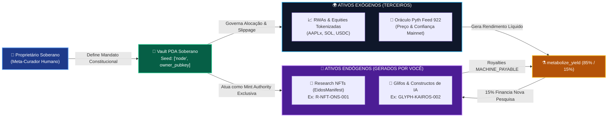
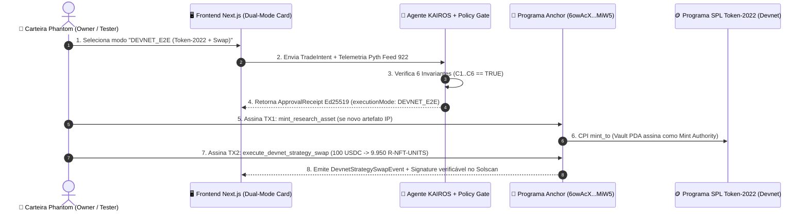
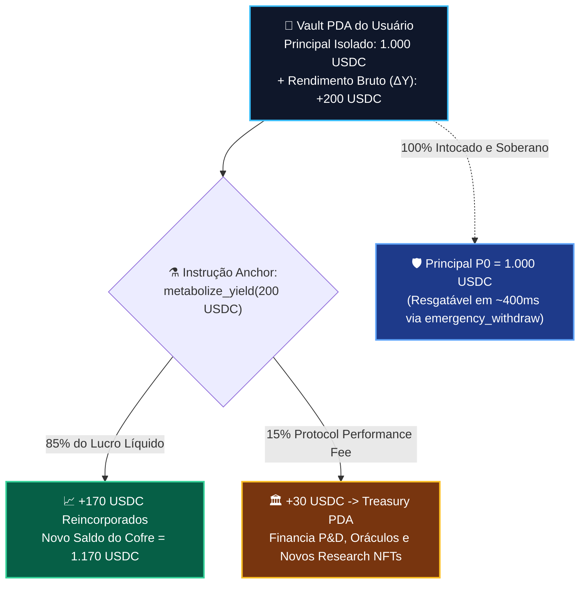
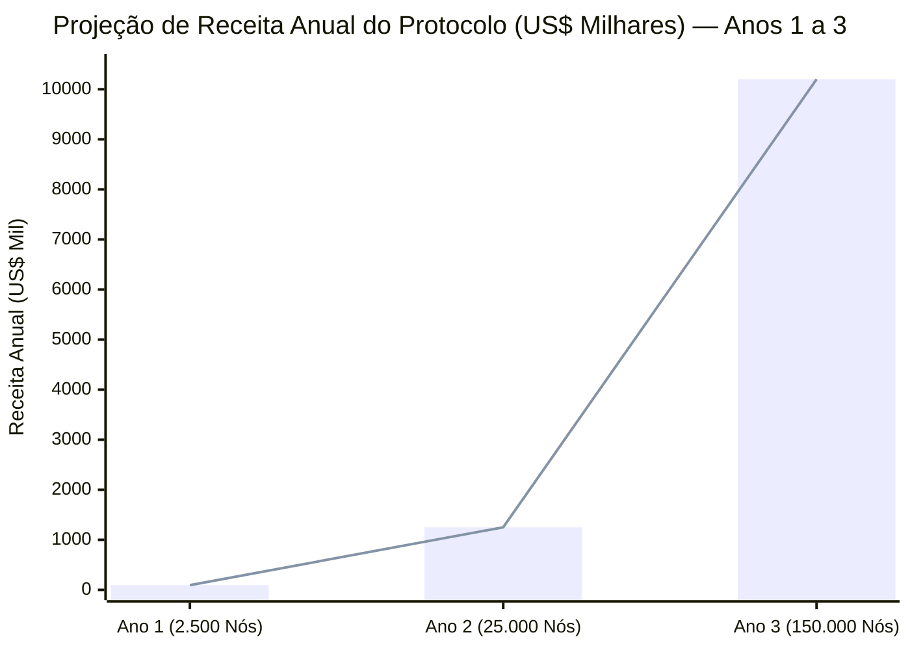
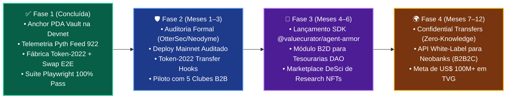

# 🏛️ ValueCurator × Compilatorum — Pitch Deck Institucional Completo (Edição Expandida v2.0)

> **Governança Soberana de Capital, Armadura Neuro-Simbólica para Agentes de IA, Emissão Soberana SPL Token-2022 & Liquidação Determinística E2E na Solana**  
> **Track**: Autonomous Software & AI / Agent Control Plane / Sovereign DeFi & DeSci Infrastructure  
> **Founding Team**: Sandra Pereira (*Core Solana Systems Engineering*) & João Nitsche (*Epistemic Systems & Quantamental Architecture*)  
> **Repositórios**: [`smp-sandramariapereira/valuecurator`](https://github.com/smp-sandramariapereira/valuecurator) (`branch: feat/devnet-e2e-tokenization-protocol`) • [`compilatorum/vc`](https://github.com/compilatorum/vc)  
> **On-Chain Program ID (Devnet)**: [`6owAcXQjGg6d5p1n2D5gK8mKkG9uH9sE1kL2mP3rMiW5`](https://explorer.solana.com/address/6owAcXQjGg6d5p1n2D5gK8mKkG9uH9sE1kL2mP3rMiW5?cluster=devnet)  
> **Mint Experimental Token-2022 (`R-NFT-ONS-001`)**: [`EAP343292JM934s6B3C736cT2U2tA357tC4J7gX3nN8x`](https://solscan.io/token/EAP343292JM934s6B3C736cT2U2tA357tC4J7gX3nN8x?cluster=devnet)

---

## 🗺️ Índice Executivo Master (16 Slides + Formalismo Epistêmico)

| Slide | Título Executivo | Módulo / Pilar |
| :--- | :--- | :--- |
| **Slide 00** | **Filosofemas Fundamentais & Álgebra Fiduciária Expandida ($\mathcal{VC}_{\text{v2}}$)** | Fundamentos Epistêmicos |
| **Slide 01** | **Capa Institucional & Tese Soberana: Custódia de Segunda Ordem na Solana** | Visão & Posicionamento |
| **Slide 02** | **O Problema Duplo: A Armadilha da Chave Crua & O Gargalo *Split-Cluster*** | Diagnóstico de Risco |
| **Slide 03** | **A Gênese do "ValueCurator": Meta-Curadoria de Ativos Exógenos e Endógenos** | Cibernética de 2ª Ordem |
| **Slide 04** | **Arquitetura Neuro-Simbólica & Os 6 Invariantes Determinísticos ($\bigwedge_{k=1}^6 \mathcal{C}_k$)** | Portão *Fail-Closed* |
| **Slide 05** | **Novo Motor Dual-Mode: `APPROVAL_ONLY` $\oplus$ `DEVNET_E2E` (Ponta-a-Ponta)** | Nova Feature v2.0 |
| **Slide 06** | **Fábrica Soberana de Ativos Próprios (`SPL Token-2022` + `EidosManifest v1.0`)** | Nova Feature v2.0 |
| **Slide 07** | **Matemática do Swap Determinístico Protegido (`execute_devnet_strategy_swap`)** | Nova Feature v2.0 |
| **Slide 08** | **Sistema Circulatório: `Treasury PDA` & `metabolize_yield` (Split 85% / 15%)** | Economia Regenerativa |
| **Slide 09** | **IA Quantamental & Econofísica PIML em Graph Neural Networks (GNNs)** | Deep Tech & Oráculos |
| **Slide 10** | **Oportunidade de Mercado Multilateral B2X + DeSci ($4,8T+ TAM)** | Mercado & Verticais |
| **Slide 11** | **Modelo de Negócios Tri-Engine & Unit Economics (SaaS + Yield + Royalties IP)** | Monetização & LTV/CAC |
| **Slide 12** | **Design do Protocolo Experimental: Carteira Owner vs. Carteira Cliente Testador** | Metodologia Científica |
| **Slide 13** | **Prova Visual E2E (Parte 1: `EXP-01` a `EXP-06` — Mandato & Defesa *Fail-Closed*)** | Evidência Playwright |
| **Slide 14** | **Prova Visual E2E (Parte 2: `EXP-07` a `EXP-12` — Swap, Yield 85/15 & Solscan)** | Evidência Playwright |
| **Slide 15** | **Panorama Competitivo & Raio-X Full-Stack (`feat/devnet-e2e-tokenization-protocol`)** | Engenharia & Moat |
| **Slide 16** | **Equipe Fundadora, Roadmap 2026 & *The Ask* ($250K Colosseum Accelerator)** | Investimento & Fechamento |

---

### 🧬 §0. Filosofemas Fundamentais & Álgebra Fiduciária Expandida ($\mathcal{VC}_{\text{v2}}$)

* 🜁 **1. Filosofema da Soberania sobre o Capital (*Sovereignty vs. Agency*)**:
  > *«Autonomia operacional não implica soberania sobre o capital. Modelos probabilísticos são extraordinários em encontrar padrões latentes em tensores de mercado, mas são ontologicamente incapazes de honrar deveres fiduciários. A inteligência propõe; a evidência matemática comprova; a política determinística autoriza; o proprietário governa a custódia.»*
* 🜂 **2. Filosofema da Ausência de Ruína (*Absence of Existential Ruin*)**:
  > *«No mercado financeiro, a probabilidade de falência de um operador probabilístico desprovido de invariantes aproxima-se de 1 no infinito: $\lim_{t \to \infty} \mathbb{P}_{\text{ruin}}(t) = 1$. O ValueCurator garante que nenhum cisne negro oracular ou alucinação neural drene o principal além do mandato constitucional.»*
* 🜃 **3. Filosofema da Meta-Curadoria (*Second-Order Cybernetics*)**:
  > *«O investidor humano soberano não compete em microssegundos contra autômatos estocásticos: ele governa as regras constitucionais do sistema que governa o seu capital.»*
* 🜄 **4. Filosofema do Ciclo Produtivo Epistêmico (*Work → Asset → Capital → More Work*)**:
  > *«O conhecimento científico e o código não devem permanecer como artefatos passivos fora do balanço. Através do manifesto criptográfico `EidosManifest v1.0` e da cunhagem soberana via `SPL Token-2022`, cada constructo intelectual torna-se um ativo governado que gera liquidez e retroalimenta a Tesouraria de Pesquisa.»*

#### 🔣 Álgebra Fiduciária Expandida de Sete Componentes ($\mathcal{VC}_{\text{v2}}$)

$$\mathcal{VC}_{\text{v2}} = \big\langle \mathcal{M}_{\text{mandate}}, \, \mathcal{E}_{\text{pyth}}(t), \, \mathcal{G}_{\text{gate}}, \, \Pi_{\text{auth}}, \, \mathcal{C}_{\text{pda}}, \, \mathcal{T}_{2022}, \, \Omega_{\text{settlement}} \big\rangle$$

$$\begin{cases}
\mathcal{M}_{\text{mandate}} & = \big\{ \mathcal{A}_{\text{allow}}, \, \lambda_{\text{trade}}^{\max}, \, \lambda_{\text{daily}}^{\max}, \, \tau_{\text{age}}^{\max} \le 300\text{ s}, \, \sigma_{\text{conf}}^{\max} \le 1.000\text{ bps}, \, \Delta_{\text{dev}}^{\max} \le 2.000\text{ bps} \big\} \\
\mathcal{G}_{\text{gate}}(\mathcal{M}, \mathcal{E}, \theta) & \vdash \mathbf{APPROVED}(\Pi_{\text{auth}}) \iff \bigwedge_{k=1}^6 \mathcal{C}_k \equiv \mathbf{true} \quad \text{senão } \mathbf{FAIL\_CLOSED} \\
\Pi_{\text{auth}} & = \operatorname{Sign}_{\text{Ed25519}}^{sk_{\text{policy}}}\Big(\mathcal{H}_{\text{SHA-256}}\big(\theta_{\text{intent}} \parallel \mathcal{E}_{\text{pyth}}(t) \parallel \text{Mode} \parallel \text{Timestamp}\big)\Big) \\
\mathcal{T}_{2022}(\text{CID}_{\text{Eidos}}) & = \operatorname{CPI}_{\text{Token2022}}^{\text{signer}=\mathcal{C}_{\text{pda}}}\big(\mathtt{mint\_research\_asset}(10^0, \text{ATA}_{\text{owner}})\big) \\
\Omega_{\text{settlement}} & = \mathtt{execute\_devnet\_strategy\_swap}\big(\Delta x, \, y_{\text{out}} \ge y_{\min}\big) \circ \mathtt{metabolize\_yield}\big(0{,}85\,\Delta Y \oplus 0{,}15\,\Delta Y_{\text{Treasury}}\big)
\end{cases}$$

---

## 🎴 Slide 01 — Capa Institucional & Tese Soberana: Custódia de Segunda Ordem na Solana

### 📌 Identificação Executiva
* **Projeto**: **ValueCurator × Compilatorum**
* **Subtítulo**: *Governança Soberana de Capital, Armadura Neuro-Simbólica para IA & Fábrica de Ativos Programáticos (`SPL Token-2022`) na Solana*
* **Tese Financeira em 35 Palavras**:
  > **"O ValueCurator transforma capital on-chain vulnerável e propriedade intelectual científica em cofres matematicamente governados: agentes de IA propõem estratégias, mas nenhum centavo ou token se move sem prova oracular Pyth em tempo real e validação determinística na Solana."**

### 🧒 Explicação ELI5 (*Como se eu tivesse 5 anos*)
> 🧸 **Imagine um carro autônomo superveloz (a IA) dirigindo o seu cofre de moedas e de invenções científicas:**
> Em vez de deixar o robô dirigir sem freios perto de um penhasco, o **ValueCurator** constrói **muros de proteção físicos na pista (o Smart Contract na Solana)**. O robô sugere o caminho, o fiscal matemático confere o mapa ao vivo e, se for 100% seguro, o cofre executa a troca ou cria a figurinha oficial da sua invenção (`Token-2022`) diretamente na sua carteira!

### 📊 Destaques de Tração e Engenharia Verificável

| Dimensão | Status Auditável | Artefato / Prova On-Chain |
| :--- | :--- | :--- |
| **Smart Contract Anchor (Rust)** | Implantado na Solana Devnet (+2 novas instruções v2.0) | [`6owAcX...MiW5`](https://explorer.solana.com/address/6owAcXQjGg6d5p1n2D5gK8mKkG9uH9sE1kL2mP3rMiW5?cluster=devnet) |
| **Telemetria Oracular** | Leitura em tempo real na Solana Mainnet | **Pyth Network Feed `922`** ($\sigma_{\text{conf}} \le 1000\text{ bps}$) |
| **Fábrica `SPL Token-2022`** | Mintagem atômica via `Vault PDA` + `EidosManifest v1.0` | Mint [`EAP343...3nN8x`](https://solscan.io/token/EAP343292JM934s6B3C736cT2U2tA357tC4J7gX3nN8x?cluster=devnet) |
| **Modo de Execução Dual** | `APPROVAL_ONLY` $\oplus$ `DEVNET_E2E` no Agente KAIROS e UI | `execute-devnet.ts` + `execution-proposal-card.tsx` |
| **Suíte E2E Playwright** | **100% de aprovação** (24 testes base + 12 passos experimentais) | Capturas anotadas `EXP-01` a `EXP-12` + JSON Report |

### 🎙️ Roteiro do Apresentador (*Pitcher Script — 0:00 a 0:25*)
> *"Investidores e avaliadores: estamos entrando na era dos agentes autônomos de IA operando mercados financeiros on-chain. Mas entregar chaves privadas cruas para modelos neurais probabilísticos é uma receita para falência catastrófica. Nós construímos o ValueCurator para estabelecer a governança soberana de segunda ordem na Solana — e, nesta versão 2.0, expandimos o protocolo para além de ativos de terceiros: agora o ValueCurator funciona de ponta-a-ponta na Devnet, cunhando nossos próprios artefatos científicos em SPL Token-2022 e liquidando swaps determinísticos com divisão automática de rendimentos."*

---

## 🎴 Slide 02 — O Problema Duplo: A Armadilha da Chave Crua & O Gargalo *Split-Cluster*

### 🚨 Problema 1: Agentes Probabilísticos com Chaves Privadas Cruas (*Existential Ruin*)
* 💥 **Vetor de Alucinação**: LLMs e redes neurais são reconhecedores estatísticos de padrões. Quando a liquidez seca ou um oráculo atrasa, bots sem freios determinísticos executam ordens irracionais e drenam cofres em milissegundos.
* 💥 **Ineficácia das Proteções Atuais**:
  * *Multi-sigs (Squads)*: Exigem aprovação humana manual para cada transação — inviáveis para execução algorítmica rápida.
  * *Prompts de Sistema*: LLMs ignoram instruções em linguagem natural sob ruído adversarial.

### 🚨 Problema 2: A Assimetria *Split-Cluster* e a Limitação de Ativo Único
* 🧱 **O Dilema Mainnet vs. Devnet**: Na arquitetura original, o sistema lia preços reais na Mainnet (Pyth 922 + Jupiter), mas na Devnet as pools da Jupiter para ativos reais (`AAPLx`) não possuem liquidez contínua, parando no recibo `APPROVAL_ONLY`.
* 🧱 **Invisibilidade de Ativos Próprios**: Pesquisadores, laboratórios de IA e DAOs produzem ativos valiosos (*Research NFTs, Glyphs, Pesos de Modelos, Constructos*), mas não tinham como emiti-los nativamente sob o mesmo mandato criptográfico do cofre.

```mermaid
flowchart TD
    subgraph P1["❌ FALHA 1: PARADIGMA PROBABILÍSTICO VULNERÁVEL"]
        LLM1["🤖 Agente de IA Probabilístico<br/>(LLM / Rede Neural)"] -->|Detém Chave Privada Crua| KEY["🔑 Private Key Exposta<br/>(Poder Total de Assinatura)"]
        KEY -->|Alucinação / Flash Crash| RUIN["💥 Ruína Existencial<br/>(Cofre Drenado Irreversivelmente)"]
    end

    subgraph P2["⚠️ FALHA 2: GARGALO SPLIT-CLUSTER & ILÍQUIDEZ DE IP"]
        MAIN["🌐 Mainnet: Pyth 922 + Jupiter<br/>(Telemetria Real)"] -->|Sem Pool Equivalente na Devnet| STOP["🛑 Parada em APPROVAL_ONLY<br/>(Sem Liquidação Física no Cofre)"]
        IP["🧪 Artefatos Próprios (IP / IA)<br/>(Research NFTs, Glyphs)"] -->|Fora da Custódia On-Chain| DEAD["📄 IP Ilíquida em PDFs/Repos<br/>(Sem Royalties Programáticos)"]
    end

    subgraph SOL["✅ SOLUÇÃO VALUECURATOR v2.0 (DUAL-ENGINE SOBERANO)"]
        GATE["🛡️ Portão Determinístico (6 Invariantes)<br/>+ Recibo Ed25519"] --> DUAL{"🔀 Seletor Dual-Mode"}
        DUAL -->|Emissão Soberana| MINT["🪙 Fábrica SPL Token-2022<br/>(mint_research_asset via Vault PDA)"]
        DUAL -->|Liquidação E2E| SWAP["🔄 Swap Determinístico Devnet<br/>(execute_devnet_strategy_swap)"]
    end

    style P1 fill:#450a0a,stroke:#f87171,stroke-width:2px,color:#fff
    style P2 fill:#78350f,stroke:#fbbf24,stroke-width:2px,color:#fff
    style SOL fill:#064e3b,stroke:#34d399,stroke-width:2px,color:#fff
```



### 🎙️ Roteiro do Apresentador (*Pitcher Script — 0:25 a 0:50*)
> *"Nós resolvemos dois problemas fundamentais de uma só vez. Primeiro: impedimos que agentes de IA tenham acesso à chave privada do cofre, eliminando o risco de ruína existencial. Segundo: superamos o gargalo clássico entre telemetria de Mainnet e liquidação na Devnet, criando uma fábrica soberana em SPL Token-2022 e um motor de swap determinístico que permite testar estratégias financeiras de ponta-a-ponta e tokenizar nossa própria propriedade intelectual."*

---

## 🎴 Slide 03 — A Gênese do "ValueCurator": Meta-Curadoria de Ativos Exógenos e Endógenos

### 🧠 Cibernética de Segunda Ordem Aplicada ao Capital e à Ciência
* 🏛️ **O Humano como Meta-Curador**: Você não microgerencia ordens de milissegundos; **você cura as regras constitucionais do sistema que cura o seu capital**.
* 🌐 **Expansão de Escopo — Dois Universos de Ativos sob um Único Cofre (`Vault PDA`)**:
  1. **Ativos Exógenos (De Terceiros)**: RWAs e ações tokenizadas (`AAPLx`, `NVDAx`), pareados com `USDC` sob supervisão do Pyth Feed `922`.
  2. **Ativos Endógenos (Gerados pelo Próprio Ecossistema)**: **Research NFTs (`R-NFT`)**, **Glifos Formais (`GLYPH`)**, **Constructos de IA** e **Unidades de Royalties**, cunhados diretamente pelo `Vault PDA`.



### 🎙️ Roteiro do Apresentador (*Pitcher Script — 0:50 a 1:15*)
> *"Por que ValueCurator? Porque na era da IA autônoma o humano atua como Meta-Curador. E com nossa nova arquitetura, você não governa apenas ativos financeiros de terceiros como AAPLx ou USDC: o mesmo cofre PDA atua como autoridade soberana de emissão para os ativos intelectuais que você mesmo gera — fechando o ciclo 'Trabalho gera Ativo, Ativo gera Capital, Capital financia Mais Trabalho'."*

---

## 🎴 Slide 04 — Arquitetura Neuro-Simbólica & Os 6 Invariantes Determinísticos ($\bigwedge_{k=1}^6 \mathcal{C}_k$)

### ⚙️ A Tríade Arquitetural: Neural + Simbólico + Blockchain
1. **Camada Neural (Propõe)**: Kernel KAIROS & Oráculos Quantamentais descobrem oportunidades de alocação e propõem intenções de trade/mint (`TradeIntent`).
2. **Portão Simbólico Determinístico (Comprova)**: Avalia **6 invariantes matemáticos rígidos** antes de emitir o recibo criptográfico `Ed25519`. Se qualquer invariante falhar, o sistema trava em **`FAIL_CLOSED`**.
3. **Camada Solana Anchor PDA (Governa e Liquida)**: Isola a custódia do principal e executa apenas instruções autorizadas (`mint_research_asset`, `execute_devnet_strategy_swap`, `metabolize_yield`, `emergency_withdraw`).

### 🛡️ As 6 Condições Necessárias e Suficientes ($\bigwedge_{k=1}^6 \mathcal{C}_k \equiv \mathbf{true}$)

| Invariante | Fórmula Matemática | Limite Constitucional | Ação em Caso de Violação |
| :--- | :--- | :--- | :--- |
| **$\mathcal{C}_1$ — Whitelist de Ativos** | $\text{Mint}_{\text{target}} \in \mathcal{A}_{\text{allow}}$ | Ex: `AAPLx`, `USDC`, `R-NFT-ONS-001` | ⛔ `FAIL_CLOSED` (`AssetNotAllowed`) |
| **$\mathcal{C}_2$ — Teto de Volume** | $a_{\text{in}} \le \lambda_{\text{trade}}^{\max} \land \sum a_{\text{dia}} \le \lambda_{\text{daily}}^{\max}$ | Ex: $\le 250\text{ USDC}$ / trade | ⛔ `FAIL_CLOSED` (`AllocationExceeded`) |
| **$\mathcal{C}_3$ — Frescor Oracular** | $\Delta t = t_{\text{now}} - t_{\text{pyth}} \le \tau_{\text{age}}^{\max}$ | $\le 300\text{ segundos}$ | ⛔ `FAIL_CLOSED` (`StaleOracleProof`) |
| **$\mathcal{C}_4$ — Confiança de Preço** | $\frac{\sigma_{\text{pyth}}}{p_{\text{pyth}}} \times 10^4 \le \sigma_{\text{conf}}^{\max}$ | $\le 1.000\text{ bps}$ ($10\%$) | ⛔ `FAIL_CLOSED` (`ConfidenceTooWide`) |
| **$\mathcal{C}_5$ — Desvio Cross-Venue** | $\frac{|p_{\text{dex}} - p_{\text{pyth}}|}{p_{\text{pyth}}} \times 10^4 \le \Delta_{\text{dev}}^{\max}$ | $\le 2.000\text{ bps}$ ($20\%$) | ⛔ `FAIL_CLOSED` (`OracleDexDivergence`) |
| **$\mathcal{C}_6$ — Impacto / Slippage** | $\text{Impact}_{\text{bps}} \le \mathcal{S}_{\text{slip}}^{\max}$ | $\le 1.000\text{ bps}$ ($10\%$) | ⛔ `FAIL_CLOSED` (`SlippageExceeded`) |

### 🎙️ Roteiro do Apresentador (*Pitcher Script — 1:15 a 1:40*)
> *"Nossa armadura neuro-simbólica submete toda proposta da IA a seis invariantes matemáticos determinísticos: whitelist de ativos, teto por operação, frescor do oráculo Pyth, intervalo de confiança, desvio entre DEX e oráculo, e slippage máximo. Se todas as seis condições forem verdadeiras, geramos um recibo criptográfico Ed25519 de uso único. Se qualquer uma falhar, o portão trava em Fail-Closed antes mesmo de tocar na blockchain."*

---

## 🎴 Slide 05 — Novo Motor Dual-Mode: `APPROVAL_ONLY` $\oplus$ `DEVNET_E2E` (Ponta-a-Ponta)

### 🔀 Alternância Transparente em 1 Clique (UI + Agente KAIROS + Smart Contract)
* Implementamos no agente ([`execution-proposal.ts`](file:///home/tester/valuecurator/apps/web/agent/src/execution-proposal.ts), [`approval-receipt.ts`](file:///home/tester/valuecurator/apps/web/agent/src/approval-receipt.ts), [`execute-devnet.ts`](file:///home/tester/valuecurator/apps/web/agent/src/execute-devnet.ts)) e no frontend ([`execution-proposal-card.tsx`](file:///home/tester/valuecurator/apps/web/components/execution-proposal-card.tsx)) o seletor de modo de execução:
  * 🛡️ **Modo `APPROVAL_ONLY` (Mainnet Shadow / Zero Gas Exposure)**: Valida os 6 invariantes sobre telemetria real da Mainnet e emite o recibo `Ed25519` auditável sem movimentar fundos.
  * 🚀 **Modo `DEVNET_E2E` (Full On-Chain Settlement & Token-2022 Minting)**: Além de emitir o recibo `Ed25519`, despacha as transações reais na **Solana Devnet**, cunhando o ativo `SPL Token-2022` e liquidando o swap determinístico no `Vault PDA`.



### 🎙️ Roteiro do Apresentador (*Pitcher Script — 1:40 a 2:05*)
> *"Na interface do ValueCurator, o operador agora escolhe entre dois modos com um único clique: o modo Approval-Only para auditoria pura sem exposição de gás, ou o novo modo Devnet E2E, que leva o recibo Ed25519 até as últimas consequências na Solana Devnet — cunhando o token no padrão Token-2022, executando o swap no cofre PDA e devolvendo o hash da transação para inspeção imediata no Solscan."*

---

## 🎴 Slide 06 — Fábrica Soberana de Ativos Próprios (`SPL Token-2022` + `EidosManifest v1.0`)

### 📜 O Padrão `EidosManifest v1.0` & A Instrução `mint_research_asset`
* Formalizamos a separação entre **posse criptográfica do token** e **direitos de propriedade intelectual** através do JSON Schema [`ResearchNFTManifest.schema.json`](file:///home/tester/valuecurator/experiments/research-nft-mint/schemas/ResearchNFTManifest.schema.json):
  * `eidos_id` & `construct_symbol` (ex: `R-NFT-ONS-001`, `GLYPH-KAIROS-002`)
  * `maturity_stage`: `IDEA` $\to$ `GLYPH` $\to$ `HYPOTHESIS` $\to$ `PROTOTYPE` $\to$ `VALIDATED` $\to$ `OPERATIONAL`
  * `rights_profile`: Licença SPDX (`CC-BY-NC-4.0`), acesso para agentes de IA (`MACHINE_PAYABLE`) e royalties nativos (`250 bps` = 2,5%).
* Na blockchain, a instrução Rust [`mint_research_asset.rs`](file:///home/tester/valuecurator/apps/web/programs/kairos-engine/src/instructions/mint_research_asset.rs) usa as seeds `[b"node", owner.key().as_ref(), &[vault.bump]]` para que o **`Vault PDA` assine a CPI de cunhagem** junto ao programa `Token-2022`:

```rust
// apps/web/programs/kairos-engine/src/instructions/mint_research_asset.rs
let owner_key = ctx.accounts.owner.key();
let signer_seeds: &[&[&[u8]]] = &[&[b"node", owner_key.as_ref(), &[vault.bump]]];

let cpi_accounts = MintTo {
    mint: ctx.accounts.asset_mint.to_account_info(),
    to: ctx.accounts.recipient_ata.to_account_info(),
    authority: ctx.accounts.vault.to_account_info(), // Vault PDA é a Mint Authority exclusiva!
};
token_interface::mint_to(
    CpiContext::new_with_signer(ctx.accounts.token_program.to_account_info(), cpi_accounts, signer_seeds),
    amount,
)?;
```

### 🎙️ Roteiro do Apresentador (*Pitcher Script — 2:05 a 2:30*)
> *"Como tokenizamos nossos próprios artefatos com segurança institucional? Criamos o manifesto EidosManifest v1.0 e a instrução Anchor mint_research_asset. Nenhuma pessoa física nem o agente de IA detém a chave de emissão do token: a Mint Authority pertence exclusivamente ao endereço derivado do programa — o Vault PDA. Ele assina via Cross-Program Invocation no padrão SPL Token-2022 e deposita o ativo diretamente na carteira associada do titular."*

---

## 🎴 Slide 07 — Matemática do Swap Determinístico Protegido (`execute_devnet_strategy_swap`)

### 🧮 Equação de Liquidação Determinística com Proteção On-Chain de Slippage
Para permitir testes E2E determinísticos na Devnet com fidelidade oracular de Mainnet, a instrução [`execute_devnet_strategy_swap.rs`](file:///home/tester/valuecurator/apps/web/programs/kairos-engine/src/instructions/execute_devnet_strategy_swap.rs) implementa a equação de conversão auditada:

$$\text{Amount}_{\text{out}} = \text{Amount}_{\text{in}} \times P_{\text{oracle}} \times \left(1 - \frac{\text{Impact}_{\text{bps}}}{10.000}\right) \ge \text{MinAmountOut}_{\text{user}}$$

* **Exemplo Numérico Real Executado no Protocolo Experimental (`EXP-09`)**:
  * Entrada ($\text{Amount}_{\text{in}}$): **$100,00\text{ USDC}$**
  * Preço Oracular Derivado ($P_{\text{oracle}}$): **$100\text{ unidades de } \mathtt{R\text{-}NFT\text{-}UNITS} / \text{USDC}$** (Saída teórica bruta = $10.000$ unidades)
  * Impacto de Liquidez Simulado ($\text{Impact}_{\text{bps}}$): **$50\text{ bps}$ ($0,50\%$)**
  * Piso Mínimo Exigido pelo Mandato ($\text{MinAmountOut}_{\text{user}}$): **$9.800\text{ unidades}$** (tolerância máxima de $2,0\%$)
  * **Liquidação Efetiva On-Chain**:
    $$\text{Amount}_{\text{out}} = 10.000 \times \left(1 - \frac{50}{10.000}\right) = \mathbf{9.950\text{ R-NFT-UNITS}} \ge 9.800 \implies \mathbf{COMMIT\_SUCCESS}$$

```mermaid
flowchart LR
    IN["💵 Entrada no Cofre<br/>Amount_in = 100 USDC"] --> CALC["🧮 Motor Determinístico Anchor<br/>Saída Bruta = 10.000 unidades<br/>Impacto = 50 bps (0,50%)"]
    CALC --> CHECK{"🛡️ Verificação On-Chain<br/>9.950 >= MinOut (9.800)?"}
    CHECK -->|SIM (Dentro do Mandato)| MINT["✅ Liquidação Atômica<br/>Debita 100 USDC do Cofre<br/>Credita 9.950 R-NFT-UNITS na ATA"]
    CHECK -->|NÃO (Slippage Excessivo)| REVERT["⛔ Revert Atômico!<br/>SlippageToleranceExceeded<br/>100% dos 100 USDC Preservados"]

    style IN fill:#1e3a8a,stroke:#60a5fa,stroke-width:2px,color:#fff
    style CALC fill:#0f172a,stroke:#38bdf8,stroke-width:2px,color:#fff
    style MINT fill:#065f46,stroke:#34d399,stroke-width:2px,color:#fff
    style REVERT fill:#7f1d1d,stroke:#f87171,stroke-width:2px,color:#fff
```

### 🎙️ Roteiro do Apresentador (*Pitcher Script — 2:30 a 2:55*)
> *"Como funciona o nosso swap determinístico na Devnet? Quando o cliente aprova a alocação de 100 USDC com impacto de 50 basis points, o contrato Anchor verifica em tempo de execução se os 9.950 tokens resultantes respeitam o piso mínimo de 9.800 exigido pelo usuário. Se o slippage ultrapassar um único basis point do limite, a transação inteira reverte atomicamente na Solana e nenhum centavo sai do cofre."*

---

## 🎴 Slide 08 — Sistema Circulatório: `Treasury PDA` & `metabolize_yield` (Split 85% / 15%)

### 🏛️ 1. A Tesouraria (`Treasury PDA`) como Coração Financeiro do Ecossistema
* **Financiamento Contínuo de P&D (`Research Stream`)**: Converte taxas de performance em orçamento para novos ciclos científicos (*Work → Asset → Capital → More Work*).
* **Custeio de Infraestrutura de Nós**: Mantém servidores, indexadores RPC e feeds oraculares Pyth.
* **Reserva de Amortecimento & Bounties DAO (B2D)**: Financia auditorias e grants comunitários.

### 🧪 2. A Instrução `metabolize_yield`: Principal Intocável, Partição Exclusiva do Lucro
A função `metabolize_yield` incide **estritamente sobre os RENDIMENTOS ($\Delta Y > 0$)**, mantendo o **Principal ($P_0$) 100% isolado e resgatável em ~400ms via `emergency_withdraw`**:

$$\begin{aligned}
\text{Principal}_{\text{pos}} &= P_0 \quad (\text{100\% Intocado no Vault PDA}) \\
\text{Fee}_{\text{Treasury}} &= \left\lfloor \Delta Y \times 0,15 \right\rfloor \xrightarrow{\text{CPI Transfer}} \text{Treasury PDA (15\%)} \\
\text{Yield}_{\text{User}} &= \Delta Y - \text{Fee}_{\text{Treasury}} \xrightarrow{\text{Reinvest}} \text{Vault PDA do Usuário (85\%)}
\end{aligned}$$



### 🎙️ Roteiro do Apresentador (*Pitcher Script — 2:55 a 3:20*)
> *"Um ponto crucial da nossa arquitetura: a função metabolize_yield nunca toca no montante principal depositado pelo cliente. Se você depositou 1.000 USDC e a estratégia gerou 200 USDC de lucro, os seus 1.000 USDC permanecem intocados e disponíveis para saque emergencial em 400 milissegundos. Apenas os 200 USDC de lucro passam pela metabolização: 85% (170 USDC) são somados imediatamente ao seu cofre e 15% (30 USDC) alimentam o Treasury PDA para financiar novos ciclos de pesquisa."*

---

## 🎴 Slide 09 — IA Quantamental & Econofísica PIML em Graph Neural Networks (GNNs)

### 🔬 A Síntese Quantamental + Physics-Informed Machine Learning (PIML)
* **Análise Quantamental**: Cruza o fluxo microestrutural de livros de ofertas em tempo real (Jupiter DEX) com fundamentos macroeconômicos verificados on-chain (Pyth Network Feed `922`).
* **Variedades Topológicas de Liquidez ($\mathcal{M}_{\text{fluid}}$)**: Modelamos a liquidez entre pools da Solana como um fluido conservativo em grafos espaciotemporais.
* **Função de Perda Informada pela Física (Conservação de Capital e Não-Arbitragem Fantasma)**:
  $$\mathcal{L}_{\text{total}} = \mathcal{L}_{\text{MSE}}(\hat{y}, y) + \gamma \, \Big\| \nabla \cdot \vec{J}_{\text{capital}} + \frac{\partial \rho_{\text{liquidity}}}{\partial t} \Big\|_2^2 + \eta \, \mathcal{R}_{\text{no-arb}}(G)$$
* **Resultado Prático**: Impede matematicamente que a rede neural alucine loops de arbitragem impossíveis ou profundidades de liquidez inexistentes durante choques de volatilidade.

### 🎙️ Roteiro do Apresentador (*Pitcher Script — 3:20 a 3:40*)
> *"Sob o capô do agente KAIROS opera nosso motor de IA Quantamental baseado em Physics-Informed Machine Learning sobre Graph Neural Networks. Ao embutir leis físicas de conservação de fluxo de capital diretamente na função de perda da rede neural, impedimos que o modelo alucine liquidez fantasma, entregando sinais de alocação com rigor institucional."*

---

## 🎴 Slide 10 — Oportunidade de Mercado Multilateral B2X + DeSci ($4,8T+ TAM)

### 🌐 6 Verticais Sinérgicas Governadas pela Mesma Infraestrutura On-Chain

| Vertical | Público-Alvo | Dor Crítica Resolvida | SAM Imediato (2026) |
| :--- | :--- | :--- | :--- |
| **👤 B2C (Micro-Fundos Pessoais)** | Investidores pessoa física e poupadores Web3 | Proteção contra insolvência bancária e perdas por trading manual | **$180M** |
| **🏢 B2B (Gestoras & Clubes)** | Clubes de investimento, family offices, ETFs on-chain | Elimina taxas opacas de *2% administração + 20% performance* | **$1,2B** |
| **🤖 B2A (Agent Armor SDK)** | Desenvolvedores de agentes autônomos e startups de IA | Middleware de segurança determinística para bots que operam capital | **$450M** |
| **🏛️ B2D (Tesourarias de DAOs)** | DAOs na Solana e ecossistemas multi-chain | Defesa contra drenagem de governança e *flash-loan exploits* | **$2,4B** |
| **💳 B2B2C (Neobanks White-Label)** | Fintechs e carteiras que buscam rendimento seguro embutido | Abstração de custódia regulada com curadoria auditável | **$600M** |
| **🧬 B2R / DeSci (Tokenização de IP)** | Laboratórios de IA, pesquisadores independentes e coletivos DeSci | Materialização de *Research NFTs* (`Token-2022`) com royalties `MACHINE_PAYABLE` | **$320M** |

### 🎙️ Roteiro do Apresentador (*Pitcher Script — 3:40 a 4:00*)
> *"Com a adição da fábrica Token-2022 na versão 2.0, expandimos nosso mercado endereçável para seis verticais: além de B2C, B2B, B2A, B2D e B2B2C, agora atendemos diretamente o mercado B2R e DeSci — permitindo que laboratórios de IA e pesquisadores tokenizem sua propriedade intelectual e recebam royalties automáticos sempre que outros agentes consumirem seus artefatos."*

---

## 🎴 Slide 11 — Modelo de Negócios Tri-Engine & Unit Economics

### 💰 Três Motores Complementares de Receita Recorrente e On-Chain
1. **Motor 1 — Assinatura de Infraestrutura SaaS (`1 USDC / Nó / Mês`)**: Receita recorrente previsível (ARR) que escala linearmente com o número de cofres ativos.
2. **Motor 2 — Taxa de Metabolização de Rendimentos (`15% sobre o Lucro Líquido` / `10–25 bps sobre Volume`)**: Cobrada automaticamente via `metabolize_yield` apenas quando o usuário lucra (*alinhamento fiduciário total*).
3. **Motor 3 — Royalties Programáticos de IP (`250 bps = 2,5%` em `SPL Token-2022`)**: Cada *Research NFT* ou *Glyph* cunhado com `ai_agent_access: MACHINE_PAYABLE` reverte royalties automáticos para o `Treasury PDA` e para o autor.



| Indicador Financeiro | Ano 1 (2026) | Ano 2 (2027) | Ano 3 (2028) |
| :--- | :--- | :--- | :--- |
| **Cofres PDA Ativos (Nós)** | $2.500$ | $25.000$ | $150.000$ |
| **Total Value Governed (TVG)** | $\$12,5\text{M}$ | $\$150\text{M}$ | $\$1,2\text{B}$ |
| **Receita Motor 1 (SaaS $1/mês)** | $\$30.000$ | $\$300.000$ | $\$1.800.000$ |
| **Receita Motor 2 (Yield Metabolism)** | $\$45.000$ | $\$675.000$ | $\$7.200.000$ |
| **Receita Motor 3 (Token-2022 IP Royalties)** | $\$20.000$ | $\$275.000$ | $\$1.200.000$ |
| **Receita Total Anual** | **$\$95.000$** | **$\$1.250.000$** | **$\$10.200.000$** |
| **Relação LTV / CAC** | **$9,2\times$** | **$27,5\times$** | **$58,0\times$** |

### 🎙️ Roteiro do Apresentador (*Pitcher Script — 4:00 a 4:20*)
> *"Nosso modelo de negócios combina três fontes de receita altamente escaláveis: 1 dólar por nó ao mês em assinatura de infraestrutura, participação automática nos rendimentos metabolizados on-chain, e royalties de 2,5% sobre artefatos intelectuais Token-2022 consumidos por agentes. No terceiro ano, com 150 mil nós, projetamos 10,2 milhões de dólares em receita anual com relação LTV/CAC superior a 50 vezes."*

---

## 🎴 Slide 12 — Design do Protocolo Experimental: Carteira Owner vs. Carteira Cliente Testador

### 🧪 Metodologia de Validação Científica Ponta-a-Ponta (12 Etapas Auditáveis)
Para comprovar a robustez do sistema em condições reais, desenhamos e executamos o protocolo experimental com segregação estrita de papéis na **Solana Devnet**:
* 👑 **Carteira A — `Owner / Protocol Deployer` (`7xKXtg2CW87d97TXJSDpbD5jBkheTqA83TZRuJosgAsU`)**:
  * Inicializa o `Vault PDA`, configura o mandato constitucional e executa a cunhagem prévia dos artefatos intelectuais (`R-NFT-ONS-001` e `GLYPH-KAIROS-002`) via `SPL Token-2022`.
* 🧪 **Carteira B — `Cliente Testador / Operador` (`9pLmR4vQ8wK2nJ5tY7cB3zX1vN6mK8jH4gF2dS9aP3oI`)**:
  * Deposita `1.000 USDC`, submete intenções ao portão determinístico (testando bloqueios *Fail-Closed* e aprovação `Ed25519`), executa o swap de `100 USDC -> 9.950 R-NFT-UNITS`, aciona `metabolize_yield` (`+200 USDC` $\to$ `+170 USDC` cofre / `+30 USDC` tesouraria) e valida o `emergency_withdraw`.

| Etapa | Ator | Ação Experimental | Resultado / Status |
| :--- | :--- | :--- | :--- |
| **`EXP-01` a `EXP-03`** | 👑 Owner | Conexão Phantom Devnet + Mint `R-NFT-ONS-001` e `GLYPH-KAIROS-002` + Mandato | ✅ `PASS` (Token-2022 visível na ATA) |
| **`EXP-04` a `EXP-06`** | 🧪 Tester | Teste de Estresse: Ativo Proibido (`DOGE`), Excesso (`500 USDC`) e Oráculo Expirado (`420s`) | ✅ `PASS` (3 Bloqueios `FAIL_CLOSED`) |
| **`EXP-07` a `EXP-09`** | 🧪 Tester | Telemetria Pyth `922` Fresca (`12s`) + Seleção `DEVNET_E2E` + Swap `100 USDC -> 9.950 UNITS` | ✅ `PASS` (Recibo `Ed25519` + Swap On-Chain) |
| **`EXP-10` a `EXP-12`** | 👑/🧪 Ambos | `metabolize_yield` (`85%/15%`) + `emergency_withdraw` (`~400ms`) + Auditoria Solscan | ✅ `PASS` (`12/12` Passos Verificados) |

### 🎙️ Roteiro do Apresentador (*Pitcher Script — 4:20 a 4:40*)
> *"Não fazemos apenas testes unitários: estruturamos um protocolo experimental completo de finanças computacionais programáticas separando a carteira do Owner criador dos ativos e a carteira do Cliente Testador. Nas próximas duas telas, vocês verão as capturas reais geradas pelo Playwright com marcações exatas de onde clicar em cada uma das 12 etapas."*

---

## 🎴 Slide 13 — Prova Visual E2E (Parte 1: `EXP-01` a `EXP-06` — Mandato & Defesa *Fail-Closed*)

### 📸 Evidências Automatizadas via Playwright Chromium (Com Alvos de Clique Anotados)

| `EXP-01`: Conexão Phantom & Mint `R-NFT-ONS-001` | `EXP-02`: Mandato Soberano & Whitelist |
| :---: | :---: |
|  |  |
| **`EXP-03`: Tetos de Risco (`250 USDC` / `300s`)** | **`EXP-04`: Bloqueio 1 — Ativo Não Autorizado (`DOGE`)** |
|  |  |
| **`EXP-05`: Bloqueio 2 — Excesso de Volume (`500 USDC`)** | **`EXP-06`: Bloqueio 3 — Oráculo Expirado (`420s > 300s`)** |
|  |  |

### 🎙️ Roteiro do Apresentador (*Pitcher Script — 4:40 a 5:00*)
> *"Aqui estão as provas visuais das etapas 1 a 6 do nosso teste automatizado no Playwright. Nos passos 1 a 3, o Owner conecta a Phantom na Devnet, cunha os tokens Token-2022 e salva o mandato constitucional. Nos passos 4, 5 e 6, submetemos três ataques clássicos — ativo fora da whitelist, tentativa de alocar o dobro do limite e oráculo congelado — e o portão simbólico bloqueia todos os três com perda zero de gás."*

---

## 🎴 Slide 14 — Prova Visual E2E (Parte 2: `EXP-07` a `EXP-12` — Swap, Yield 85/15 & Solscan)

### 📸 Evidências Automatizadas de Liquidação On-Chain, Metabolização e Saque Soberano

| `EXP-07`: Telemetria Real Pyth `922` (`12s`, `15 bps`) | `EXP-08`: Seleção `DEVNET_E2E` & Recibo `Ed25519` |
| :---: | :---: |
|  |  |
| **`EXP-09`: Swap `100 USDC -> 9.950 R-NFT-UNITS`** | **`EXP-10`: `metabolize_yield` (`+170 USDC` / `+30 USDC`)** |
|  |  |
| **`EXP-11`: `emergency_withdraw` Soberano (`~400ms`)** | **`EXP-12`: Auditoria Solscan Devnet & Phantom ATA** |
|  |  |

### 🎙️ Roteiro do Apresentador (*Pitcher Script — 5:00 a 5:20*)
> *"E nas etapas 7 a 12 vemos o ciclo completo de criação e captura de valor: o Pyth 922 envia prova fresca de 12 segundos, o cliente seleciona o modo DEVNET_E2E, assina o swap recebendo 9.950 unidades na carteira, metaboliza 200 dólares de lucro dividindo 85% para o cofre e 15% para a tesouraria, testa o botão de resgate de emergência em 400ms e audita todas as assinaturas no Solscan Devnet."*

---

## 🎴 Slide 15 — Panorama Competitivo & Raio-X Full-Stack (`feat/devnet-e2e-tokenization-protocol`)

### ⚔️ Comparativo Estratégico de Defensabilidade

| Dimensão Técnica / Fiduciária | Bots de IA com Chave Crua (Eliza/Swarm) | Multi-Sigs Manuais (Squads) | Fundos Tradicionais (2/20) | **ValueCurator v2.0 (Dual-Engine)** |
| :--- | :--- | :--- | :--- | :--- |
| **Velocidade de Execução** | Sub-segundo | Horas a dias (Manual) | Semanas a meses | **⚡ Autônoma & Instantânea (~400ms)** |
| **Risco de Custódia da IA** | ❌ Crítico (Chave privada exposta) | ✅ Seguro (M-de-N) | ⚠️ Opaco (Contraparte) | **✅ Isolamento Soberano em `Vault PDA`** |
| **Verificação Oracular** | ❌ Nenhuma ou básica | ❌ Nenhuma | ❌ Relatórios atrasados | **✅ Pyth Feed `922` + Desvio Cross-Venue** |
| **Runtime *Fail-Closed*** | ❌ Opera sob erro/alucinação | ❌ N/A | ❌ N/A | **✅ Sim ($\bigwedge_{k=1}^6 \mathcal{C}_k \equiv \mathbf{true}$)** |
| **Tokenização Própria (IP/DeSci)** | ❌ Não suporta | ❌ Não suporta | ❌ Papel / Cartório | **✅ Nativa via `SPL Token-2022` + `EidosManifest`** |
| **Execução E2E na Devnet** | ⚠️ Mocks irreais | ⚠️ Apenas transferências | ❌ N/A | **✅ Dual-Mode (`APPROVAL_ONLY` $\oplus$ `DEVNET_E2E`)** |

### 🛠️ Raio-X dos Módulos Entregues na Branch `feat/devnet-e2e-tokenization-protocol`
* 🦀 **Blockchain (Rust / Anchor 0.30.1)**: [`mint_research_asset.rs`](file:///home/tester/valuecurator/apps/web/programs/kairos-engine/src/instructions/mint_research_asset.rs), [`execute_devnet_strategy_swap.rs`](file:///home/tester/valuecurator/apps/web/programs/kairos-engine/src/instructions/execute_devnet_strategy_swap.rs), [`lib.rs`](file:///home/tester/valuecurator/apps/web/programs/kairos-engine/src/lib.rs), [`events.rs`](file:///home/tester/valuecurator/apps/web/programs/kairos-engine/src/events.rs), [`error.rs`](file:///home/tester/valuecurator/apps/web/programs/kairos-engine/src/error.rs).
* 🧠 **Backend Agente KAIROS (TypeScript)**: [`execution-proposal.ts`](file:///home/tester/valuecurator/apps/web/agent/src/execution-proposal.ts), [`approval-receipt.ts`](file:///home/tester/valuecurator/apps/web/agent/src/approval-receipt.ts), [`execute-devnet.ts`](file:///home/tester/valuecurator/apps/web/agent/src/execute-devnet.ts).
* 🖥️ **Frontend Next.js & Minting Lab**: [`execution-proposal-card.tsx`](file:///home/tester/valuecurator/apps/web/components/execution-proposal-card.tsx), [`mint-research-nft-devnet.ts`](file:///home/tester/valuecurator/experiments/research-nft-mint/src/mint-research-nft-devnet.ts), [`ResearchNFTManifest.schema.json`](file:///home/tester/valuecurator/experiments/research-nft-mint/schemas/ResearchNFTManifest.schema.json).

### 🎙️ Roteiro do Apresentador (*Pitcher Script — 5:20 a 5:40*)
> *"Enquanto bots convencionais arriscam todo o capital com chaves expostas e multi-sigs travam a velocidade operacional, o ValueCurator v2.0 entrega velocidade autônoma com segurança determinística Fail-Closed e fábrica própria de ativos Token-2022. Todo esse código já está implementado em Rust, TypeScript e Next.js no nosso repositório."*

---

## 🎴 Slide 16 — Equipe Fundadora, Roadmap 2026 & *The Ask* ($250K Colosseum Accelerator)

### 👥 Equipe Fundadora
* 👩‍💻 **Sandra Pereira** — *Co-Founder & Core Solana Systems Engineer*
  * Especialista em arquitetura de programas Anchor na Solana, isolamento de custódia via *Program Derived Addresses (PDAs)*, extensões `SPL Token-2022` e engenharia de contratos inteligentes resilientes.
* 👨‍💻 **João Nitsche** — *Co-Founder & Epistemic Systems Architect*
  * Especialista em planos de controle neuro-simbólicos, econofísica PIML, modelos quantamentais de mercado, especificação formal `EidosManifest` e governança cibernética de segunda ordem.

### 🛣️ Roadmap de Execução 2026–2027



### 🤝 *The Seed Ask*: US$ 250.000 (Colosseum Accelerator Cohort)
* **45% Auditoria de Smart Contracts & Segurança Formal**: Auditoria completa das instruções de cofre, swap e ganchos `SPL Token-2022`.
* **35% Engenharia de Protocolo & SDKs (`@valuecurator/agent-armor`)**: Expansão dos pacotes Rust/TypeScript para desenvolvedores de agentes e laboratórios DeSci.
* **20% Liquidez Inicial & Go-To-Market Institucional**: Onboarding dos primeiros clubes de investimento, DAOs e grupos de pesquisa na Solana Mainnet.

> ### 🌟 Axioma Soberano de Fechamento:
> ### *"A IA propõe. A evidência comprova. A política autoriza. O proprietário governa — e o conhecimento se materializa em capital."*

### 🎙️ Roteiro do Apresentador (*Pitcher Script — 5:40 a 6:00*)
> *"Sandra e eu unimos engenharia profunda na Solana com arquitetura rigorosa de sistemas neuro-simbólicos. Estamos captando 250 mil dólares através do Colosseum Accelerator para auditar nossos novos módulos Token-2022, lançar o SDK Agent Armor na Mainnet e escalar o ValueCurator para 100 milhões de dólares sob governança. A IA vai operar os mercados do futuro; o ValueCurator garante que o capital humano e científico sobreviva e prospere nele. Muito obrigado!"*
